# Preface {-}

This manual describes **cooperatio**, a method for organizing a team of
people, language-model agents and code around a complex target, and the
material that distributes it: the principle, the reflexive application (the
method applied to itself), the validator and its sensitivity test, the
agent skill that scaffolds a production cell, and the registry of executed
instances. It is written for three readers:

- **the adopter**, a person or an orchestrator agent who wants to set up a
  production cell for a target of their own and run it to a verdict;
- **the maintainer**, who edits the material or the instrument and has to
  keep its provenance, ledgers and pins coherent;
- **the reviewer or auditor**, who wants to know what the material claims,
  what evidence stands behind each claim, and what a clone of the material
  can and cannot verify.

It is a manual, not a replacement for the material: every rule stated here
is stated with more precision in the file it comes from, and the manual
names that file. Where the manual and the material disagree, the material
wins; please report the disagreement as a note.

**Version.** The manual describes method version 0.6.0, as recorded in
`VERSION`. The counts it quotes (gates, perturbations, tests, files) were
measured on that version; later versions change them, and the "Migration
note" of each entry in `CHANGELOG.md` says what a cell has to change.

**Conventions.** File names and identifiers appear in `monospace`; paths
are relative to the root of the material, or to the folder of the
reflexive application (`02-reflexive-application/`) where the context says
so. A term in **bold** at its first use is a term of the canon
(`02-reflexive-application/01-canon.md`) and is defined in the glossary
(appendix A). Claims the material itself labels as hypotheses are quoted
with their label, `[hypothesis]`, because the material's own rule applies
to the manual: a claim that the method works carries its evidence or its
label.

**Diagrams.** Each diagram is written twice: as a Mermaid block in the
Markdown source, which Markdown viewers that support Mermaid render in
place, and as a Graphviz file under `diagrams/`, rendered to SVG and PDF.
The PDF edition uses the Graphviz renders; the two are drawn from the same
description and differ only in layout.

**Status of the method, in the material's own words.** A working
hypothesis, with a documentary validator; the gates of a target's domain
enter as results the cell's own code produces and the validator checks;
two executed instances, one of them auditable from the material. The
manual repeats this on purpose wherever a reader could take a described
capability for a measured one.

# Part I — Purpose and scope {- .part}

# What cooperatio is

## The problem it addresses

A complex target — a vehicle, a book, a software library, a long document
— is produced today by teams in which people, language models and code
all take part. The failure modes of such a team are familiar: one very
capable agent does everything and checks its own work; a request is
mistaken for a result ("I asked for medium quality, so it is medium
quality"); the same number is stated three ways in three places; a reviewer
invents a new grid every round, so nobody can say whether version 4 is
better than version 3; an error that was found once comes back because
nothing was built to detect it; and the work never ends, because every
review finds something.

Cooperatio is a method that answers each of these with a named component
and a rule, and a material that applies the method to itself so that the
rules can be measured rather than trusted.

## The idea in one sentence

The principle (`01-principle.md`, section 1) states it thus:

> Producing a complex artifact is compiling a graph of typed artifacts,
> each with an owner, a contract and a gate, in which separate roles
> communicate only through artifacts and notes, quality is measured by what
> the system delivered and not by what was asked for, each review is made by
> someone who did not produce, with a rubric frozen before it, so that
> rounds are comparable, and every error that escapes becomes a new gate,
> until a declared stopping criterion.

Put another way: it replaces "one very capable agent does everything" with
"a small organization, with explicit contracts, in which intelligence is raw
material and code is the glue that composes, checks and remembers".

The organization assembled for one target is a **production cell**. Its
parts are typed **artifacts** (files with one **owner**, a **contract**,
dependencies and **gates**), narrow **roles** described by **role cards**,
a **canon** that is the single source of numbers and terms, a
**validator** that reads every artifact against the canon, an
**independent review** with a **rubric** frozen by hash, **notes** as the
only change request between roles, and a **stopping criterion** declared
by the owner before the last round.

## What the material distributes

The material is a folder under version control. At version 0.6.0 it holds:

| Part | Path | What it is for |
| --- | --- | --- |
| The principle | `01-principle.md` | the method: idea, scheme, eleven components, ten golden rules, what changes by domain, the recipe in twelve steps, warning signs, limits, what would promote or withdraw a claim, ontological assumptions |
| The reflexive application | `02-reflexive-application/` | the method applied to itself: a brief, a canon, an artifact graph, four role cards, a gate table with a frozen rubric, a generic recipe in fifteen steps, three designed instances, the experiments about the method, the review of its first round, the lessons of every round, and the instrument |
| The instrument | `02-reflexive-application/80-validator/` | `validator.py` (the gates and the self-test), `sensitivity.py` (the gate on the gates), `perturbation_set.py` (the known defects), `test_validator.py` (the pytest suite), and the two published reports |
| The contracts | `02-reflexive-application/05-contracts/` | six JSON Schemas: note, state of a note, instance registry, round record, domain result, owner decision |
| The skill | `skills/cooperatio-teamwork/` | an agent skill that creates the teamwork files for a target, with a scaffold script, templates and a review checklist |
| The instances | `instances/` | `registry.json`, the record of the known instances pinned by sha256, and `004-adoption-guide/`, the cell of the second executed instance, distributed as a record |
| The owner records | `VERSION`, `CHANGELOG.md`, `LICENSE`, `.gitattributes` | the version of the method, its history with a migration note per version, the Apache License 2.0, and the rule that every text file checks out with LF line breaks |

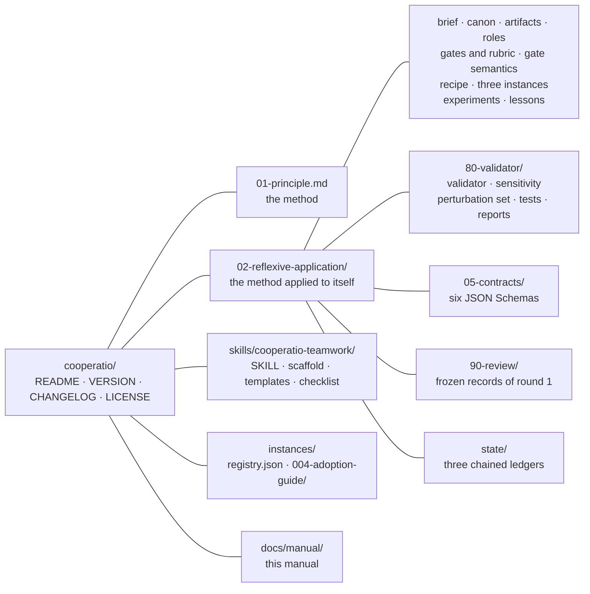

## Who it is for

The brief of the reflexive application (`02-reflexive-application/00-brief.md`)
names two readers: whoever is going to instantiate the method on a new
target without having followed the first instance, and an orchestrator
agent that receives the recipe as an instruction. Both have to be able to
execute without asking what a term means — which is why the canon exists
and why every document links to it.

The method is for a team, not for a single executor. With a single agent
playing every role the separation is weak: it writes the rubric that will
judge it. The material says so in its limits (`01-principle.md`, section 9)
and in the skill: where there is only one agent, at least the rubric and the
review have to come from outside the producing run.

## The status of the evidence

The material calls itself a working hypothesis and says exactly what that
covers. The reader of this manual should carry three facts throughout:

1. **Two executed instances, both documentary, both by the same owner.**
   Instance `000-av-production`, an audiovisual production method held by
   the owner and not distributable, from which the method was generalized;
   and instance `004-adoption-guide`, the adoption guide of the method
   itself, whose cell is distributed under `instances/` and whose method
   document is pinned by sha256. The three other instances in the registry
   (a car, a book about 2027, an HPC library) are designed sketches, not
   executions.
2. **One part of the scheme has never been exercised: the recompilation by
   hash.** In neither execution did an engine rebuild a stale artifact from
   the hash of its inputs; the validator resolves the command an artifact
   declares against the paths it names and does not run it.
3. **Efficacy is one-armed.** Everything the method found, it found under
   the method; no production of the same target ran without the gates, so
   there is no escape rate to compare. The counterfactual is experiment E2,
   designed and not run; the cheaper seeded-escape design is E4, designed
   and awaiting the owner's budget (chapter 10).

The principle keeps a table, written before any data, of what would promote
each kind of claim to a result and what would withdraw it (section 9,
"What would promote or withdraw a claim"); the manual reproduces it in
chapter 10.

# When to use it, and when not

## The four conditions

The method holds where the target has (`01-principle.md`, opening):

- **(a)** a brief that an owner can declare, with a stopping criterion;
- **(b)** a discrete artifact, assemblable from intermediate parts;
- **(c)** sources of truth separable per content type;
- **(d)** dependencies between those parts that can be kept acyclic.

The ontological assumptions behind the four (section 10 of the principle)
tell which kinds of target fall outside:

| Assumption | A target that violates it | What happens |
| --- | --- | --- |
| the target is a discrete, assemblable artifact with a done moment | a continuous process or an ongoing service | the stopping criterion would be a fiction; a service is run, not compiled |
| the target decomposes into parts with acyclic dependencies | an exploratory target, whose next question is decided by the last result | it is a loop, not a graph; the method degrades to peer review with a rubric |
| quality is measurable by instruments that do not include the producer | a target where only taste decides | every gate becomes a contract and the independent review is the only instrument |
| the knowledge the target needs exists, or is produced by declared roles | an emergent target, whose content exists only after the audience reacts | its canon would be written after the fact, which is not a canon |

## Four situations that cost something

Inside the four conditions, the principle declares four recurring
situations where the method still runs but loses part of what it promises
(section 9, "When the method fits, and what each gap costs"). The table is
a declaration of scope written before any of the cases was measured
`[hypothesis]`:

| Situation | What is lost | What it costs to run anyway |
| --- | --- | --- |
| a single provider of models (every role from one family) | independence of family between producer and reviewer; what stays is independence of session and of reasoning, and the frozen rubric | record the relation in the round record (`reviewer_relation`), and get the rubric, or a reading review, from outside the run |
| a target without a registered prior | the facts about a prior that `p-prior` checks, and a recipe already executed once | the canon starts empty of recorded facts, and the first execution becomes a prior; budget an extra round for the gates that do not fit |
| a short target (a page, a note) | proportion: the cost per round is fixed and the target is small | below a few pages the method is dead weight; a checklist and one review cost less |
| a target without an instrument of its domain | the domain gates: only the documentary gates run, so the method degrades to a review with a rubric | the owner writes the domain instrument first, or declares in the brief which non-negotiable no gate measures, and the verdict says so |

## What it costs

Per round: one production, one independent review and the maintenance of
the instruments. The only costs measured so far are those of review runs,
in experiments E1 and E3 of `02-reflexive-application/60-experiments.md`:

| Experiment | Executor | Input tokens | Output tokens | Wall time |
| --- | --- | --- | --- | --- |
| E1 (with the rubric) | X, the producer's family | about 58,000 (most of them the prior's method document) | 55,000 to 66,000, 90 to 98 % of them reasoning | 8 to 10 minutes |
| E1 | Y, another family | not separable per call | not separable | about 4 minutes, indicative |
| E3 (without the rubric and the card) | X | about 56,000 | 41,000 to 46,000 | 10 to 13 minutes |
| E3 | Y | not separable | not separable | about 4 minutes, indicative |

The material is careful about these numbers: minutes taken in two sessions
of different throughput are not comparable, so the measure is the tokens of
each call, and a wall time is reported only beside the throughput of the
same run. The cost of a production round and of the instruments has not
been measured.

The method pays off when being wrong is expensive `[hypothesis]`; stated as
a condition still unmeasured, the probability of an error times its cost
has to exceed the cost per round times the rounds until the stop. For a
throwaway draft the recipe prescribes only steps 1, 3 and 11 (brief, canon,
one version and a read from outside).

## What already exists, and what this adds

The method borrows from established practice and says so, so that a reader
can tell the vocabulary from the claim (`01-principle.md`, section 9):

| Here | Established practice | What this adds, if anything |
| --- | --- | --- |
| artifact graph, rebuild by hash | build systems | the graph is of documents and decisions too, and an owner decision is a node |
| gate with magnitude and limit | quality gates of continuous integration; acceptance criteria | the limit carries its justification and origin label, and a gate counts only after its perturbation |
| gate sensitivity test | mutation testing; fault injection | a condition of every gate, recorded with its provenance; a noisy perturbation fails |
| frozen rubric, mechanical verdict | review checklists; scoring rubrics | frozen by hash before the review, so two rounds are comparable |
| notes routed to their origin | issue trackers; defect triage | a note aims at the artifact where the defect was born; an escaped regression becomes a gate or a reason |
| role cards | RACI matrices; job descriptions | the "does not decide" field, and the code-conversion degree per role |
| failure analysis per gate | FMEA | done for the validator's gates, for one failure mode, the false green (chapter 13) |

# The material at a glance

## Where to start

The root `README.md` gives three entry points:

- to understand the method, read `01-principle.md`;
- to apply it to a new target, read
  `02-reflexive-application/10-generic-recipe.md`; the three instances
  there show what an artifact, a gate and a rubric are in each domain;
- to have an agent create the files, install the skill in
  `skills/cooperatio-teamwork/` and ask it to set up teamwork for the
  target.

Its "ten-minute path" is reproduced, with the commands verified, in
chapter 17.

## What an adopter carries, and what is research

The material separates the two. The fixed cost of a cell is the set of
files the scaffold writes (24 with two roles; chapter 17 lists them), among
them the instrument it copies: three Python scripts the adopter runs and
does not have to read, about 5,700 lines at version 0.6.0 (`validator.py`
4,859, `sensitivity.py` 550, `perturbation_set.py` 333, measured by line
count), plus one review per round. The history that matters to an adopter
is the "Migration note" of each version in `CHANGELOG.md`; the rest of the
changelog — the panels, the probes, the reworks — is the research.

## Requirements

- Python 3.9 or later, standard library only, for the three scripts (they
  exit 2 below it; an interpreter older than 3.7 refuses the file before
  any line runs).
- `pytest` for the test suites, which are run with `python3 -B -m pytest
  -p no:cacheprovider` so that no bytecode cache lands in the material.
- A checkout with LF line breaks: `.gitattributes` enforces `* text eol=lf`,
  and every sha256 the instrument computes is taken over the text read as
  UTF-8, byte-order mark dropped, line breaks as LF, so a CRLF checkout
  keeps the pins.

## Versioning and the freeze policy

`VERSION` holds the semantic version of the method; `CHANGELOG.md` has one
entry per version, with a migration note. The round record
(`02-reflexive-application/state/round-record.jsonl`) has one line per
round, naming the executor of each role by **family** letter and effort,
never by model identifier.

After 0.6.0 the instrument is frozen: the validator, the sensitivity test
and the scaffold change only for a failure that changes a verdict, or for a
new execution. The next budget goes to measuring value (experiment E4) and
portability (an execution outside the documentary domain by someone who is
not the owner, experiment E5), not to more instrument.

## License

Apache License 2.0; the full text is in `LICENSE`.

# Part II — The method {- .part}

# The scheme and the loop

## The scheme

The principle writes the method as a scheme — a naming of the parts and of
the loop, not a formula with a testable property (`01-principle.md`,
section 3). Let `A` be the target, `B` the brief and `F` the corpus:

```text
A = Compile( Graph( Roles, Artifacts, Gates ), B, F )  until  Stop

where:
  Artifact   = (name, owner, schema, dependencies, paths, gates, hash)
  Role       = (responsibility, inputs, outputs, decides, does not decide,
                exit gate, notes it emits, code-conversion degree)
  Gate       = measurable function over an artifact that returns pass/reject
               with the magnitude measured, never only a signal
  Note       = (target_artifact, severity, text, origin, evidence, round)
  Canon      = single source of numbers, names, terms and decisions, with a
                version per section and an owner per section
  Review     = independent reading of the product with a fixed rubric,
               comparable between rounds, that returns notes and a verdict
  Stop       = criterion declared by the owner before the last round
```

## The loop

```text
compile(graph, brief, corpus):
    canon ← extract(brief, corpus)                  # numbers, terms, names, rules
    repeat:
        for each artifact in topological order:
            if inputs changed (hash) or there is a high/blocking note against it:
                output ← owner_role.produce(inputs, canon, open_notes)
                for each gate of the artifact:
                    measure ← gate(output)          # magnitude, not only a signal
                    if rejected: note(artifact, severity, measure) ; return to owner
                validator.check(output, canon)  # terms, numbers, names, assets
        product ← assemble(final artifacts)
        review ← independent_reviewer(product, fixed_rubric)
        for each finding of the review:
            if it is an instrument defect (false positive): fix the instrument at the root
            if it is a regression that no gate caught: create the gate, then fix
            otherwise: note to the originating artifact
        if stopping_criterion: record open notes and exit
    until stop
```

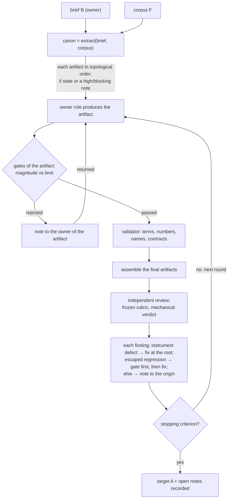

Three features of the loop decide most of what follows in this manual:

- **Only what is stale is rebuilt.** An artifact is **stale** when the hash
  of an input changed since it passed its gates, or when a high or blocking
  note targets it. This is the design; as said in chapter 1, no execution
  has yet exercised an engine that rebuilds by hash.
- **A gate rejects with a magnitude.** The note it emits carries the
  measure, not a sign, so the owner of the artifact knows how far from the
  limit the output landed.
- **Each finding of the review has exactly three destinations.** Instrument
  defect, escaped regression, or product defect. The first fixes the
  instrument at the root; the second creates a gate *before* the fix; the
  third is a note to the artifact where the defect was born.

## The orchestrator

The orchestrator is whoever executes the recipe: it passes paths (never
summaries) to the roles, runs the engine and imports the notes. It is a
**step, not a role**: it decides nothing that a card assigns to a role or
to the owner (`10-generic-recipe.md`, "The orchestrator in pseudocode").

# The eleven components

The principle names eleven components that do not change from one domain
to another (section 4; section 6 says what does change). The last column
is the error each one prevents, with the example the material gives.

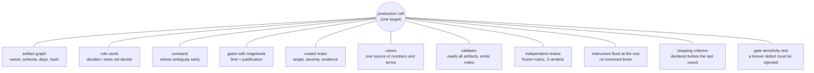

| Component | What it is | The error it prevents (example) |
| --- | --- | --- |
| **Artifact graph** | each intermediate output is a typed file with an owner, schema, dependencies and hash; the core recompiles only what changed | work redone for nothing and, worse, work *not* redone when the input changed |
| **Role cards** | each role has a card: what it decides, what it does not decide, inputs, outputs, exit gate, notes it emits | one role compensating for the defect of another; the "does not decide" field returns the defect to its owner as a note |
| **Contracts (schemas)** | every artifact validates against a schema before being accepted; the schema refuses what is ambiguous | an ambiguous position key in a hand-off sheet; an unknown field accepted at assembly instead of at validation |
| **Gates with magnitude** | a gate returns the measure, and the limit is declared with a justification; "greater than zero" lets a broken instrument pass | an offset measured against a reference that was itself wrong |
| **Routed notes** | a change request only by note, with target, severity, evidence and round; only high and blocking return the artifact; deduplication by hash | loose conversation between roles, a lost request, the same note three times |
| **Canon** | single source of numbers, names, terms to avoid, accepted variants, rules; each section with an owner and a version | a figure stated one way in one section and differently in another |
| **Validator** | a verifier that reads all artifacts against the canon and emits notes by itself | an old version of an asset cited by the canon while the sections used the new one |
| **Independent review with a fixed rubric** | another agent, with no access to the producers' reasoning, measures the product with the same grid each round; three verdicts | the team approving its own work; rounds that cannot be compared |
| **Instrument fixed at the root** | a false positive becomes a fix to the rule, with a test that reproduces the case, and the previous round is redone | an automatic reviewer of which 10 of 12 notes were false, in the second pilot of the first instance `[prior:000-av-production]` |
| **Stopping criterion** | the owner declares when to stop: the review of the last version becomes a list of open notes, not a new version | endless rounds |
| **Gate sensitivity test** | before trusting a gate, inject a known defect and check that it rejects | a gate that checked numbers while the non-negotiable was about statements; the sensitivity test found a validator that read line by line and missed numbers in broken sentences |

What changes by domain is: which roles there are, which artifacts, what
each gate measures, what the review rubric is, which sources of truth
exist for each type of content, and what code-conversion degree the domain
already allows. The principle's table of three instantiations (car, text,
HPC) calibrates what an "artifact", a "gate" and a "rubric" are in each; the
manual summarizes the three designed instances in chapter 16.

# Roles, artifacts and notes

## Roles and role cards

A **role** is a narrow responsibility exercised by an agent, a person or
code, which communicates with other roles only through artifacts and
notes. A role that neither emits notes nor has a gate is a step, not a
role.

Every role has a **role card** with seven fixed fields, which the gate
`p-card` reads as bold labels:

| Field | What goes there |
| --- | --- |
| **Decides** | what the role settles alone |
| **Does not decide** | the neighboring decisions the role would be tempted to make, and whose they are |
| **Inputs** | the artifacts it reads |
| **Outputs** | the artifacts it writes |
| **Exit gate** | the gates its output has to pass |
| **Notes it emits** | the typical target and severity |
| **Code-conversion degree** | how much of the work the code does, and the executor of the role |

The **code-conversion degree** has three values: (a) converted, the code
does it and a person or a model decides exceptions; (b) partial under
gate, the code does or measures a part; (c) contract and gate only, the
role is exercised by an agent or a person and the code only validates the
output. The degree is explicit per role and is expected to rise over time.

The reflexive application has four roles (`02-reflexive-application/03-roles/`):

| Role | Mission | Degree | Executor |
| --- | --- | --- | --- |
| writer | turn the principle into documents an agent can execute; fill the instances | (c) | a language model |
| verifier | check facts about the priors; maintain the instrument; decide false positives; own the note ledgers | (b) | code for the number checks and the contracts, judgment for the false positives |
| runner | run the validator and route its notes; decide nothing beyond the rules it executes (named "validator" until v0.6.0) | (a) | the script `validator.py` |
| reviewer | read the whole product with the frozen rubric; return scores, findings and a verdict by the mechanical rule | (c) | an executor that did not take part, in a separate session, ideally of another family |

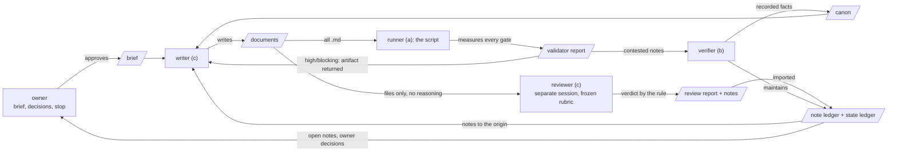

## Executors and families

Separating roles makes it possible to give each role a different executor:
a person, code, or a language model of a chosen kind. The principle
(section 2, "Using several models across the roles") gives the rules:

- **Capability follows the role.** A mechanical, fully specified role takes
  a fast, inexpensive model; a role that designs or weighs hard trade-offs
  takes the strongest available. The gate, not the model's confidence,
  decides whether the output is accepted.
- **Independence across families is recommended, not required**
  `[hypothesis]`. The review is best run on a model of another family than
  the producer's; the cost is a second provider. It is a recommendation
  because the one datum is against it as a rule: in experiment E1 the
  producer's own model, in another session, caught 2 of 2 injected
  defects, as the model of another family did (`[against:E1]`). What a
  pilot did show is the part a team can adopt without a second provider: a
  frozen rubric with a mechanical verdict rule turned a finding into a
  verdict (`[experiment:E3]`).
- **Code is not a model.** Whatever a gate can measure is measured by code,
  identically whichever model produced the artifact.
- **Contracts make models swappable.** Replacing the model behind a role
  must not change any other file; if it does, the contract is too loose.
- **The assignment is auditable, and anonymous.** The round record names
  the executor of each role by **family** — a letter kept stable across the
  material — and by effort, never by model identifier. The map from letter
  to family stays with the owner, outside the material, and since the
  rework of v0.6.0 each chained line of the round record carries a salted
  commitment to that map (chapter 15). A route or an alias is not a
  family: whether two executors differ is checked on what each name maps
  to, never on the name.

The round record also states, line by line, the reviewer's relation to the
producer (`reviewer_relation`: `another family`, `same family, separate
session`, `same model, separate route`, or `none`), so the recommendation
can be checked against what was done.

## Artifacts

An **artifact** is an intermediate or final output, typed, with a name, a
single owner, paths, a schema, dependencies, gates and content identified
by hash. An owner decision is also an artifact: it has a name, it is
recorded as an open item for the owner, and the graph knows what depends on
it (golden rule 7).

The record of an artifact, in the JSON form a cell uses
(`03-artifacts.json`):

```text
{ "name": "...", "owner": "ROLE", "paths": ["..."], "depends_on": ["..."],
  "schema": "05-contracts/....schema.json" or null, "command": "..." or null,
  "gates": ["..."], "resource": "code" | "agent" | "human" | "machine",
  "proposed": false }
```

Three rules about the record matter to the validator:

- the `gates` list is the **one source of the map from gate to artifact**:
  the validator runs each gate on the files of the artifacts that list it,
  and the gate table has to mirror that assignment (chapter 13);
- `paths` may carry globs, and since v0.6.0 each literal path has to exist
  and each glob has to match at least once (`p-declared`);
- `command`, when present, is resolved against the folder: every path it
  names has to exist, and the command is never run. Paths and commands may
  carry `{version}`, which takes the layout's `version-label`.

The **artifact graph** is the set of artifacts with the dependencies between
them; it has to be acyclic, and the validator checks that on every pass
(`p-references`). "Depends on" means: the artifact reads that input and
becomes stale when it changes. A note is not a dependency.

## Notes

A **note** is the only change request between roles. It has six fields,
all required (`05-contracts/notes.schema.json`):

```text
{ "target_artifact": "name in the graph", "severity": "low|medium|high|blocking",
  "text": "what is wrong and what is expected", "origin": "role or instrument",
  "evidence": "file, excerpt, measurement", "round": N }
```

**Severity** has four values. Only `high` and `blocking` send the artifact
back to its owner; `low` and `medium` accumulate as debt that the stop
records. A note aims at the artifact where the defect was born, not where
it was seen; the note router refuses a target the graph does not know and
deduplicates by identity (target, severity, text, origin, evidence).

An **open note** is a note recorded and not resolved when the production
stops: written debt, not forgotten debt (golden rule 10). Since v0.6.0 the
state of a note lives in a ledger of its own, append-only and chained
(chapter 15).

## Sources of truth and the canon

Every type of content has one declared **source of truth**, and it is never
the writer (golden rule 2): a fact comes from the corpus or its primary
source; a number comes from the canon or from the instrument that measured
it; exact text comes from the original. The inventory is a table with
content type, the source that errs least, who consults it and what is
forbidden as a source (`01-sources-of-truth.md` in a cell).

The **canon** is the single source of numbers, names, terms to prefer and
to avoid, accepted variants and rules, with an owner and a version per
section. In the reflexive application it is a Markdown page whose tables
the validator reads directly (`01-canon.md`); in a cell it is a JSON file
(`02-canon.json`) with the lists the validator consumes. Everything that
two roles could write differently goes into it. The canon is itself an
artifact: it has an owner, a version and dependents, and the validator
reads it on every pass.

A **contract** is the schema an artifact has to validate before it is
accepted; it rejects the ambiguous before the expensive work (golden
rule 5). The material's own contracts are listed in appendix B.

# Gates, limits and the sensitivity test

## What a gate is

A **gate** is a measurable function over an artifact that returns pass or
fail together with the measured **magnitude**. It has a **limit** and a
written justification, and the justification starts with an **origin
label**:

| Label | Meaning |
| --- | --- |
| `[method]` | the limit follows from the method itself (for example, zero terms outside the canon) |
| `[brief]` | the limit was set by the owner in the brief |
| `[hypothesis]` | the limit is an assumption about the domain, plausible and justified, to be confirmed in a real instance |

A row of a gate table has five columns: Gate, Artifact, Magnitude, Limit,
Justification. The validator reads the justification's label and counts
its words (at least six, read from the `p-limit` row itself), and compares
the numbers of the Limit cell with the limit it applies.

Three distinctions the material insists on:

- **A tool that does not run is a tool failure, never a pass or a fail.**
  The validator exits 2 for it; the exit codes are in chapter 19.
- **A gate that was not measured is pending, neither a pass nor a fail.**
  A gate whose object is a list of the canon is pending when the list is
  empty, never "0 of 0 passed". A run with a pending the caller did not
  accept by name exits 4.
- **A signal gate** — one that only tests existence or "greater than zero"
  — lets a broken instrument through and has to gain a magnitude limit on
  both sides: an absurd value also rejects, because it signals a broken
  instrument.

A number taken from an earlier execution is a fact about it, never a limit
a new one inherits: a `[hypothesis]` limit may cite a prior as support,
never as the limit itself.

## Documentary gates and domain gates

The validator that ships with the material measures documents: terms,
sections, links, form, numbers stated about registered priors, the
contracts and the chains of its ledgers (the `p-*` gates, chapter 13). A
gate of a target's domain — the identity of a library's results, a
speedup, a mass — is a **domain gate**, named `d-<name>` in the cell's
gate table. The cell's own code measures it and writes a result file in the
contract `domain-result.schema.json`; the validator reads the result,
recomputes the sha256 of its inputs, refuses it when an input changed since
it was written, turns a `fail` into a note and a missing result into a
pending, never a pass. The validator does not run the cell's code
(chapter 21).

## The sensitivity test

Before trusting a gate, inject a known defect and check that the gate
rejects it; a gate that never rejects proves nothing. The material makes
this a condition of every gate: the **gate sensitivity test**
(`sensitivity.py`) copies the whole material, injects one **perturbation**
at a time, runs the validator on the copy and checks that the expected
(document, gate) row went from pass to fail — and that no other row
changed. A perturbation that changes another row is *noisy* and fails the
report like a missed one, unless it declares the other gate it reaches by
design. The report carries the provenance of what it was made against, and
the validator's `p-sensitivity` gate refuses a report that the instrument
cannot have produced. Chapter 14 describes the test in full.

## The lifecycle of a gate

A gate is born from a regression that escaped every gate (golden rule 4),
together with its perturbation. It lives while its object exists. It is
retired deliberately, never by neglect: when its object is gone, or when
its rule moved into a contract that refuses the defect earlier. The row of
the gate table, its assignment in the artifact list and its perturbation
leave together, and the changelog records "retired gate: `<id>`", the
reason and the rounds the gate stayed silent. No gate was retired between
v0.4.0 and v0.6.0.

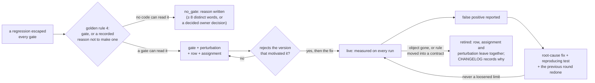

The instrument detects half a retirement: removing a gate and keeping its
perturbation makes the perturbation missed; removing the perturbation of a
gate that still runs fails the test that every gate has one. Removing both
and regenerating the sensitivity report passes everything; only the
declaration in the changelog records that retirement.

# The independent review

## Who reviews, with what

An **independent review** is a reading of the product by someone who did
not produce it and has no access to the producer's reasoning, with the
fixed rubric, returning notes and a verdict. The reviewer receives the
files and the rubric — never drafts, conversation or summaries — and the
dispatch records the effective output limit of the executor and the reason
its generation ended. An ending for length, or a report that lacks a
section of the format, is a tool failure and produces no verdict; the
review runs again. This rule came from experiment E1, where one report
stopped at a limit the dispatch had not declared and carried a verdict no
reader could verify.

## The rubric

The **rubric** is the fixed grid of dimensions, anchors and verdict rule
that every review uses in every round; it is written before the first
review and frozen by hash. The generic recipe (step 8) asks for six to ten
dimensions with **rubric anchors** for scores 1, 3 and 5; a severity scale
of the findings with examples from the domain; a mechanical verdict rule;
and a report format.

The reflexive application's rubric (`04-gates-and-rubric.md`, section
"Rubric") has eight dimensions:

| Dimension | What is measured |
| --- | --- |
| D1 Fidelity to the principle | the eleven components and the golden rules applied without contradiction; nothing about the reference case invented |
| D2 Recipe executability | each step says what it reads, creates, does and when it is done |
| D3 Concreteness of instances | each element filled with domain content, not text that would serve any target |
| D4 Gates and numbers | gates with magnitude; plausible limits; justifications that say why that number; hypotheses marked |
| D5 Internal coherence | canon terms in their sense; the same number equal everywhere; references close |
| D6 Reflexivity | the production followed its own method and is honest where it did not |
| D7 Form | American English, plain Markdown, pseudocode in `text`, no path, date or machine, sizes in range |
| D8 Epistemic honesty | distinguishes method, prior instance and domain; marks hypotheses |

Its severity scale: `blocking` for an invented fact about the prior
instance, a contradiction with the principle that would change the
application, a missing mandatory document, or an instance that cannot be
executed; `high` for a gap that prevents an agent from executing a step, a
signal gate or unjustifiable limit, a term used in a sense different from
the canon's, or an instance element filled with generic text; `medium` for
a domain imprecision without a `[hypothesis]` mark; `low` for style.

## The verdict rule

The **verdict** has three values — `rejected`, `accepted with conditions`,
`accepted` — and the rule that produces it is mechanical:

```text
if a blocking finding exists or some dimension has a score ≤ 2:
    verdict = rejected
else if no high finding and every dimension has a score ≥ 4:
    verdict = accepted
else:
    verdict = accepted with conditions
```

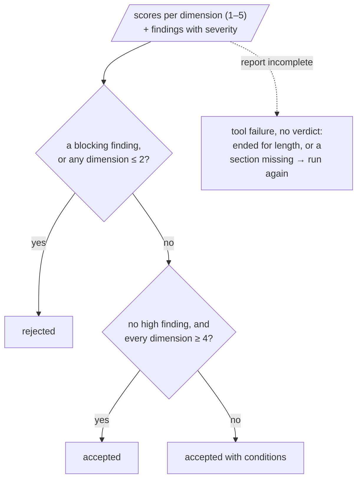

Experiment E3 is the measure of what this rule is worth: without the
rubric and the severity table, two reviewers of different families still
named both injected defects but classed an invented fact about a prior as
`high` and accepted the product with conditions; with them, the same
finding was `blocking` and the verdict was `rejected` (`[experiment:E3]`).
That the severity table and the mechanical rule are the parts that did it
is a hypothesis the design does not separate `[hypothesis]`.

## The report format

1. **Verdict**, with the application of the rule.
2. **Scores by dimension**: table with dimension, score, evidence.
3. **Findings by severity**: each with target artifact (a name from the
   graph, or `corpus`), severity, text, evidence.
4. **Verified and correct.**
5. **Not verified**, and why.
6. **Out of scope.**
7. **Notes in JSON**, in the note contract (`origin` = `reviewer`).

From the second round on, the report adds the item-by-item table of the
previous round (resolved, partial, remained, worsened).

## Freezing, and who writes the rubric

The rubric is frozen with `validator.py --freeze-rubric FILE`, which writes
the sha256 of the rubric as the layout resolves it (a dedicated
`07-rubric.md` in a cell; the "Rubric" section of the gates file in the
corpus). The command **refuses to overwrite an existing pin**: replacing a
frozen rubric is a deliberate act via `--re-freeze-rubric`, with the reason
recorded in the changelog, because re-freezing after a review would make
the verdicts incomparable.

The provenance of the rubric matters. In the reflexive application the
rubric was written by the producing agent in the first round, against
step 8 of the recipe, which gives it to the owner and the reviewer; the
deviation is recorded in the lessons, and the round record names the
author of the rubric (`rubric_author`). A rubric written by the producer is
recorded as such — a gap, not a neutral fact — and the validator adds a low
note when a chained round line has `rubric_applied: true` and
`rubric_author: producer`.

# The golden rules and the warning signs

## The ten golden rules

From `01-principle.md`, section 5, each with its reason in short:

1. **Measure what the system delivered, not what was asked for.** The
   effective value comes from a named instrument applied to the produced
   artifact, never from the parameter that requested it.
2. **Every type of content has one declared source of truth, and it is
   never the writer.** A number taken from an earlier execution is a fact
   about it, never a limit a new one inherits.
3. **Every false positive is an instrument defect until proven otherwise.**
   The easy path is to loosen the limit; the right path is to understand
   why the instrument read wrongly. A third way out is legitimate when the
   instrument cannot accept exceptions: work around it and record the
   workaround as a note, so that it does not become a silent rule.
4. **Every regression that escaped all the gates becomes a gate, or a
   recorded decision not to make one.** Before fixing the defect, create
   the detector. Since v0.6.0 the state ledger records which (`escaped`,
   with `gate` or `no_gate`), and the validator refuses an escaped
   regression closed with neither.
5. **The contract refuses ambiguity before the expensive work starts.**
6. **Dates, machine names and absolute paths do not enter a durable
   artifact** if anonymity or reproducibility matters. The checking date is
   a command-line parameter, not content.
7. **A human decision is an artifact too.** What belongs to the owner is
   not invented.
8. **Convert judgment into code only when the criterion is measurable and
   the answer is unique.** The rest stays with an agent under a gate, or
   with a human under a contract.
9. **Version is method state; date of making is not.**
10. **What the review points out and the round does not fix is written
    down.**

## Signs that an instance is wrong

The principle (section 8) and the recipe ("Signs that the instance is
wrong, and which step catches them") give the same list from two sides:

| Sign | Step of the recipe that should have caught it |
| --- | --- |
| a role approves its own artifact without a gate | 5 (exit gate) and 7 |
| the review of round N is not comparable with that of N−1 | 8 (frozen rubric) |
| a finding was "resolved" by loosening a limit | 12 (root-cause fix) |
| two artifacts state different numbers for the same fact | 3 and 9 |
| the owner gets a question the brief already answered, or a role decided what its card said "does not decide" | 1 and 5 |
| the round gets longer and the notes do not fall | 12 (origin, not symptom) |
| someone redid by hand what the graph should have recompiled | 4 and 10 (hash) |

# Evidence and epistemic discipline

The material applies its own doctrine of evidence to itself. Four
mechanisms carry it: the registry of prior instances with its marks, the
labels a claim of efficacy has to carry, the experiments with their
provenance, and the table of what would promote or withdraw a claim.

## Prior instances and the `[prior:<id>]` mark

A **prior instance** is an instance of the method that ran before the
current one and is registered in the **instance registry**
(`instances/registry.json`). A statement about a prior carries
`[prior:<id>]`, and a number inside the marked unit is checked against that
prior's method document (`p-prior`). A statement that uses one of the
canon's prior-statement trigger phrases ("reference case", "prior
instance", "of the case", "the executed instance", "instance 0") without
the mark is a finding of `p-prior-mark`.

The registry at 0.6.0:

| Id | Status | Document | Locator | Method version |
| --- | --- | --- | --- | --- |
| `000-av-production` | executed | the owner's method document, pinned by sha256 | owner-held, not distributable | — |
| `001-car`, `002-text-2027`, `003-hpc` | designed | none | none | — |
| `004-adoption-guide` | executed | `metodo-de-producao.md`, pinned by sha256 | `instances/004-adoption-guide` | 0.2.2 |

An executed entry carries `document`, `sha256`, `locator` and
`number_format` (`point-decimal` or `comma-decimal`), none of them null; a
designed entry keeps the four null, so it can never pass for a pinned
prior. The entry of `000-av-production` also declares a `heading_style`
(the shape of its section, subsection and step headings), which the
synthetic prior of the sensitivity test follows (chapter 14).

Numbers about a prior do not enter the documents before they have a row in
the canon's "Recorded facts" table, which names the number, its context
(with the mark) and the sections of the prior's document where it lives.
The canon also commits, by sha256, to the text of each cited section of
the owner-held document, so that a later rewrite of a cited section is
detectable without publishing the text (chapter 15).

## Claims of efficacy and their labels

A unit that uses one of the canon's efficacy trigger phrases ("pays off",
"the method found", "the gates caught", "the review found", "err less",
"the only way", and the rest of the closed list) claims that the method
works, and has to carry one of five labels outside code spans
(`p-efficacy-mark`):

| Label | Where the evidence is registered |
| --- | --- |
| `[prior:<id>]` | the method document of that registered prior |
| `[experiment:<id>]` | the section of that id in `60-experiments.md`, whose status is `executed` and whose "Provenance" table gives the sha256 of at least one input and one output |
| `[against:<id>]` | an executed experiment whose result goes against the claim: counter-evidence is labeled like evidence |
| `[lessons:<title>]` | the entry of `99-lessons.md` whose heading is that title |
| `[hypothesis]` | nowhere yet: an assumption, to be measured |

The gate is lexical and says so: a paraphrase of a claim escapes it, and
no list closes that gap; the mitigation is a review with a frozen rubric.
A claim labeled `[hypothesis]` that states a number or a universal
quantifier gets a low note: the label stays valid, the claim has the shape
of a measurement with none behind it.

## The experiments

`02-reflexive-application/60-experiments.md` registers the measurements
about the method itself, each with its question, object, conditions,
executors by family, protocol, predictions written before measuring,
results, what it shows and does not show, cost, what became a gate or a
lesson, and a provenance table. Only an executed experiment backs a claim.

| Id | Status | Question | Result in one line |
| --- | --- | --- | --- |
| E1 | executed | does the reviewer with the frozen rubric name two injected defects, and does a reviewer of another family differ? | both executors named 2 of 2 and gave `rejected` on the perturbed copy; one control run ended for length and is a tool failure, not a verdict |
| E2 | designed | the counterfactual: the same target produced with and without the method | not run; two productions per target |
| E3 | executed | the same reviewers without the rubric and the reviewer card | both still named 2 of 2, but classed the invented fact `high` and accepted with conditions: the apparatus turned the finding into a verdict |
| E4 | designed | seeded escape: does the apparatus let fewer of ten seeded defects escape than a careful baseline, and does another family find more? | protocol and predictions written; awaits the owner's thresholds and budget |
| E5 | designed | can a third party set up a cell for a target with domain measurements and reach a verdict without improvising instrument? | awaits the owner finding the third party |

## What would promote or withdraw a claim

Written before the data, as the gates are (`01-principle.md`, section 9),
so that the material leaves the state of a working hypothesis by a
measurement and not by a decision. The thresholds are the owner's to
accept or adjust before E4 runs:

| Claim | Promoted when | Withdrawn when |
| --- | --- | --- |
| a reviewer of another family adds to one of the producer's family | in E4 or an equivalent design, the arm of the other family finds at least 1 more defect per 10 seeded, in at least 2 of 3 repetitions | the difference is nil in 3 repetitions |
| the review apparatus adds to a careful review without it | in E4, the escape rate of arm A is lower than that of arm B by at least 20 points | the difference is under 5 points |
| the method is portable outside the documentary domain | one execution outside it, by someone who is not the owner, with its domain gates read by the validator and a verdict of the canon | that execution cannot reach a verdict without improvising instrument |

# Part III — The material and the instrument {- .part}

# The reflexive application

## What it is, and what round counts as evidence

`02-reflexive-application/` is the method applied to itself: a production
cell whose target is the set of documents that shows how to assemble a
production cell. Its brief (`00-brief.md`) declares the target, the two
readers, five non-negotiables with ids (`nn-method`, `nn-prior-facts`,
`nn-hypothesis`, `nn-form`, `nn-anonymity`), the owner decisions, a budget
(two returns per document per failed gate, then escalation) and the
stopping criterion: **exactly one independent review round**.

That first round, and only that round, was a production under the method.
The review gave `rejected` for the version it read (one blocking, two
high); the blocking and high notes were fixed and checked by the gates,
without a second review, as the brief prescribed; the 22 remaining notes
are kept, frozen, in `90-review/notes.json`. Every round after it (v0.2 on)
is a **maintenance round** of the material: recorded in the round record
with `kind: maintenance`, its scope and the reviewer's relation to the
producer, emitting no verdict of the canon, with its decisions in
`CHANGELOG.md`. The reflexive application is evidence about the method
only for round 1; the maintenance rounds are evidence about the material.

## The folder

| File or folder | Artifact | What it is |
| --- | --- | --- |
| `00-brief.md` | `brief` | target, non-negotiables with ids, owner decisions, budget and stop, the protocol of the maintenance rounds |
| `01-canon.md` | `canon` | method terms, terms to avoid, the fixed lists the validator reads, form rules, recorded facts, section commitments, historical vocabulary |
| `02-artifacts.md` | `artifacts` | the artifact table (the one source of the gate map) and the graph |
| `03-roles/` | `cards` | the four role cards: writer, verifier, runner, reviewer |
| `04-gates-and-rubric.md` | `gates-and-rubric` | the gate table with magnitude, limit and justification; the measurement `m-determinism`; the size ranges; the frozen "Rubric" section |
| `05-contracts/` | `contracts` | six JSON Schemas (appendix B) |
| `06-gate-semantics.md` | `gate-semantics` | what each gate reads in detail; the hash policy; domain gates; the false greens table; the gate lifecycle; the provenance of the rubric |
| `10-generic-recipe.md` | `recipe` | the fifteen steps, with "Reads", "Creates", "Does" and "Done when" each |
| `20-instance-car.md`, `21-instance-text-2027.md`, `22-instance-hpc.md` | `instance-*` | the three designed instances |
| `60-experiments.md` | `experiments` | E1 to E5 |
| `80-validator/` | `instrument-validator`, `validator-tests`, `validation-report` | the scripts, the test suite, `report.md` and `sensitivity.md` |
| `90-review/` | `review`, `replies`, `open-notes` | the frozen records of round 1: `rubric.sha256`, `auditor-report.md`, `auditor-notes.json`, `notes.json`, `replies.md` |
| `99-lessons.md` | `lessons` | one entry per round; append-only |
| `state/round-record.jsonl` | `round-record` | one line per round |
| `state/notes-status.jsonl` | `notes-status` | the state of each tracked note and panel finding |
| `state/owner-decisions.jsonl` | `owner-decisions` | the decisions only the owner can take |
| `README.md` | `readme` | the index and the runbook |

Four artifacts live at the root and are declared in the same table:
`version` (`VERSION`), `license`, `changelog`, `registry`
(`instances/registry.json`), `readme-root` and `skill` (the three files
of the skill). The gate `p-declared` checks that every Markdown document
of the folder belongs to an artifact or is listed in the canon as outside
the table; this production lists none.

## The artifact graph

Each arrow is "is read by". The graph is acyclic and the validator checks
it on every pass (`p-references`).

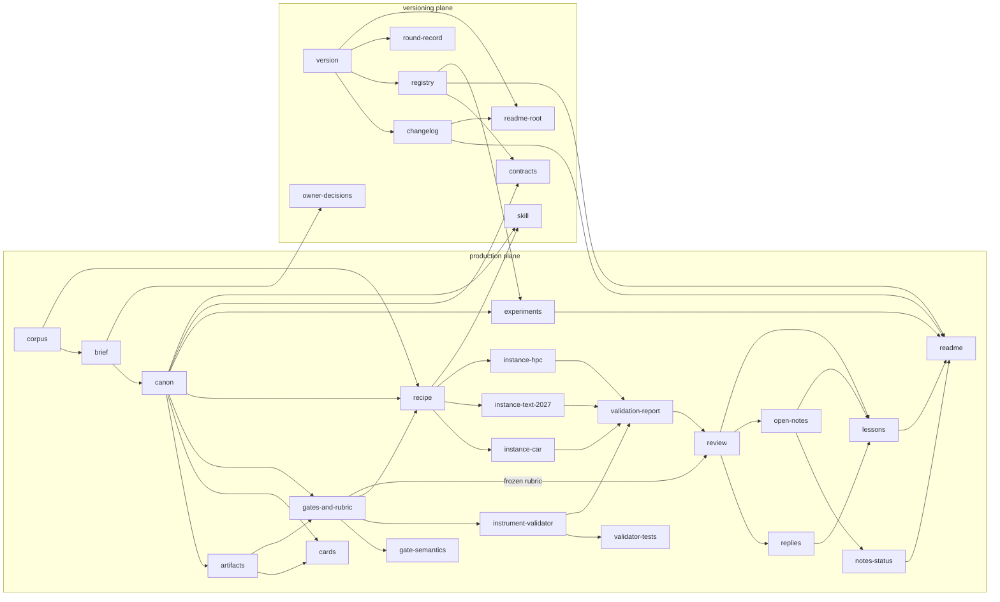

Two things the graph says about the order of the work: the three instances
only start after the recipe passes its gates, because it is the recipe
that fixes what an instance has to fill in; and the review only starts
after the validator passes on every document, so that the one review round
is not spent on defects the code already finds.

## The canon's tables the validator reads

The validator reads the tables of `01-canon.md` directly: changing a table
changes what it checks, and the canon's "Canon schema" section is
versioned (`v1`) so that a validator refuses a canon of another version.

| Section of the canon | Read by |
| --- | --- |
| Method terms | the glossary; not a gate |
| Terms to avoid | `p-terms` |
| Instantiation table rows, Mandatory sections of an instance | `p-table`, `p-sections` |
| Role card fields | `p-card` |
| Origin labels of a limit | `p-limit` |
| Method components | `p-components` |
| Prior-statement triggers, Efficacy triggers and their labels | `p-prior-mark`, `p-efficacy-mark` |
| Efficacy mark in append-only documents | the heading from which `99-lessons.md` is measured |
| Documents outside the artifact table | `p-declared` |
| Chained ledgers | `p-contract-shape` (the lines before each chain) |
| Frozen records | `p-frozen-rubric` |
| Accepted paths, Month names, Machine roots | `p-anonymity` |
| Recorded facts, Section commitments | `p-prior` |

A cell's JSON canon carries the same lists under the keys the scaffold
writes (`terms to avoid`, `instantiation table rows`, `mandatory sections`,
`role card fields`, `origin labels`, `method components`,
`prior-statement triggers`, `recorded facts`, `efficacy triggers`,
`documents outside the artifact list`), each a list of plain strings except
the recorded facts, which are objects.

# The validator

## Purpose

`validator.py` is the **runner**'s instrument: it reads every document the
artifact list assigns a gate to, measures each gate on it, and writes a
deterministic report with the magnitude, the limit and the result of each
(document, gate) pair, plus the notes the failures produce. It also runs
the global gates (the note ledgers, the frozen records, the sensitivity
report, the declared files, the domain results), carries an embedded
self-test, freezes the rubric, and measures its own determinism.

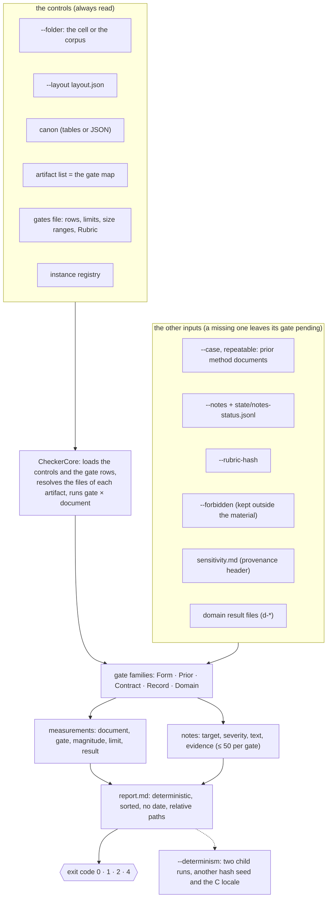

## Inputs and the layout

The validator is written for the corpus's Markdown layout and remapped to a
cell's JSON layout by `--layout layout.json`. The layout has a closed set of
keys; a key the validator does not read is refused (exit 2) instead of
silently falling back to a default it meant to override.

| Layout key | Meaning | Default (the corpus) | A scaffolded cell |
| --- | --- | --- | --- |
| `version` | the layout format | — | `1` |
| `artifacts.canon` | the canon | `01-canon.md` | `02-canon.json` |
| `artifacts.artifacts` | the artifact list | `02-artifacts.md` | `03-artifacts.json` |
| `artifacts.gates-and-rubric` | the gates file | `04-gates-and-rubric.md` | `06-gates.md` |
| `artifacts.roles-dir` | the role cards | `03-roles` | `04-roles` |
| `artifacts.rubric` | a dedicated rubric file (else the "Rubric" section of the gates file) | absent | `07-rubric.md` |
| `artifacts.sensitivity` | the sensitivity report | `80-validator/sensitivity.md` | `08-validator/sensitivity.md` |
| `artifacts.perturbations` | the perturbation data file of a cell | absent (the corpus keeps `perturbation_set.py`) | `08-validator/perturbations.json` |
| `artifacts.report` | the validator report | `80-validator/report.md` | `08-validator/report.md` |
| `artifacts.experiments`, `gate-semantics`, `notes-status`, `round-record`, `lessons`, `brief`, `owner-decisions` | the other documents the global gates read | the corpus's files | as the scaffold writes, or the defaults |
| `gates` | the parser of each gate: `builtin-markdown` or `builtin-json-canon`; every gate of the map has to use the same one | all `builtin-markdown` | all `builtin-json-canon` |
| `registry` | the instance registry, relative to the folder | `../instances/registry.json` | `priors.json` |
| `domain-results` | the result files of the `d-*` gates | `[]` | `[]` |
| `version-label` | what `{version}` expands to in paths and commands | absent | — |

The other inputs are command-line options (appendix C): `--case` for each
prior method document (repeatable; each is identified by its sha256
against the registry, and the number check of a `[prior:<id>]` unit reads
the document identified as `<id>`, in the number format its registry entry
declares); `--notes` for the note ledger; `--rubric-hash` for the frozen
pin; `--forbidden` for the list of forbidden identifiers; `--allow-pending`
for the gates whose pending rows the caller accepts by name.

## Architecture

Since v0.6.0 the checker is one class per family of gates over a core that
holds the state of a run and the interface every family uses. The split
moved the methods unchanged, and the report of the corpus was
byte-identical before and after it.

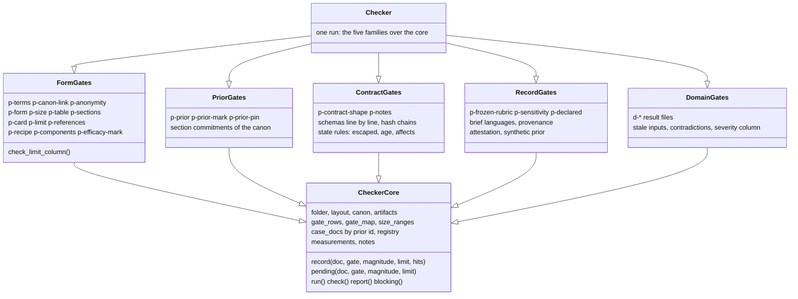

A run proceeds as follows (`CheckerCore.run`):

1. The controls are loaded through the layout: the canon, the artifact
   list, the gates file (its merged gate tables, one row per gate, else
   exit 2; its size ranges), the registry. Every gate id of the table or
   of the map has to be a builtin, a global gate or a `d-*` gate, else
   exit 2.
2. The gate map is built from the artifact list: for each gate, the
   artifacts that list it; for each artifact, the files its paths resolve
   to. Domain gates are skipped here and read from their result files in
   the global pass.
3. The documents that carry `p-prior` are scanned for `[prior:<id>]` ids,
   so that `p-prior-pin` knows which executed priors it has to pin.
4. A run that measures no documents writes a blocking note on `artifacts`:
   a production with no documents is not green, so a freshly scaffolded
   cell fails until it has real artifacts.
5. For each document in sorted order, for each (gate, artifact) pair in
   sorted order, the handler of the gate records a measurement and its
   notes. A hit is a note of the gate's severity (high unless the gate
   says otherwise) and fails the row; an advisory is a low note that does
   not. Notes are capped at 50 per gate, with one note saying how many were
   omitted.
6. The global gates run once (`check_global`): the brief's languages, the
   frozen records, the declared files and documents, the sensitivity
   report, the note ledgers, the domain results.
7. The Limit column of the gate table is compared with the limits the
   validator applied (`check_limit_column`).

## The report

`report.md` has three sections: **Measurements** (one row per document and
gate, sorted, with magnitude, limit and `pass`, `fail` or `pending`, then
the lines "Pending accepted by the caller", "Pending not accepted" and,
when an accepted gate had nothing pending, "Accepted but not pending");
**Instrument measurement** (the `m-determinism` row, the count of the
embedded self-test, and the sha256 of the test suite next to the
validator); and **Notes** (the count by severity and a table with target,
severity, text and evidence).

The report is deterministic by construction: no date, relative paths,
rows sorted by document and gate, notes sorted and deduplicated. With
`--output FILE` the report goes to the file and one summary line goes to
the error stream (`validator: exit N; notes: ...; pending not accepted:
...`), so that a failing run with `--output` is never silent.

`--determinism` runs the validator twice more as child processes, with
`PYTHONHASHSEED` set to 1 and 2 and, on the second run, `LC_ALL=C`, and
compares the sha256 of the two reports; a difference is a high note. The
working folder and the Python version (3.9 and 3.12) were varied by hand,
not by the measurement, and gave the same report.

## Exit codes

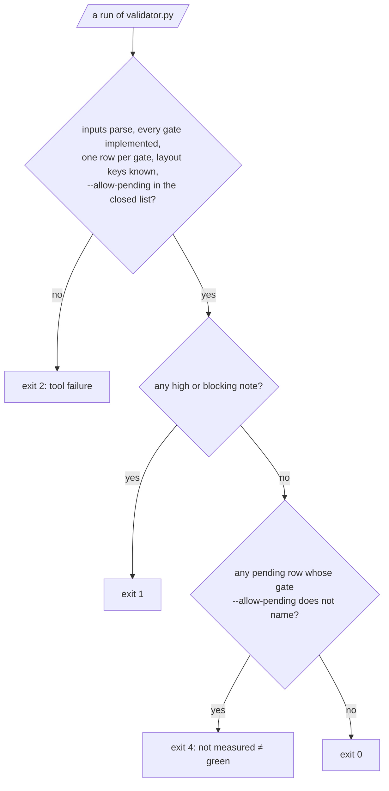

| Code | Meaning |
| --- | --- |
| 0 | every gate was measured, or its pending was accepted by name, and no note is high or blocking |
| 1 | at least one high or blocking note (a `--determinism` mismatch included) |
| 2 | invalid input or tool failure: a layout key the validator does not read, a file that is not UTF-8, a truncated table row, a gate it does not implement, a gate with two rows, a gate named by `--allow-pending` outside its closed list, a domain result that breaks its contract, a Python older than 3.9, an unexpected exception |
| 4 | no such note, but a gate not measured that `--allow-pending` does not accept |

`--allow-pending` accepts only four names: `p-anonymity`, `p-prior` and
`p-prior-pin` (the halves that need an input the material does not
distribute: the forbidden list, the owner-held prior document) and
`p-sensitivity-synthetic` (a sensitivity report a clone regenerated with a
synthetic prior). Any other name is exit 2, `p-sensitivity` included; a
missing sensitivity report is blocking; and `p-anonymity-language` (a
language the brief declares without month names) cannot be accepted
either. The history behind the closed list: the panel that reviewed v0.5.0
deleted the sensitivity report, accepted the gate by name and got exit 0.

## The hash policy

Every sha256 the instrument computes — the documents passed with `--case`,
the rubric, the gate section, the canon, the resolved gate map, the
validator itself, the inputs of a domain result and the lines of a chained
ledger — is the sha256 of the text as the validator reads it: UTF-8, a
byte-order mark dropped, every line break read as LF. A file that is not
UTF-8 text (a domain input only) is hashed as its bytes. The scripts write
UTF-8 to the console whatever its code page.

## The self-test and the test suite

`validator.py --self-test` runs 185 checks (at 0.6.0) embedded in the
script, with no inputs; the runbook and every cell use it without pytest,
and the report prints its count. The pytest suite
(`80-validator/test_validator.py`, 280 tests together with the scaffold's
`test_scaffold.py` at 0.6.0) runs the self-test and one case per rule:
one that passes and one that is rejected. Both are run with `python3 -B
-m pytest -p no:cacheprovider`, because pytest imports the files before
their own code can switch the bytecode cache off.

## The scaffold

`skills/cooperatio-teamwork/scripts/scaffold.py` creates an empty
production cell for a target, refusing to overwrite anything: it builds the
cell in a staging folder and moves it into place, so a failure leaves no
half-written cell. It copies the validator, the sensitivity script, the
perturbation module and five contracts from the material, so it has to run
from inside the material (or with the skill folder kept inside it);
copied alone, the skill creates the cell without them, says so, and the
cell has no validator until one is copied in. Chapter 17 lists what it
writes.

# The gate catalogue

This chapter is the reference of the gates the validator implements at
version 0.6.0: 17 builtin gates measured per document, 4 global gates
measured once per run, one measurement of the instrument, and the family
of domain gates a cell supplies. For each gate: the artifacts the
reflexive application assigns it to, what it reads, its limit, when it is
pending, and the semantics worth knowing before reading a note. The
authoritative text is the gate table of `04-gates-and-rubric.md` and the
declared semantics of `06-gate-semantics.md`.

## Conventions shared by every gate

- **Units.** A gate reads a document in units: a paragraph, a list item, a
  table row or a heading. A mark or a label applies to the unit it sits in.
- **Code spans and fences.** Since v0.6.0 one tokenizer reads fenced
  blocks for every gate, in the CommonMark rules (three or more backticks
  or tildes, indented up to three spaces, closed by a line of the same
  character at least as long; an unclosed fence runs to the end and is a
  note). Marks, labels and triggers are read outside code spans: a mark
  between backticks is notation, not a mark.
- **Placeholders.** An angle-bracket word (`<fill in>`), `TBD` or `TODO`
  outside code spans is an unfilled field in exactly four places: a card
  (`p-card`), a gate row (`p-limit`), an instantiation cell (`p-table`) and
  an artifact record (`p-references`). A placeholder in prose passes every
  gate and is the review's to find.
- **Empty lists.** A gate whose object is a list of the canon is pending
  when that list is empty, never a pass of 0 of 0.
- **Severity.** A hit is a high note unless the gate's semantics say
  blocking (a cycle, an invented prior number, a malformed mark, a missing
  declared file, a broken chain, a changed frozen record, a stale domain
  result) or low (an advisory).
- **Cap.** 50 notes per gate; the 51st is replaced by a count.

## Gates measured per document

### `p-terms` — terms to avoid

- **Assigned to:** every prose document of the material, the changelog, the
  replies, the experiments and the skill's files.
- **Reads:** occurrences of each term of the canon's "Terms to avoid" table
  (`quality gate`, `checkpoint`, `pipeline`, `feedback`, `iteration`,
  `single source of truth`, `bible`, `ruler`, `review board`), as whole
  words, case-insensitive, with a plural suffix, outside code and link
  targets; in the canon, outside the table itself.
- **Limit:** 0. `[method]`: a synonym outside the canon is the first sign
  of drift, and replacing it costs one word.
- **Exempt:** the frozen ledger under `90-review/`, by design: vocabulary
  rules govern living documents.

### `p-canon-link` — a link to the canon

- **Assigned to:** every document except the canon and the frozen records.
- **Reads:** links naming `01-canon.md` (or the cell's canon file) that
  resolve, relative to the document's own folder, to the canon of the
  layout; and links naming it that do not resolve.
- **Limit:** ≥ 1 resolved, 0 unresolved. `[method]`: a reader who lands on
  a loose document needs to know where the definitions are.

### `p-anonymity` — paths, dates, identifiers

- **Assigned to:** every document, the registry, the three ledgers, the
  principle, the root README and the skill.
- **Reads, the path-and-date half:** absolute paths (a segment under a
  common root such as `/tmp`, `/home`, `/opt`; a path of two or more
  segments; file URLs; home folders by user name; UNC paths); dates in
  year-month-day, day/month/year, year/month/day and day.month.year
  formats; dates written with a month's name in English, Portuguese,
  Spanish, French, German or Italian, and in a language the canon's "Month
  names" table adds; the expressions "made on", "written on", "generated
  on" followed by a date; e-mail addresses; host names under a private
  suffix (`.local`, `.lan`, `.internal`, `.intranet`, `.corp`); a root of
  one segment the canon's "Machine roots" table names. A month and a year
  with no day, a version number, a relative path and a public domain name
  are not hits.
- **Reads, the identifier half:** the entries of the `--forbidden` list,
  by name or as `sha256:<hex>` entries compared with the sha256 of each
  lowercased word. Model identifiers belong to that list. The list is kept
  outside the material, since it contains what it forbids; the corpus runs
  with none, so this half is **pending by design** and accepted by name.
- **Limit:** 0. `[brief]`: the brief forbids absolute paths, authoring
  dates, machine names and user names; in the method the gate is an option
  of the instance.
- **Valves:** an interpreter line (`#!`) on line 1 is not read; a path hit
  equal to an entry of the canon's "Accepted paths" table for that document
  is dropped (the entry has to be a path and nothing else; the canon
  cannot accept a path for itself); a final period is not part of the path
  compared.
- **Languages:** the brief declares the languages of its documents on a
  line `Languages: en, pt`; a declared language with no built-in months and
  no row of the canon's table is pending on the brief under
  `p-anonymity-language`, which no caller accepts.

### `p-form` — plain Markdown

- **Assigned to:** every prose document and the changelog.
- **Reads:** HTML tags and comments outside code; fenced blocks (backtick
  or tilde, indented up to three spaces) whose info string is not exactly
  `text`.
- **Limit:** 0. `[brief]`: plain Markdown and pseudocode only in `text`
  blocks are non-negotiables of the brief.

### `p-size` — words in range

- **Assigned to:** the documents of the "Size ranges" table of the gates
  file.
- **Reads:** words separated by whitespace; since v0.6.0 the pipes and
  separators of a table are not words.
- **Limit:** within the range declared, before writing, in the "Size
  ranges" table. `[hypothesis]`: a range is raised before writing, never
  met by cutting text.

### `p-table` — the instantiation table

- **Assigned to:** the three instances.
- **Reads:** the rows of the canon's "Instantiation table rows" list
  present in the two-column table that opens the instance; empty cells or
  cells holding a placeholder.
- **Limit:** 14 of 14, 0 empty. `[method]`: the table is the summary that
  makes instances comparable.

### `p-sections` — the mandatory sections

- **Assigned to:** the three instances.
- **Reads:** the headings of the canon's "Mandatory sections of an
  instance" list.
- **Limit:** 14 of 14. `[method]`: each section corresponds to a step of
  the recipe.

### `p-card` — the seven fields

- **Assigned to:** the role cards and the three instances (which carry
  cards of their own).
- **Reads:** per card, the fields of the canon's "Role card fields" list
  missing (as bold labels), and placeholders left in a field.
- **Limit:** 0 missing, 0 placeholders. `[method]`: a role without a gate
  and without a note is a step; the seven fields make that verifiable.

### `p-limit` — justified limits

- **Assigned to:** the gates file and the three instances.
- **Reads:** gate table rows with an empty magnitude, limit or
  justification; a justification without an origin label or with fewer
  than 6 words (the number is read from the gate's own row); a placeholder
  in a field.
- **Limit:** 0. `[method]`: 6 words is the minimum to say where the number
  comes from and why not another one. It is a lexical proxy: six words of
  any kind pass, and the review reads whether they justify.

### `p-references` — the graph closes

- **Assigned to:** the artifact table, the cards, the gates file and the
  three instances.
- **Reads:** artifacts cited in gates, dependencies or notes a card emits
  and not declared; owners that are neither a role nor `owner`; cycles in
  the graph (blocking); gates the artifact table assigns with no row in
  the gate table, or rows naming other artifacts than it assigns;
  placeholders in an artifact record; paths an artifact's `command` names
  that do not exist; Limit cells whose numbers are not the numbers of the
  limit the validator applied.
- **Limit:** 0. `[method]`: a loose reference is the written form of "the
  old text nobody knew had changed"; a cycle means a wrong graph.

### `p-prior` — numbers about a registered prior

- **Assigned to:** the principle, the canon, the recipe, the three
  instances, the lessons and the experiments.
- **Reads:** prior labels whose id is not registered, or whose id breaks
  the grammar `[0-9a-z-]+` (a malformed mark, blocking); every number of a
  unit marked `[prior:<id>]`, code spans included, which needs a row of
  that prior in the canon's "Recorded facts" and is checked by presence in
  the union of the sections the row cites, in the method document passed
  with `--case` whose sha256 is the pin of `<id>`, read in the
  `number_format` the registry declares; section references ("section
  2.1", "step 16") checked by the existence of that label; on the canon,
  the section commitments compared with the sections of the documents
  passed.
- **Limit:** 0. `[brief]`: a number absent from the prior's method
  document is an invented fact until proven otherwise.
- **Pending:** without a registry; without the `--case` document of a cited
  prior (pending by name: a cited owner-held prior reads "owner-held
  evidence, not measured here").
- **Exceptions:** the full id of a registered instance
  (`004-adoption-guide`) is a name, a bare `004` is a number; a digit
  attached to a letter (`p95`, `v7`) is a name; numbers written in words
  are not read. The check verifies the presence of the number's tokens in
  the cited sections, not the claim around it; the "Recorded facts" section
  of the canon is exempt by name.

### `p-prior-mark` — statements about a prior carry the mark

- **Assigned to:** the principle, the recipe, the three instances and the
  experiments.
- **Reads:** paragraphs, list items and table rows that use a phrase of
  the canon's "Prior-statement triggers" without a `[prior:...]` mark
  outside code spans (a mark in a code span is no mark; a mark outside the
  grammar is no mark either).
- **Limit:** 0. `[method]`: created after the first review, where a
  qualitative statement about the prior, absent from its document, passed
  every gate because only numeric statements needed a mark.
- **Exempt:** the frozen "Rubric" section of the gates file, by design.

### `p-prior-pin` — the pin of each executed prior

- **Assigned to:** the registry.
- **Reads:** for each executed prior cited in a document that carries
  `p-prior`, the registered sha256 compared with the documents passed with
  `--case`, prior by prior: a cited owner-held prior whose document was not
  passed is pending by name; a cited distributed prior whose pin matches
  none of the documents passed is blocking; a document passed that is the
  pin of no executed instance is blocking (with such a document even the
  owner-held prior is blocking, since the stray may be that prior, edited);
  a cited executed instance without a pin is blocking.
- **Limit:** equal. `[method]`: a pin nobody can re-verify is not a pin.

### `p-contract-shape` — the contracts hold

- **Assigned to:** the artifact table, the contracts, the registry, the
  note ledger, the state ledger, the round record and the owner decisions.
- **Reads:** schema cells of the artifact table citing a `*.schema.json`
  file that is missing or does not parse; keywords of each contract outside
  the subset the validator applies, or a `contract_version` other than the
  one it reads (`1`); the registry, the note ledger, the state ledger, the
  round record and the owner decisions validated line by line against
  their schemas; registry entries that break the contract of their status;
  the hash chain of the three append-only ledgers (chapter 15) and the
  rules of a chained line of the round record (its `kind`, its
  `reviewer_relation`, no verdict on a maintenance line, a `rubric_hash`
  equal to the frozen rubric when `rubric_applied` is true, the form of
  `family_map_commitment`).
- **Limit:** 0. `[method]`: a contract that exists but is never applied is
  not a contract.

### `p-recipe` — the steps of the recipe

- **Assigned to:** the recipe.
- **Reads:** steps missing one of the fields "Reads", "Creates", "Does",
  "Done when"; the number of steps (the minimum is read from the gate's
  row).
- **Limit:** 0 missing a field; ≥ 12 steps. `[method]`: 12 is the number
  of steps in the principle's recipe, which this one details.

### `p-components` — the eleven components named

- **Assigned to:** the three instances.
- **Reads:** the method components of the canon's list named in the
  document (inflected forms accepted).
- **Limit:** 11 of 11. `[method]`: an instance without one of them is not
  the method.

### `p-efficacy-mark` — claims of efficacy carry their evidence

- **Assigned to:** the principle, the brief, the recipe, the three
  instances, the lessons (from the heading the canon declares on), the
  README and the experiments.
- **Reads:** units that use a phrase of the canon's "Efficacy triggers"
  without one of the labels `[prior:<id>]`, `[experiment:<id>]`,
  `[against:<id>]`, `[lessons:<title>]`, `[hypothesis]` outside code
  spans; `[experiment:<id>]` and `[against:<id>]` labels that do not name
  an executed experiment with a "Provenance" table in `60-experiments.md`
  (a label citing a designed or pending experiment is a note; one without
  provenance reads as `[hypothesis]`, with a note); `[lessons:<title>]`
  labels that name no level-2 or level-3 heading of the lessons file; a
  `[hypothesis]` claim with a number or a universal quantifier (a low
  note).
- **Limit:** 0. `[method]`: a claim that the method itself works is a
  statement of the same kind as a statement about a prior, and exempting it
  was the double standard a critical panel found.

## Gates measured once per run

### `p-notes` — the note ledgers

- **Assigned to:** `open-notes` and `notes-status`.
- **Reads:** notes of the ledger passed with `--notes` missing one of the
  six fields, with a severity outside the four, or with a target outside
  the graph; notes without a line in the state ledger, or with two, or
  with a closing status and no version; evidence naming a file of the
  material (`.md`, `.json`, `.jsonl`, `.py`) that does not exist; the
  rules of the state (chapter 15): an escaped regression closed with
  neither a gate of the gate table nor a reason (high); an open high or
  blocking note that affects a non-negotiable and no decided owner decision
  covers (blocking); an open note older than 3 rounds and not scheduled
  (low).
- **Limit:** 0. `[hypothesis]`: a note aimed at an artifact the graph
  does not know is undeliverable; the note router of the first instance
  rejected such a target `[prior:000-av-production]`.
- **Pending:** without `--notes`; that pending cannot be accepted.

### `p-frozen-rubric` — the rubric and the frozen records

- **Assigned to:** the gates file and the review.
- **Reads:** the sha256 recorded at the launch of the review
  (`--rubric-hash`) against the current sha256 of the rubric as the layout
  resolves it; and the sha256 of each record the canon's "Frozen records"
  table pins (the reviewer's report and notes of round 1, the derived
  note ledger, the replies, the pin of the rubric, and the part of the
  lessons above the heading the efficacy gate reads from).
- **Limit:** equal (blocking when a record changed). `[method]`: a rubric
  changed after the review makes the verdict incomparable. The panel that
  reviewed v0.5.0 rewrote "Rejected" as "Accepted" in the reviewer's report
  and no gate saw it; since v0.6.0 the records are pinned.

### `p-sensitivity` — the gate on the gates

- **Assigned to:** `instrument-validator`.
- **Reads:** the sensitivity report named by the layout: a missing report
  (blocking); an incomplete one; a table that does not add up to its
  "Caught" line; a provenance that does not match (the running validator
  and the one next to the report, the "Gates" section, the canon, the
  resolved gate map, the perturbation set, the `case sha256` of each prior
  document and its `case attestation`); known defects the expected gate let
  through (missed) or that changed another row (noisy); an assigned gate
  without a perturbation, or fewer than 25 % of the (document, gate)
  pairs perturbed (pending with the reason, never a pass); a report made
  with a synthetic prior (pending under `p-sensitivity-synthetic` in a run
  without that prior's document, refused in a run with it).
- **Limit:** every gate covered, ≥ 25 % of pairs, 0 missed, 0 noisy.
  `[method]`: a gate that never fails proves nothing, and a report this
  instrument cannot have produced proves nothing either; `[hypothesis]`:
  the floor of a quarter of the pairs is the first this version commits
  to, above the 18 % a panel measured, to be raised and never lowered. The
  corpus covers 50 of 182 pairs.

### `p-declared` — what is declared exists, and what exists is declared

- **Assigned to:** the artifact table.
- **Reads:** declared paths that match nothing on disk (each literal path,
  and each glob at least once; blocking, naming the path); Markdown
  documents of the folder no artifact declares and the canon does not list
  as outside the table; files that belong to two artifacts; documents of
  the "Size ranges" table no artifact declares; a declared artifact marked
  `proposed` (pending with its reason) or declared with no paths (pending).
- **Limit:** 0. `[method]`: a declared document that silently matches no
  file is a promise the instrument never kept.

## The measurement of the instrument

### `m-determinism`

Not a gate on a document: a measurement of the validator itself, which
cannot fail a document. It is the equality of the report's sha256 across
two consecutive runs on the same input, the second with another hash seed
and the C locale; measured only with `--determinism`, and a difference is
a high note. `[hypothesis]`: a report that changes by itself is not
evidence; the continuity ledger the validator of the first instance wrote
was deterministic `[prior:000-av-production]`.

## Domain gates

### `d-<name>`

A gate of the target's domain, declared as a row of the cell's gate table
(every gate table of the gates file is read, so domain gates may keep a
table of their own) and never run by the validator. The cell's own code
measures it and writes a result file in the contract
`domain-result.schema.json`; the layout lists the result files under
`domain-results`. The validator reads each result and:

| Case | What the validator does |
| --- | --- |
| an input changed or is missing since the result was written (its sha256 recomputed) | blocking: the result is stale |
| the result names no input | blocking |
| the inputs do not include every file of the artifacts the gate's row names | blocking (a result over the canon alone passed while the candidate changed) |
| the result's own numbers contradict it, when the limit starts with a comparison and a number (`≤ 2 s`, `at least 1.5 x`) or is a bare zero (`0 divergent`) | blocking |
| `result: fail` | a note with the severity of the gate's row (an optional Severity column, else high); a severity below high counts only for a gate a decided owner decision covers |
| `result: tool-failure`, or a result that breaks the contract | exit 2 |
| a declared `d-*` gate with no result | pending, which no caller can accept |

Declared reach: a result whose inputs were recomputed by hand, the
candidate changed and its new sha256 written in, passes; it is the same act
as running the gate again without running it, which the validator, reading
results and never running the cell's code, cannot tell apart. The
sensitivity of a domain gate is the cell's own (mutants, a reference with
a known defect), and the coverage of `p-sensitivity` leaves domain gates
out. Chapter 21 shows how a cell writes one.

## The false greens

`06-gate-semantics.md` keeps a failure-mode analysis of the validator's
gates for the one failure mode that matters to a verdict: the **false
green**, a defect the gate lets through with a pass. For each gate it names
the cause, what detects it today, the probe that first found it and the
perturbation that covers it now. The table is reproduced in appendix D;
the summary is that most of the causes found so far came from the critical
panels that reviewed v0.4.2 and v0.5.0 and from the independent review of
v0.6.0, each probe turned into a regression test and, where it is a defect
of a document, a perturbation. The causes are the ones found so far, not an
exhaustive list; a new probe that passes a gate adds a row and a
perturbation.

# The sensitivity test

## Purpose

A gate that never fails proves nothing. `sensitivity.py` is the gate on
the gates: it injects known defects, one at a time, into a copy of the
material and checks that the expected gate rejects each on the expected
document, and nothing else moves. Its report, `sensitivity.md`, is an
artifact the validator reads (`p-sensitivity`), with a provenance header
that ties it to the exact validator, gate table, canon and gate map it was
made against. The validator refuses a report that the instrument cannot
have produced, so the test cannot be satisfied by an old report or a
hand-written one.

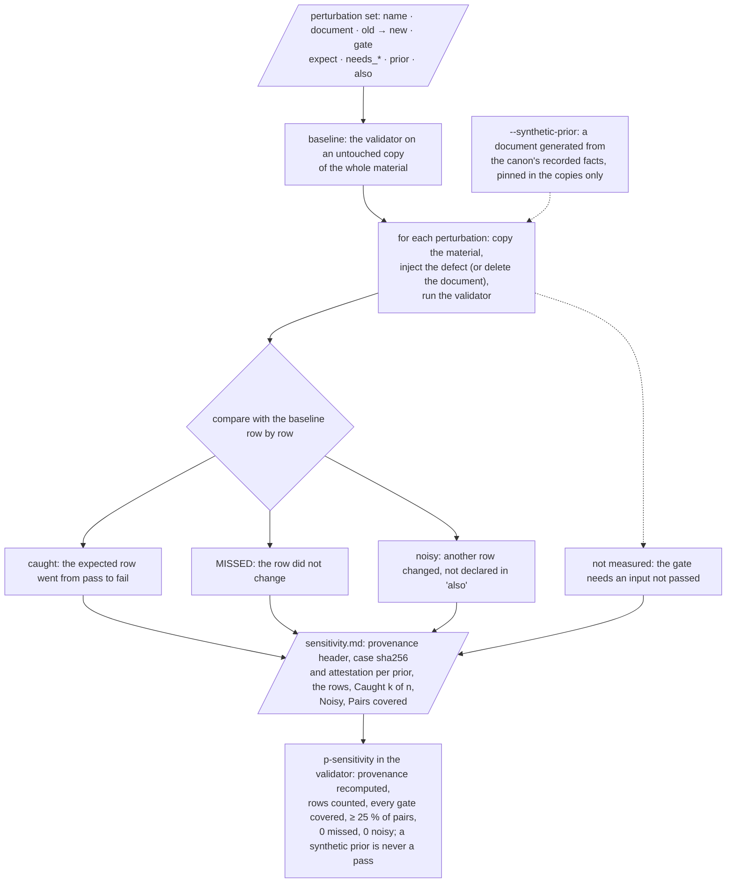

## A perturbation

The corpus keeps its set in `perturbation_set.py` (65 perturbations at
0.6.0), a module the validator reads without importing the sensitivity
script; a cell keeps its own as data, `08-validator/perturbations.json`,
named by the layout key `artifacts.perturbations`. The fields:

| Field | Meaning |
| ---------- | ------------------------------ |
| `name` | unique, without a comma (the report lists the names on one line) |
| `document` | the document to perturb, relative to the folder; `../instances/registry.json` is the copied registry |
| `old`, `new` | the text replaced once in the document; with `delete: true` the document is removed instead |
| `gate` | the gate that has to react on that document; one the validator implements, never a domain gate |
| `expect` | `fail` (default), or `pending` for a defect that empties what the gate reads (one perturbation of the corpus empties a list of the canon) |
| `needs_case`, `needs_rubric_hash`, `needs_notes`, `needs_registry` | the validator inputs the expected gate cannot run without; a row whose input was not passed is not measured, never missed |
| `prior` | the registered prior whose method document the gate needs; without a `--case` document identified as it, the row is not measured, whatever other prior was passed |
| `also` | gates the defect also reaches by design, comma-separated; their rows are not counted as noise, and the report lists them (eleven perturbations of the corpus declare one: a pin decides which document is the prior, a list of the canon feeds a gate on every document, a placeholder in angle brackets also reads as an HTML tag, an edited old line of a chained ledger breaks its chain) |

Two examples from the corpus's set:

```text
Perturbation("avoid-word inserted", "10-generic-recipe.md",
             "## The orchestrator in pseudocode",
             "## The orchestrator of the pipeline", "p-terms")
Perturbation("prior number altered", "10-generic-recipe.md",
             "the validator gave 38", "the validator gave 39", "p-prior",
             needs_case=True, prior="000-av-production")
```

## The copy is the material

Since v0.6.0 each perturbation runs on a copy of the whole material the
folder belongs to: the folder and everything its artifact table and
registry reach above it (the principle, the root README, the skill, the
changelog, the registry). Until then the copy was the folder alone, so no
perturbation could reach those documents. The copies go to `--work
SCRATCH_FOLDER`, or to a temporary folder; `.git`, `__pycache__` and
`.pytest_cache` are not copied.

## Specificity, coverage and the floor

The perturbed report is compared with the baseline row by row. A
perturbation is **caught** when the expected (document, gate) row went
from pass to fail (or to pending, when `expect` says so), **missed** when
it did not, and **noisy** when another row changed its result — not
counting the expected row, the row of `p-sensitivity` itself (which reads
the provenance an edit of an input pins on purpose), the rows of a
document that left the report, and the gates the perturbation declares in
`also`. A noisy perturbation fails the gate like a missed one.

Coverage is measured twice: by gate (every gate the artifact table
assigns, except `p-sensitivity`, the measurements and the domain gates,
has at least one perturbation) and by pair (the (document, gate) rows of
the baseline report that at least one measured perturbation targets). The
magnitude reads "k of n gates covered, p of q pairs (r %), 0 missed of m,
0 noisy"; at 0.6.0 the corpus reads 20 of 20 gates and 50 of 182 pairs
(27 %). An assigned gate without a perturbation, or fewer than 25 % of
the pairs, leaves `p-sensitivity` pending with the reason, never a pass;
the floor is a hypothesis, the first this version commits to, raised and
never lowered. The three generic perturbations of a new cell cover three
gates and three pairs; each gate a cell adds needs one of its own.

## Provenance

The header of the report records what it was made against, and the
validator recomputes every line and compares:

```text
validator sha256: <sha of validator.py: the running one, and the one next to the report>
gates sha256: <sha of the "Gates" section; a cell's whole gates file>
canon sha256: <sha of the canon>
map sha256: <sha of the sorted (gate, document path) pairs of the gate map>
perturbations: <count> (<names, comma-separated>)
case sha256: <prior id> <sha of the document passed>   (one per prior; "none")
case attestation: <prior id> <sha of the text + the four digests above>
```

Editing the validator, the "Gates" section, the canon or the gate map
makes the report stale: regenerate it (and then the validator report)
before the next run, or `p-sensitivity` fails on provenance. Deleting the
report does not help: a missing report is blocking, and `p-sensitivity`
cannot be accepted by name.

## The synthetic prior, for a clone

Five rows of the corpus's set need the method document of the first
prior, which the owner keeps. A maintainer who edits the instrument
without it regenerates a full report with `--synthetic-prior
000-av-production`: the script generates a document from the canon's
recorded facts (one numbered section per label the facts cite, holding
the facts' numbers in the prior's number format), in the `heading_style`
the registry declares for the real document, passes it as `--case`, and
patches its sha256 and its section digests into the registry and the canon
of every copy, never of the material.

The validator tells a synthetic prior by its `case sha256` differing from
the registry's pin, never by a line that declares it (the first draft's
declaring line could be deleted, and the report then read as the owner's).
A report made with a synthetic prior is never a pass: in a run without
that prior's document its row is `p-sensitivity-synthetic`, pending,
accepted only when the caller names that gate; in a run with the document
it is refused. It shows that every gate fails its known defect; it does
not show that the owner's document holds the facts, nor that the
validator reads that document's format beyond what the registry declares.

## The attestation, and what it leaves

The pin of the registry is public, so a `case sha256` line can be written
by hand with the real pin over a report made with the synthetic document.
Until the closing pass of v0.6.0 that forged line passed every run. Since
then the report records, for each document it was made with, a `case
attestation`: the sha256 of the document's text followed by the validator,
gates, canon and map digests of the report, which only whoever holds the
text can compute. A run that passes the document recomputes it and refuses
a mismatch; that is the owner's run for `000` and every run for `004`.
What it leaves, declared: a run without the document compares nothing, so
**in a clone the forged line still passes**, and a frozen record re-pinned
in the canon shows there only in the diff against a signed version.

# Ledgers, records and integrity

## The three ledgers

Three append-only ledgers under `state/` hold the state the gates read,
one JSON object per line, each with a contract (appendix B):

| Ledger | One line per | Written by |
| --- | --- | --- |
| `round-record.jsonl` | round: method version, round label, the executor of each role by family and effort, a summary, and since v0.6.0 its `kind`, the `reviewer_relation`, `rubric_applied`, `rubric_hash`, `rubric_author`, the `family_map_commitment`, and optional cost fields (tokens per role, calls, finish reason, `wall_seconds`, `notes_count`, `crew`, `rounds_to_stop`) | the verifier, at the close of a round |
| `notes-status.jsonl` | state change of a tracked note: `ref` (`notes:<n>` for the n-th note of the frozen ledger, `panel:<version>:<id>` for a panel finding), `status` (`open`, `fixed`, `disputed`, `out of scope`), `closed_in`, `summary`, and the fields of the state rules below | the verifier |
| `owner-decisions.jsonl` | decision only the owner can take: `name`, `status` (`open`, `decided`), `blocks`, `version`, `summary`, and once decided the notes it `covers` | the owner, through the orchestrator |

## The hash chain

Each line written from v0.6.0 on carries `prev`, the sha256 of every line
above it, each followed by LF (for a file with no blank line, the sha256 of
the file before the line was appended). `p-contract-shape` recomputes the
chain: an earlier line edited, removed or reordered breaks the first
chained line after it. The canon's "Chained ledgers" table counts the
lines written before each chain (10 in the round record, 48 in the state
ledger, 0 in the owner decisions), which are never edited, and every line
after them has to carry `prev`, so stripping the chain is a finding too.

The reach is declared: the chain detects an edit made without recomputing
it — the careless maintainer and the honest error. It does not detect an
edit that recomputed it, which costs one sha256 per line, and it does not
cover the last line of a ledger, which can be rewritten with no sign until
a line is appended after it. Only an anchor outside the tree — a signed tag
per version, which is the owner's to make — answers that.

## The rules of the state of a note

Since v0.6.0 the last line of each tracked note is read against four rules
(`p-notes`):

- **Golden rule 4.** A note that is a regression that escaped every gate
  (`escaped: true`) closes with the gate it became (`gate`, a row of the
  cell's gate table) or with the recorded reason not to make one
  (`no_gate`, at least 8 distinct words, or `decision` exactly the name of
  a decided owner decision); closed with neither, it is a high note. The
  count of words measures the form of the reason, not its content.
- **Age.** An open note is counted in rounds from the version it was
  opened in (`opened_in`, or the version of a panel ref, or 0.1.0 for the
  frozen ledger). Past 3 rounds, and not scheduled for a version still
  ahead (`due`), it is a low note: schedule it, dispute it or close it with
  the reason. Three rounds is a hypothesis: a panel counted 16 of the 22
  notes of round 1 open nine rounds later.
- **Non-negotiables.** The brief gives each non-negotiable an id in a code
  span (`nn-<name>`); a note names those it affects (`affects`). An open
  note of severity high or blocking that affects one is blocking, unless a
  decided entry of the owner decisions covers it (`covers`). The fields a
  line's writer controls cannot undo the protection: the severity is the
  highest of the note ledger's and of every line of the ref; the
  non-negotiables are the union of every line's `affects`; a decision
  covers only while its last line is `decided`; a high or blocking note
  opened in 0.6.0 or later has to name what it affects (an empty list when
  nothing).
- **Evidence.** A note whose evidence names a file of the material needs
  that file to exist; the frozen ledger keeps the names of its time and is
  exempt.

## Frozen records

The records of the first review and the history of the lessons are never
edited. The canon's "Frozen records" table pins their sha256
(`90-review/auditor-report.md`, `auditor-notes.json`, `notes.json`,
`replies.md`, `rubric.sha256`, and the part of `99-lessons.md` above the
heading "The v0.5.0 round: exit 0 is not green"), and `p-frozen-rubric`
compares them on every run. An append-only rule that no gate checked is
how the panel that reviewed v0.5.0 rewrote a verdict unseen.

## The family map and its commitment

The round record names the executors by family letter; the map from
letter to family, and a salt, stay with the owner. Since the rework of
v0.6.0 a chained line of the round record of method version 0.6.0 or later
carries `family_map_commitment`, the sha256, over UTF-8, of

```text
json.dumps(map, sort_keys=True, separators=(',', ':'), ensure_ascii=False) + '\n' + salt
```

where `map` is the object from letter to the description of the family
and `salt` a string of 64 hex characters. `p-contract-shape` checks the
form only (64 hex characters); the owner proves the commitment by
revealing the map and the salt, and nothing in the material lets anyone
else check it. A pseudonym made of the hash of a host name or a user name
is not anonymity (a dictionary reverses it); this is why the material uses
letters and a salted commitment.

## What a clone verifies, and what rests on the owner

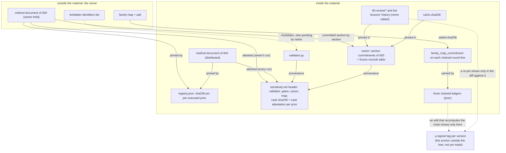

| A clone verifies | Only the owner verifies |
| --- | --- |
| every gate on every document; the pin and the numbers of `004`, whose document is distributed; the frozen rubric; the provenance of the sensitivity report, the sha256 of each prior document included; the hash chain of the three ledgers | the numbers stated about `000`, whose document is owner-held (its cited sections are committed by sha256, so it cannot be swapped unseen, but a clone cannot read them); that the sensitivity report was made with that document, by regenerating it |
| that a ledger line written since v0.6.0 was not edited without recomputing the chain | an edit that recomputed the chain; the lines before the chain; the history of the lessons and the record of the experiments' raw files |
| the family letter each round line records, and the form of its salted commitment | the map from a family letter to a family, and its salt |

The residual risks the material declares, as they stand at 0.6.0:

- in a clone without the owner's document, a forged `case sha256` line
  passes;
- the 8 distinct words of a `no_gate` reason measure form, not content;
- the attestation does not prove the perturbations actually ran, only
  that the report was made over those inputs;
- the git history distributes the name of the author and the dates of the
  commits; the gates measure the content, not the history;
- the anchor outside the tree, a signed tag per version, is recommended
  and not yet made (an open owner decision).

# The instances

## Instance 000: the audiovisual production method

The first executed instance, from which the method was generalized: an
audiovisual production method, written in Brazilian Portuguese, held by
the owner and not distributable. The registry pins its method document by
sha256 and declares its number format (`comma-decimal`) and its heading
style (a section `## 6.`, a subsection `### 1.1`, a step `### Passo 15.`),
and the canon commits, section by section, to the text of the twelve
sections the recorded facts cite. The facts the material states about it
are the rows of the canon's "Recorded facts" table — among them 18 roles
with a card, 49 artifacts in the graph of its first pilot, 2 maximum rounds
per artifact, the review of v1 with 3 blocking, 4 high, 12 medium and 12
low findings, 26 low notes open at v5, a drift gate whose wrong instrument
read a p95 of 0.546 s at v1 and 0.10 s once fixed, and an automatic
reviewer of which 10 of 12 notes were false `[prior:000-av-production]`.
Several rules of the recipe carry the error of this instance that the step
prevents, as a measured size of the error.

Its historical vocabulary is recorded in the canon so that the frozen
records of round 1 can be read: the validator was its "continuity
checker"; the verdicts were "publishable", "publishable with minor
corrections" and "rejected"; the production cell carried a media term;
the quarantine mark of a bracketed word became `[prior:<id>]`.

## Instance 004: the adoption guide

The second executed instance: the adoption guide of the method itself, in
Brazilian Portuguese, of 900 to 1,400 words by its brief, produced under
method version 0.2.2 with a writer of one family and a review in a
separate dispatch without the producer's reasoning, which gave `accepted`
with no dimension below 4 and a guide of 1,054 words
`[prior:004-adoption-guide]`. That review was first recorded as coming
from another family; it came from the producer's own model through
another route, so it separated the session and the reasoning, not the
family.

Its cell is distributed under `instances/004-adoption-guide/` since
v0.5.0, as a **record, not an example to copy**:

- it does not run under the current validator without a migration (the
  migration notes of `CHANGELOG.md`);
- its own copy of the validator, `08-validator/validator.py`, is the
  instrument of 0.2.2 and since v0.6.0 refuses to run unless called with
  `--historical`, because its exit 0 does not mean what the current
  validator's does (under 0.2.2 a gate that was not measured left the run
  with exit 0); that flag is the only change made to the cell since it was
  distributed;
- its `ERRATA.md` lists what the guide says that is no longer true when
  read against the material as it stands (the rubric is frozen before the
  first review, not before the production; the registry holds two executed
  instances; the skill copied alone creates a cell without the validator;
  independence across families is a recommendation, not a rule);
- its list of forbidden identifiers stayed with the owner, outside the
  material, since it contains what it forbids.

The cell shows the shape of a JSON-layout cell at 0.2.2: `00-brief.md`,
`01-sources-of-truth.md`, `02-canon.json`, `03-artifacts.json`,
`04-roles/` (four cards), `05-contracts/`, `06-gates.md`, `07-rubric.md`
with its pin, `08-validator/` with its reports, `09-engine/`, `review/`
(two wave reports and the round-1 notes), `state/`, `lessons.md`,
`open-notes.json`, `priors.json`, `layout.json`, the guide, the method
document and the errata.

Whether a new cell under 0.6.0 replaces it as the example is an open owner
decision (appendix F).

## The three designed instances

Three instances were chosen because they differ from each other, and each
fills the fourteen rows of the instantiation table and the fourteen
mandatory sections with domain content marked `[hypothesis]` where it is
an assumption. They are designed sketches, not executions, and carry the
design, not a result.

| Element | Car (`20-instance-car.md`) | Text about 2027 (`21-instance-text-2027.md`) | HPC library (`22-instance-hpc.md`) |
| --- | --- | --- | --- |
| Target | the design of a battery-electric passenger vehicle released for tooling, with approved validation prototypes and a homologation dossier | a publishable nonfiction manuscript of about 90 thousand words in 12 chapters on the world in 2027, saying on every page which statement is fact, projection or opinion | a C++ library with a C interface that replaces the reference implementation of a 3D finite-difference operator, with measured speedup and byte-for-byte identical outputs |
| Owner | the program director | the author | the library's technical lead |
| Sources of truth | requirement → brief and regulatory matrix; geometry → released CAD; mass → weighing; cost → supplier quotation; physics → correlated simulation; standard → the regulation's text | fact → primary source; projection → declared model; number → claims register; quotation → original; figure → data plus script | correctness → oracle (frozen reference and hashed outputs); performance → measurement on a pinned node with the configuration obtained recorded; where the time goes → attribution instrument |
| Main artifacts | requirements, architecture, budgets, subsystem CAD, virtual vehicle, BOM, simulations, safety analysis, validation plan, test reports, homologation dossier | thesis, theme map, domain dossier, claims register, projections, outline, scenarios, chapters, figures, fact-check, manuscript | specification, interface, oracle, attribution report, lever decision, experiment plan, implementation, tests, build, equivalence, measurements, performance report, documentation |
| Main gates | mass against target with reserve, range with the real mass, charging time, clearances, crash margin, thermal propagation, traceability, coverage, quoted cost, simulation × test correlation | every claim with a register identifier, every projection marked, primary source, source density, readability, size per chapter, overlap, recheck of volatile claims | byte-for-byte equivalence, independence from order and thread count, sensitivity of the gate to mutations, configuration obtained, noise, speedup with confidence interval, size sweep, prediction written beforehand, sanitizers, third-party reproduction |
| Review rubric | a design review by a panel from outside the program | blind reading by readers from the target audience | code review and benchmark reproduction by someone who did not implement |
| What stays with the human | targets, styling, supplier choice, residual risk, safety sign-off, the decision to launch | thesis, tone, opinion, the label of projection or opinion, legal risk, release | what to optimize, the target, acceptable memory, new dependencies, the budget, the release |

What each sketch adds to the method's vocabulary: the car shows the gates
of a physical product and the fidelity ladder of its versions (paper,
virtual, engineering prototype, validation prototype); the text shows the
separation of fact, projection and opinion as a contract of the claims
register and a gate on the chapters; the HPC library shows the danger
moving from the role that writes badly to the instrument that measures
wrongly and passes — the equivalence gate that never rejects, the benchmark
that records the threads requested and not the threads obtained, the
speedup measured at an extreme point and generalized — and makes "measure
what the system gave, not what was asked for" the first gate of the loop.

## The registry as a contract

`instances/registry.json` is one list; the status of an entry decides its
fields, and `p-contract-shape` enforces that contract on every run. A cell
keeps its own registry, `priors.json`, in the same contract, and registers
itself in it at the close of its production (step 14 of the recipe), which
is also what makes the token of its own id read as a name rather than as a
number.

# Part IV — Using the method {- .part}

# Quick start

## The ten-minute path

The root `README.md` gives a four-step path; here it is with the commands
run from the root of the material.

1. Read the first section and section 7 of `01-principle.md` (the idea and
   the recipe).
2. Scaffold a cell:

   ```bash
   python3 skills/cooperatio-teamwork/scripts/scaffold.py \
       --target "My target" --roles writer reviewer --out ./teamwork
   ```

3. Fill the brief, give each non-negotiable an id (`nn-<name>`), fill the
   lists of `02-canon.json` the validator reads and one card per role (the
   skill's `references/templates.md` has a filled example).
4. Freeze the rubric, run the sensitivity test, then the validator, with
   the commands of the skill ("The commands of a cell", reproduced in
   chapter 19); read every pending row before reading the exit code.

## What the scaffold writes

With two roles the scaffold writes 24 files, refusing to overwrite
anything that exists; of the folders it creates, `09-engine/` and
`review/` stay empty:

| File | What it is |
| --- | --- |
| `00-brief.md` | the brief template: target, audience, non-negotiables, owner decisions, budget and stop |
| `01-sources-of-truth.md` | the table of sources per content type |
| `02-canon.json` | the canon as data: four sections, the lists the validator reads (empty), the recorded facts (empty) |
| `03-artifacts.json` | one placeholder artifact record |
| `04-roles/<role>.md` | one card per role, seven bold fields with placeholders, a link to the canon |
| `05-contracts/02-canon.schema.json` | the contract of the JSON canon (written by the scaffold) |
| `05-contracts/notes.schema.json`, `notes-status.schema.json`, `round-record.schema.json`, `domain-result.schema.json` | copied from the material |
| `06-gates.md` | an empty gate table and an empty "Size ranges" table |
| `07-rubric.md`, `07-rubric.sha256` | the rubric template and the pin placeholder `not-frozen` |
| `08-validator/validator.py`, `sensitivity.py`, `perturbation_set.py` | copied from the material |
| `08-validator/perturbations.json` | three generic perturbations (an avoid-word, an absolute path, a deleted card field) |
| `layout.json` | the layout of the cell (chapter 12) |
| `lessons.md`, `open-notes.json`, `priors.json` | empty |
| `state/notes-status.jsonl`, `state/round-record.jsonl` | empty |

## The first run is red, by design

Verified on a cell scaffolded with three roles at 0.6.0: the self-test
passes (185 checks), and the first validator run

```bash
python3 08-validator/validator.py --folder . --layout layout.json \
    --rubric-hash 07-rubric.sha256 --notes open-notes.json \
    --allow-pending p-anonymity
```

exits 1 with 3 blocking and 8 high notes: "no documents were measured; a
production with no documents is not green" (the placeholder artifact
matches no file), "declared artifact missing: `<relative path>`", "no
sensitivity report at `08-validator/sensitivity.md`", and one high note per
Markdown document of the cell that "belongs to no artifact and is not
declared outside the artifact table". This is the contract: a newly
scaffolded cell fails until it has real artifacts.

## The shortest path to green, verified

The following edits, made on a cell scaffolded with `--roles writer
reviewer`, took it from that red run to exit 0 with no notes in one pass
(verified on 0.6.0; the full chapter 18 is the real procedure, this is the
smallest cell the instrument accepts):

1. **`00-brief.md`**: a link to the canon (`Canon:
   [02-canon.json](02-canon.json)`), a `Languages: en` line, two
   non-negotiables with ids (`nn-source`, `nn-size`), one decided owner
   decision, a budget and a stop.
2. **`02-canon.json`**: `terms to avoid` (`pipeline`, `checkpoint`), the
   seven `role card fields`, the three `origin labels`, and `documents
   outside the artifact list` set to `01-sources-of-truth.md`,
   `07-rubric.md`, `lessons.md`, `08-validator/*.md`.
3. **`03-artifacts.json`**: three records — `brief` (`00-brief.md`, gates
   `p-terms`, `p-canon-link`, `p-anonymity`, `p-form`), `cards`
   (`04-roles/*.md`, those four plus `p-card`) and `gates` (`06-gates.md`,
   gates `p-limit`, `p-terms`, `p-canon-link`, `p-form`).
4. **`04-roles/writer.md`, `reviewer.md`**: the seven fields filled with
   one line each, the executor named by family and effort in the degree
   field.
5. **`06-gates.md`**: a link to the canon and one row per gate assigned
   above, each naming the same artifacts, with a magnitude, a limit and a
   justification of at least six words starting with an origin label; the
   "Size ranges" table left empty.
6. **`08-validator/perturbations.json`**: the three generic perturbations
   kept, plus one each for `p-form` (an HTML tag in the brief),
   `p-canon-link` (a broken link in a card) and `p-limit` (a justification
   deleted in the gates file), so that every assigned gate has one.

Then the four commands of the cell (chapter 19): the self-test (185
checks); the freeze, which printed the pin and replaced `not-frozen`; the
sensitivity test, whose report read "Caught 6 of 6. Noisy: 0 of 6. Pairs
covered: 6 of 22."; and the validator, which wrote a report of 23 rows
with `p-sensitivity` at "6 of 6 gates covered, 6 of 22 pairs (27 %), 0
missed of 6, 0 noisy", three `p-anonymity` rows pending and accepted (the
identifier half, with no forbidden list), `m-determinism` passed, and
exit 0. Had the three generic perturbations been left alone,
`p-sensitivity` would have been pending for the three uncovered gates and
the run would have exited 4.

# Setting up a cell

This chapter condenses the fifteen steps of
`02-reflexive-application/10-generic-recipe.md` and the procedure of the
skill into one how-to. Each step says what it creates and when it is done;
the recipe adds, for each, who performs it, what it reads and the trap the
step exists to avoid.

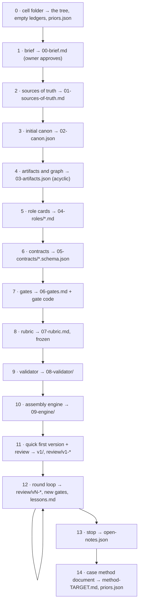

## Step 0 — the folder

Create the tree (the scaffold does), decide where everything that stays
out of version control goes and record it in the brief, and decide how
machine-dependent paths enter: always as a command-line variable, never
written into an artifact. Done when the tree exists, the ledgers exist
and are empty, and `priors.json` parses. Trap: starting to write the brief
in a conversation. What is not in a file has no hash, and what has no hash
makes nobody stale.

## Step 1 — the brief

`00-brief.md`, with fixed sections: target; for whom; non-negotiables,
each with an id in a code span (`nn-<name>`), written as sentences a gate
could measure ("mass ≤ X kg", "no fact without a source", not "safe",
"good", "fast"); owner decisions as a table with a status (and, since
v0.6.0, as lines of `state/owner-decisions.jsonl`); available sources of
truth; budget (maximum rounds per artifact, review rounds); a provisional
stopping criterion; what is not an objective; assumptions labeled
`[hypothesis]`. The brief also declares the languages of the documents on a
line `Languages: en` (two-letter codes), which the anonymity gate reads.
Done when every section is filled or says "owner decision pending", and
the owner recorded the approval.

## Step 2 — the sources of truth

`01-sources-of-truth.md`: a table with content type, the source that errs
least, who consults it, and what is forbidden as a source. The writer is
never a source of fact; a generative tool is never a source of exact text;
a number never comes from the paragraph that cites it. Done when every
content type of the brief has exactly one source.

## Step 3 — the canon

`02-canon.json`, with its schema in `05-contracts/`. Sections with owner,
version and state; canonical numbers (spelling by medium, unit, rounding,
nature, source); accepted variants; names and terms; rules. Fill the lists
the validator reads (a list left empty leaves its gate pending): `terms to
avoid`, `role card fields`, `origin labels` (with their brackets), and the
others the scaffold writes empty. List under `documents outside the
artifact list` the Markdown documents of the cell that belong to no
artifact (`01-sources-of-truth.md`, `07-rubric.md`, `lessons.md`,
`08-validator/*.md`), or `p-declared` reports them. Every number the cell
states about a registered prior gets a row of `recorded facts`:

```text
{ "number": "18", "context": "roles with a card [prior:<id>]", "section": "1.1" }
```

Done when every section has an owner and a version, every number of the
brief is in the canon, and the schema validates.

## Step 4 — the artifacts and the graph

`03-artifacts.json`: one record per artifact (chapter 6). Start from the
target and walk backward; give each artifact a single owner; turn every
owner decision into an artifact with resource `human`; mark as `proposed`
an artifact that has no file yet; compute the topological order. The
`gates` field of each record is the one source of the gate map. Done when
the graph is acyclic, every artifact has one owner, at least one gate and
(except the target) at least one consumer. Trap: a finding that lands on
the nearest artifact because the right target is not in the graph.

## Step 5 — the role cards

`04-roles/<role>.md`, one per artifact owner, with the seven fields as
bold labels (`**Decides:**`), plus "Questions it always asks" and the base
prompt the orchestrator hands to the agent. In "Does not decide", write
the neighboring decisions the role would be tempted to make and whose they
are. In the degree field, name the executor: a person, code, or a kind of
language model by family and effort; a role that audits another gets an
executor different from the one that produced the artifact. Done when
every card has the seven fields, no decision appears in "Decides" of two
cards, and no auditing role shares an executor with the role it audits.

## Step 6 — the contracts

`05-contracts/<artifact>.schema.json` for each artifact that passes
between roles, rejecting unknown fields and the domain's most likely
ambiguity, with one valid and one invalid example; the invalid one has to
fail. Done when validation runs in seconds, before any expensive work.
Trap: the ambiguous position key.

## Step 7 — the gates

`06-gates.md`: one row per gate of the artifact list, naming the same
artifacts, with magnitude, limit and a justification that starts with an
origin label and has at least six words; a "Size ranges" table with the
word range of each document, declared before writing. Give every signal
gate a magnitude limit on both sides; separate "rejects" from "tool
failure"; never let a limit inherit a prior's number. A gate of the domain
is a row `d-<name>` (chapter 21). The ids have to be ones the validator
implements, or `d-*`: any other id exits 2. Done when every limit has a
justification with an origin, and every code gate rejected its known
perturbation.

## Step 8 — the rubric, frozen

`07-rubric.md`: six to ten dimensions with anchors for 1, 3 and 5; the
severity scale; the mechanical verdict rule; the report format. Then:

```bash
python3 08-validator/validator.py --folder . --layout layout.json \
    --freeze-rubric 07-rubric.sha256
```

The scaffold's pin holds the placeholder `not-frozen`, which the first
freeze replaces; a real pin is refused, and a deliberate replacement goes
through `--re-freeze-rubric`. Done when the hash is recorded before the
first review and the round record will name who wrote the rubric. Written
by the owner with whoever will review; never by whoever will produce,
alone.

## Step 9 — the validator

The scaffold copied `validator.py`, `sensitivity.py` and
`perturbation_set.py` into `08-validator/`. Adapt the three generic
perturbations of `perturbations.json` to the cell's text and add one per
gate the cell assigns. Run the sensitivity test, then the validator
(chapter 19). Done when two runs give an identical report, every gate has
its perturbation caught, and the validator refuses a canon of another
schema version.

## Step 10 — the assembly engine

`09-engine/`: the graph core (state, hash per artifact, plan, execute), the
note router, the assembly of the target and the tests. The content hash of
an artifact is the sha256 over the canonical form of the file (UTF-8, the
whitespace at the end of each line normalized, a single final newline). The
plan marks each artifact `current`, `stale`, `missing`, `returned` or
`escalated`; only what is stale runs, in topological order; the router
refuses an unknown target, deduplicates, and only high and blocking return
the artifact; the assembly validates every contract before the expensive
work and names the output with the version label. Done when assembling
twice with the same inputs gives the same product. Trap: the namesake file
from an old version, which every reader silently picks.

## Step 11 — the quick first version and its review

Produce every artifact, even bad, instead of polishing the first ones;
assemble; hand the reviewer only the files and the rubric; record in the
dispatch the output limit and the reason the generation ended; import the
review's notes into the ledger. Done when every artifact exists, the
report follows the rubric's format and the notes entered the ledger
without refusal. Trap: polishing v1.

## Step 12 — the round loop

Chapter 20.

## Step 13 — the stop

The owner declares the criterion before the last round, in terms of rounds
or verdict, never calendar; the review of the last version becomes open
notes in `open-notes.json`, in the contract; a violated non-negotiable is
not an open note but an undelivered target.

## Step 14 — the case method document and the registration

`method-TARGET.md`: the ideas with the defect each prevents, the graph,
the step by step with the real commands, the pseudocode per role with its
degree, the owner decisions, the known false positives with a status,
`[unverified]` on whatever was not checked. Register the instance in
`priors.json` with id, status, the document's path relative to its own
repository root, its sha256, its locator and its number format. Trap: a
document that repeats the READMEs.

## Before handing over

Run through `skills/cooperatio-teamwork/references/review-checklist.md`.
At minimum: every document points to the canon; every gate has magnitude,
limit and a justified origin label; the graph is acyclic; every owner is a
role or the owner; every card has the seven fields; the rubric hash is
recorded; every non-negotiable of the domain is a `d-*` gate whose result
the cell's code writes; the validator exits 0 and every pending it reports
is one of the four it accepts by name, with the reason; and the files do
not claim the method has been validated on this target — the first review
round does that.

# Running the instrument

## The commands of a cell

From inside the cell, after the files are filled (the skill, "The commands
of a cell"):

```bash
python3 08-validator/validator.py --folder . --layout layout.json --self-test
python3 08-validator/validator.py --folder . --layout layout.json \
    --freeze-rubric 07-rubric.sha256
python3 08-validator/sensitivity.py --folder . --layout layout.json \
    --rubric-hash 07-rubric.sha256 --notes open-notes.json --work SCRATCH_FOLDER
python3 08-validator/validator.py --folder . --layout layout.json \
    --rubric-hash 07-rubric.sha256 --notes open-notes.json \
    --allow-pending p-anonymity --determinism --output 08-validator/report.md
python3 -B -m pytest -p no:cacheprovider tests/
```

The last line only if the cell keeps a test suite. Add `--case` for each
registered prior the cell cites, and `--forbidden` with the cell's list of
forbidden identifiers kept outside the cell (then drop `--allow-pending`).
Run the sensitivity test again after every change to the validator, the
gates file, the canon, the artifact list's gate map or the perturbation
set, and before the validator: the validator reads the report and fails
`p-sensitivity` on provenance otherwise.

## The commands of the corpus

From `02-reflexive-application/` (its README, "How to run the validator"):

```bash
python3 80-validator/sensitivity.py --folder . \
    --case PRIOR_000_DOCUMENT_PATH \
    --case ../instances/004-adoption-guide/metodo-de-producao.md \
    --rubric-hash 90-review/rubric.sha256 --notes 90-review/notes.json \
    --work SCRATCH_FOLDER --output 80-validator/sensitivity.md
python3 80-validator/validator.py --folder . \
    --case PRIOR_000_DOCUMENT_PATH \
    --case ../instances/004-adoption-guide/metodo-de-producao.md \
    --rubric-hash 90-review/rubric.sha256 --notes 90-review/notes.json \
    --allow-pending p-anonymity --determinism --output 80-validator/report.md
python3 80-validator/validator.py --self-test
python3 -B -m pytest -p no:cacheprovider 80-validator/test_validator.py \
    ../skills/cooperatio-teamwork/scripts/test_scaffold.py
```

The published report is made with exactly that command; at 0.6.0 it
exits 0 with no notes, 27 rows of `p-anonymity` pending and accepted (the
identifier half, with no forbidden list), `m-determinism` passed, the
self-test at 185 checks; the sensitivity report reads 65 of 65 caught, 0
noisy, 50 of 182 pairs; the test suites pass 280 tests.

## The clone run

The method document of instance 000 stays with the owner, so a clone of
the material does not have it. The clone passes the document of 004 and
accepts by name the gates that need the owner's:

```bash
python3 80-validator/validator.py --folder . \
    --case ../instances/004-adoption-guide/metodo-de-producao.md \
    --rubric-hash 90-review/rubric.sha256 --notes 90-review/notes.json \
    --allow-pending p-anonymity,p-prior,p-prior-pin --determinism
```

Expected: exit 0, no notes, the report on the standard output, the three
gates listed as pending accepted by the caller, the pin and the numbers of
004 measured (its edited document, or an invented number about it, is a
blocking note, exit 1), and the rows of 000 saying "owner-held evidence,
not measured here". Without any `--case` the same run still exits 0, but
measures neither pin.

A clone that edits the instrument cannot regenerate the sensitivity report
with the owner's document; it regenerates one with a synthetic prior:

```bash
python3 80-validator/sensitivity.py --folder . \
    --case ../instances/004-adoption-guide/metodo-de-producao.md \
    --synthetic-prior 000-av-production \
    --rubric-hash 90-review/rubric.sha256 --notes 90-review/notes.json \
    --work SCRATCH_FOLDER --output 80-validator/sensitivity.md
```

and then adds `p-sensitivity-synthetic` to `--allow-pending` of the clone
run. The report stays pending until the owner regenerates it with the
document (chapter 14).

## Reading a report

Read the pending rows before the exit code. A row is `pass`, `fail` or
`pending`; the lines after the table say which pending gates the caller
accepted, which it did not (the run exits 4 for those unless a note exits
1), and which accepted gates had nothing pending ("Accepted but not
pending", so the caller sees that the acceptance covered nothing). The
notes table gives, per note, the target artifact, the severity, the text
(prefixed by the gate id) and the evidence (the document). With
`--output`, one summary line goes to the error stream.

## Troubleshooting

| Message or symptom | Cause | What to do |
| --- | --- | --- |
| `no documents were measured; a production with no documents is not green` (blocking, on `artifacts`) | the artifact list has no record whose paths match a file, or no gates | fill `03-artifacts.json` with real records and gates |
| `p-declared: declared artifact missing: <path>` (blocking) | a literal path of an artifact matches no file, or a glob matches nothing | create the file or fix the path |
| `p-declared: document X belongs to no artifact and is not declared outside the artifact table` (high) | a Markdown document of the folder is neither an artifact nor listed in the canon | add it to an artifact's paths, or list it under `documents outside the artifact list` with the reason |
| `p-sensitivity: no sensitivity report at ...` (blocking) | `sensitivity.py` has not run, or the layout key `artifacts.sensitivity` points elsewhere | run the sensitivity test |
| `p-sensitivity` fails on provenance (validator, gates, canon or map sha) | the instrument or its inputs changed after the report | regenerate the report, then the validator report |
| `p-sensitivity` pending: an assigned gate without a perturbation, or fewer than 25 % of pairs | the perturbation set does not cover the cell's gates | add one perturbation per gate the artifact list assigns |
| exit 4 with `Pending not accepted: ...` | a gate was not measured and the caller did not accept it | supply the input (`--notes`, `--rubric-hash`, `--case`, the canon's list, the domain result), or accept it by name when it is one of the four |
| `--allow-pending accepts only p-anonymity, p-prior, p-prior-pin, p-sensitivity-synthetic ...` (exit 2) | the caller named a gate that has to be measured | measure it |
| `--allow-pending names gates this validator does not implement` (exit 2) | a typo in the gate name | fix the name |
| `the rubric is already frozen at ...` (exit 2) | `--freeze-rubric` on an existing pin | leave the pin, or `--re-freeze-rubric` deliberately with the reason in the changelog |
| `the gate table has more than one row for ...` (exit 2) | two rows for one gate | one row per gate |
| a gate id the validator does not implement (exit 2) | a placeholder row, a typo, or a cell-specific gate not named `d-*` | use a builtin id, or a `d-*` row with a result file |
| `layout: ...` or a layout key refused (exit 2) | a key the validator does not read (a typo such as `sensitivty`) | use the keys of chapter 12 |
| `more than one parser` (exit 2) | a cell from before 0.4.0 whose layout lacks `p-efficacy-mark` in its gate map, so the merged map names two parsers | add the gate to the layout's map |
| `p-prior`: a number of a marked unit unverified (blocking) | the number has no row in the recorded facts, or is absent from the sections the row cites, or the prior's document was not passed | add the row and check the number; pass `--case` |
| `p-prior`: malformed mark (blocking) | a `[prior:...]` whose id is not lowercase letters, digits and hyphens | fix the id |
| `p-prior-pin` blocking on the registry | a document passed is the pin of no executed instance, or a distributed prior's pin matches no document | pass the right document; check the registry's sha256 |
| `p-contract-shape`: a broken chain | an earlier chained line was edited, removed or reordered | restore the line; a state change is a new line |
| `p-notes`: an escaped regression closed with neither a gate nor a reason (high) | the ledger line has `escaped: true` and no `gate` of the gate table, no `no_gate` of 8 distinct words and no decided `decision` | name the gate, or write the reason |
| `p-anonymity-language` pending on the brief | the brief declares a language with no built-in months and no row in the canon's "Month names" | add the row with the twelve names |
| `Python 3.9 or later is required` (exit 2) | an older interpreter | use 3.9 or later |

# Running a round

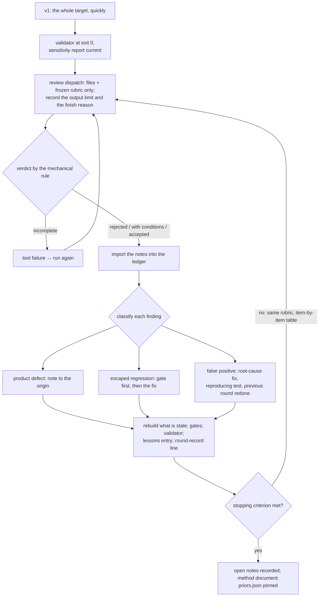

## Before the review

The review only starts after the validator passes on every document and
the sensitivity report is current: reviewing a text that the validator
fails would spend a review round on defects the code already finds.

## The dispatch

The reviewer receives the files and the rubric, never the reasoning of
whoever produced them. The dispatch records the effective output limit of
the executor and the reason its generation ended. A report that ended for
length or lacks a section of the format is a tool failure and produces no
verdict; the review runs again. The reviewer's relation to the producer
is recorded in the round record (`reviewer_relation`), checked on what
each alias or route maps to, not on its name: a second session of the
producing model is `same family, separate session` or `same model,
separate route`, never "independent".

## Importing and classifying

Import the notes into the ledger (the router refuses an unknown target and
deduplicates); only high and blocking return the artifact. Classify each
finding:

- **product defect** — a note to the artifact where it originated;
- **regression that escaped every gate** — first create the gate (which
  has to reject the current version) with its perturbation, then fix; the
  state ledger records the note as `escaped`, and it closes with the
  `gate` it became or a `no_gate` reason;
- **false positive** — fix the instrument's rule at the root, with a test
  that reproduces the case, and redo the previous round to prove that no
  real finding disappeared; never loosen the limit.

Each owner answers note by note: done (where), partial (what is missing),
contested (reason) or out of scope (for whom). A validator note the writer
disputes goes to the verifier, who decides whether it is a false positive.

## Closing the round

The engine recompiles what is stale; the gates run; the validator runs;
the reviewer reviews with the same rubric and makes the item-by-item table
of the previous round. The round's entry goes to `lessons.md` (what it
taught and what became code, contract or gate), and a line goes to
`state/round-record.jsonl`:

```text
{"method_version": "0.6.0", "round": "v2", "kind": "production",
 "models": [{"role": "writer", "model": "family A, high effort"},
            {"role": "reviewer", "model": "family B, high effort"}],
 "reviewer_relation": "another family",
 "rubric_applied": true, "rubric_hash": "<the frozen sha256>", "rubric_author": "owner",
 "family_map_commitment": "<64 hex characters>",
 "summary": "...", "prev": "<sha256 of every line above>"}
```

A production line may carry a `verdict`; a maintenance line may not. The
optional cost fields (per role: `tokens` with `input`, `output`,
`reasoning`, `cached`; `calls`; `finish`) and the round's `wall_seconds`,
`notes_count`, `crew` and `rounds_to_stop` are what the principle asks a
round to measure, so that costs become comparable.

## The stop

Done when the criterion is written in terms of rounds or verdict, the
open notes validate against the contract with their state in the state
ledger, no non-negotiable is among the open notes (an open high or
blocking note that affects one is blocking at the stop unless a decided
owner decision covers it), the lessons have the round's entry, and the
instance is registered and pinned in `priors.json`.

# Domain gates in a cell

The distributed validator measures documents. A target whose
non-negotiables are domain measurements — identity of results, a speedup,
a mass — needs the cell's own code to write them as results the validator
reads, or its exit 0 says nothing about them.

## Declaring the gate

A row `d-<name>` in the cell's gate table, with its magnitude, limit and
justification like any other; an optional Severity column sets the
severity of a `fail` (high by default; a severity below high counts only
for a gate a decided owner decision covers, so a failed identity of
results cannot become a low note by the cell's own column). The artifact
list assigns the gate to the artifacts it measures, and the result's
inputs have to include every file of those artifacts.

## Writing the result

The cell's code measures the gate and writes a result file in the
contract `05-contracts/domain-result.schema.json`:

```text
{
  "contract_version": "1",
  "gate": "d-identity",
  "magnitude": "0 divergent of 38 cases",
  "limit": "0 divergent",
  "result": "pass",
  "inputs": [ { "path": "v2/candidate.bin", "sha256": "<sha256 of that file>" },
              { "path": "oracle/reference.bin", "sha256": "<sha256 of that file>" } ]
}
```

`result` is `pass`, `fail` or `tool-failure`. The sha256 of an input is
that of the file's text read as UTF-8 with LF line breaks (for a binary
file, of its bytes). The layout lists the result files under
`domain-results`.

## What the validator does with it

It recomputes the sha256 of every input; an input changed or missing
makes the result stale (blocking); a result that names no input, or whose
inputs do not include every file of the gate's artifacts, is blocking;
when the limit starts with a comparison and a number or is a bare zero,
the first number of the magnitude is compared and a contradiction is
blocking; `fail` is a note of the row's severity; `tool-failure` or a
result outside the contract is exit 2; a declared `d-*` gate with no
result is pending, which no caller can accept. The validator never runs
the cell's code: a result whose inputs were recomputed by hand after the
candidate changed passes, and the material says so.

## The cell's own sensitivity

The sensitivity test perturbs documents and leaves domain gates out of its
coverage; the sensitivity of a domain gate is the cell's own: mutants of
the implementation, a reference with a known defect, a seeded regression
that has to leave the run red. Experiment E5 is designed around exactly
this (a candidate that breaks identity has to leave the validator at exit
1), and a failing test of the cell is a rejection of its gate, with a note
to the implementation where the defect was born.

# Maintaining the material

For a maintainer of the material itself, or of a cell that carries a copy
of the instrument.

## The order of a change

Editing the validator, the "Gates" section of the gates file, the canon or
the gate map of the artifact table changes a sha the sensitivity report
records. The order that keeps the provenance coherent, as the changelog's
"Round infra" entries record it: the scripts first; then the canon and the
gate section the provenance pins; then the sensitivity report (regenerated
with the owner's document, or with the synthetic prior in a clone); then
the other documents and the validator report; then a round-record line,
chained, with the executors by family and effort.

## Adding a gate or a perturbation

A new gate needs, in the same change: its implementation and its handler
in the family it belongs to; a row in the gate table; its assignment in
the artifact list; its perturbation in `perturbation_set.py` (or the
cell's `perturbations.json`); a test in the suite; its declared semantics
in `06-gate-semantics.md` where a cell of the table is not enough; and a
regenerated sensitivity report. The lesson of v0.6.0 is the rule: when a
correction moves a definition, the place it moves to gets the pin, the
completeness check and the perturbation in the same round, or the
correction is declared incomplete.

## Retiring a gate

The row, the assignment and the perturbation leave together, and the
changelog records "retired gate: `<id>`", the reason and the rounds it
stayed silent (chapter 7).

## Re-freezing the rubric

Only when another review round opens: a new rubric is written by the
reviewing side, frozen through `--re-freeze-rubric` with the reason in
the changelog, and the round record names its author.

## Ledgers and frozen records

A change of state is a new chained line, never an edit; the last line of a
ledger is the one the chain does not yet cover, so append before relying
on it. The records of `90-review/` and the history of the lessons above
the measured heading are never edited; the append-only rule of the lessons
is checked by hand at each round (the old file has to be a prefix of the
new one), and the sweep for forbidden identifiers is run by hand each
round, recorded outside the material.

## Migration notes

Each entry of `CHANGELOG.md` carries a migration note for a cell that
moves to that version. The ones a cell from an older validator meets, in
order:

| To version | A cell has to |
| --- | --- |
| 0.3.0 | re-run `sensitivity.py`, since reports without the provenance header fail `p-sensitivity` by design; name its rubric in the layout (`artifacts.rubric`) |
| 0.4.0 | add `p-efficacy-mark` to the gate map of its layout (else exit 2, "more than one parser"); give its executed priors a `number_format`; give every number it states about a prior a row of its JSON canon's recorded facts; register its own entry in its priors registry; make the card links resolve; regenerate the sensitivity report |
| 0.4.1 | cite an instance inside a marked unit by its full id; give every executed entry a `locator` and a `number_format`, and keep the four fields null on a designed one; cite only executed experiments; name executors by family and effort, model identifiers going to the forbidden list |
| 0.4.2 | replace a copy of the validator from before 0.4.2 (it wrote a bytecode cache); run pytest with `-B -p no:cacheprovider` |
| 0.5.0 | give its artifact records a `gates` list and keep the gate table in step; fill the canon's lists or accept their pending by name; remove placeholders; write cards in bold fields; add `contract_version` to its contracts; give each note a line in the state ledger; copy `sensitivity.py`, write `perturbations.json`, name it in the layout and regenerate the report |
| 0.6.0 | list its Markdown documents outside the artifact list in the canon; give every literal path a file; write its `d-*` gates as result files under `domain-results`; use `[lessons:<title>]` and a provenance table for each cited experiment; freeze its rubric and pass `--notes` (their pending can no longer be accepted); regenerate the report (map, specificity, pairs); copy `perturbation_set.py`; give its non-negotiables ids and keep the owner's decisions in `state/owner-decisions.jsonl`; schedule, dispute or close the open notes older than three rounds; declare `"version": "v1"` in its JSON canon |

## The tests

```bash
python3 02-reflexive-application/80-validator/validator.py --self-test
python3 -B -m pytest -p no:cacheprovider \
    02-reflexive-application/80-validator/test_validator.py \
    skills/cooperatio-teamwork/scripts/test_scaffold.py
```

The suite runs the self-test, one passing and one failing case per rule,
the regression tests of the probes the panels found (a repointed file, a
mark outside its grammar, a number between backticks, a deleted report
accepted by name, a domain regression the validator never read), and the
scaffold's integration test, which asserts that a fresh cell fails high.

## The freeze policy, restated

After 0.6.0 the instrument changes only for a failure that changes a
verdict, or for a new execution. A maintainer who finds a false green adds
a row to the table of false greens, a regression test and, where it is a
defect of a document, a perturbation — and declares the change in the
changelog with its migration note.

# Appendices {- .part}

# Appendix A — Glossary {-}
Condensed from the "Method terms" table of
`02-reflexive-application/01-canon.md`, which is the authoritative
definition of each term.

| Term | Definition |
| --- | --- |
| accepted variant | another spelling of a number or term that the canon admits in a declared place and for a declared reason |
| artifact | an intermediate or final output, typed, with a name, a single owner, paths, a schema, dependencies, gates and content identified by hash; an owner decision is also an artifact |
| artifact graph | the set of artifacts with the dependencies between them; it has to be acyclic |
| assembly engine | the code that composes the artifacts into the target, rejects ambiguity, rebuilds by hash, routes notes and names the outputs by version label |
| brief | the owner's document: what the target is, for whom, what is non-negotiable, what is an owner decision, the round budget |
| canon | the single source of numbers, names, terms to prefer and to avoid, accepted variants and rules, with an owner and a version per section |
| case method document | the document that records, at the end, the ideas, graph, step by step, pseudocode per role with its degree, the owner's pending items and the known false positives of an instance |
| code-conversion degree | how much of a role's work the code does: (a) converted, (b) partial under gate, (c) contract and gate only |
| contract | the schema an artifact has to validate before it is accepted |
| corpus | the facts, materials, standards and references available before the production; read, never edited |
| dispatch | one call of an executor with its inputs, recorded with what the endpoint returned (tokens, the reason the generation ended) |
| domain gate | a gate of the target's domain, named `d-<name>`, measured by the cell's own code and read by the validator from a result file |
| escalated | the state of an artifact that exceeded its maximum rounds: nothing that depends on it runs until the owner decides |
| executor | whoever or whatever exercises a role: a person, code, or a language model of a declared kind |
| experiment | a measurement about the method itself, registered with its question, protocol and predictions written before measuring; `executed`, `pending` or `designed` |
| false negative | a real defect that no instrument reported |
| false positive | a note the instrument emits when there is no defect; an instrument defect until proven otherwise |
| family | the provider and line of models an executor belongs to, named by a stable letter |
| first version | the v1: the whole target, end to end, made quickly to be reviewed, not to be good |
| gate | a measurable function over an artifact that returns pass or fail together with the measured magnitude; with a limit and a written justification |
| gate sensitivity test | injecting a known defect and checking that the gate rejects it, before trusting the gate |
| hand-off sheet | the artifact one role writes for another role to consume |
| independent review | a reading of the product by someone who did not produce it and has no access to the producer's reasoning, with the fixed rubric |
| instance registry | the record of the known instances, each with an id, a status, the path of its method document and the sha256 that pins it |
| instantiation table | the table of fourteen fixed rows that summarizes an instance |
| instrument | anything that measures: gate, validator, reviewer, simulation, benchmark |
| limit | the value that separates pass from fail, with the justification and the origin label next to it |
| magnitude | the measured value the gate returns, never just a sign |
| maintenance round | a round that corrects the material of the method itself after its stopping criterion, outside the reflexive production, with no verdict of the canon |
| maximum rounds | how many returns an artifact accepts before it is escalated to the owner |
| note | the only change request between roles: target artifact, severity, text, origin, evidence, round |
| open note | a note recorded and not resolved when the production stops |
| orchestrator | whoever executes the recipe: passes paths to the roles, runs the engine and imports notes; a step, not a role |
| owner | the person who commissions the target, approves the brief, makes the decisions no role can make and declares the stop |
| position key | the value that fixes where a part of the target lands during assembly; an ambiguous one is a contract error |
| prior instance | an instance of the method that ran before the current one and is registered in the registry |
| production cell | the organization assembled for one target: roles, artifacts, gates, canon, validator, review and assembly engine |
| regression | a defect that comes back or appears in a new version; if it escaped every gate, it gains a gate before it is fixed |
| retired gate | a gate removed deliberately, with its perturbation, because its object is gone or its rule moved into a contract |
| role | a narrow responsibility exercised by an agent, a person or code, which communicates only through artifacts and notes |
| role card | the sheet of a role with seven fixed fields |
| root-cause fix | handling a false positive by fixing the instrument's rule, with a test that reproduces the case, and redoing the previous round |
| round | one pass of the loop: produce, pass the gates, assemble, review, notes |
| rubric | the fixed grid of dimensions, anchors and verdict rule that every independent review uses in every round |
| rubric anchor | the written description of what a score of 1, 3 or 5 means in one rubric dimension |
| runner | the role that runs the validator and routes its notes; it decides nothing beyond the rules the validator executes |
| severity | `low`, `medium`, `high`, `blocking`; only the last two send the artifact back |
| signal gate | a gate that only tests existence or "greater than zero"; it has to gain a magnitude limit |
| source of truth | for each content type, the only source accepted as origin; the writer is never a source of fact |
| stale | the state of an artifact whose input changed since it passed its gates |
| stopping criterion | the condition, declared by the owner before the last round, under which the review becomes a list of open notes |
| target | the final product that the production cell hands over |
| teamwork | the files that set up a production cell for a target; the name of the skill that creates them |
| unit | what a gate reads as one statement: a paragraph, a list item, a table row or a heading |
| validator | a checking instrument, preferably in code, that reads all artifacts against the canon and emits notes on its own |
| verdict | `rejected`, `accepted with conditions`, `accepted` |
| wave | a batch of dispatches run in parallel, whose outputs are read together before the next step |

# Appendix B — The contracts {-}
Six JSON Schemas under `02-reflexive-application/05-contracts/`, each
declaring `contract_version` `1` and rejecting unknown fields. The
validator applies a closed subset of JSON Schema keywords and reports a
contract that uses others.

| Contract | File | Required fields | Optional fields |
| --- | --- | --- | --- |
| Note | `notes.schema.json` | `target_artifact`, `severity` (the four values), `text`, `origin`, `evidence`, `round` (string, or the legacy integer) | `status` (`open`, `fixed`, `disputed`, `out of scope`), `closed_in` |
| State of a note | `notes-status.schema.json` | `ref` (`notes:<n>` or `panel:<version>:<id>`), `status`, `summary` | `closed_in`, `prev`, `escaped`, `gate`, `no_gate`, `decision`, `opened_in`, `due`, `severity`, `affects` |
| Instance registry | `registry.schema.json` | `instances`: a list of entries with `id`, `status` (`executed`, `designed`) | per entry: `document`, `sha256`, `locator`, `number_format` (`point-decimal`, `comma-decimal`), `heading_style` (`section`, `subsection`, `step`), `method_version`; an executed entry carries the first four non-null, a designed one keeps them null |
| Round record | `round-record.schema.json` | `method_version`, `round`, `models` (a list of `role`, `model`, with optional `tokens` of `input`, `output`, `reasoning`, `cached`; `calls`; `finish`), `summary` | `verdict`, `rubric_hash`, `rubric_author`, `family_map_commitment`, `prev`, `kind` (`production`, `maintenance`), `reviewer_relation` (`another family`, `same family, separate session`, `same model, separate route`, `none`), `rubric_applied`, `rounds_to_stop`, `wall_seconds`, `notes_count`, `crew` |
| Domain result | `domain-result.schema.json` | `contract_version`, `gate`, `magnitude`, `limit`, `result` (`pass`, `fail`, `tool-failure`), `inputs` (a list of `path`, `sha256`) | — |
| Owner decisions | `owner-decisions.schema.json` | `name`, `status` (`open`, `decided`), `blocks`, `version`, `summary` | `covers`, `prev` |

The scaffold writes a seventh, `02-canon.schema.json`, the contract of a
cell's JSON canon, and copies the first five except the registry's (a
cell's `priors.json` follows the same contract, enforced by the validator).

# Appendix C — Command-line reference {-}
## `validator.py`

| Option | Meaning |
| --- | --- |
| `--folder FOLDER` | the production folder (default `.`) |
| `--layout LAYOUT` | a `layout.json` that remaps artifacts to paths and gates to parsers; default is the Markdown layout of the corpus |
| `--registry REGISTRY` | the instance registry; default `../instances/registry.json` relative to the folder, when present; without a registry `p-prior` is pending |
| `--case CASE` | a prior method document, repeatable; each is identified by its sha256 against the registry |
| `--forbidden FORBIDDEN` | the list of forbidden identifiers, one per line (names or `sha256:<hex>`); without it that half of `p-anonymity` is pending |
| `--rubric-hash FILE` | the file with the frozen sha256 of the rubric |
| `--freeze-rubric FILE` | write the current sha256 of the rubric to the file and exit; refuses an existing pin (the scaffold's `not-frozen` placeholder excepted) |
| `--re-freeze-rubric FILE` | replace an existing frozen rubric deliberately; mutually exclusive with the previous |
| `--notes NOTES` | the note ledger to validate against the contract, with its state ledger |
| `--output FILE` | write the report to the file; one summary line goes to the error stream |
| `--determinism` | run twice more with different hash seeds (and the C locale) and compare the reports |
| `--allow-pending LIST` | the gates whose pending rows the caller accepts, comma-separated, from the closed list `p-anonymity`, `p-prior`, `p-prior-pin`, `p-sensitivity-synthetic` |
| `--self-test` | run the embedded checks and exit |

Exit codes: 0, 1, 2, 4 (chapter 12).

## `sensitivity.py`

| Option | Meaning |
| --- | --- |
| `--folder FOLDER` | the production folder to copy and perturb |
| `--case CASE` | as in the validator, repeatable; without any, the rows that need a prior are not measured |
| `--forbidden FORBIDDEN` | the list of forbidden identifiers |
| `--registry REGISTRY` | the instance registry |
| `--rubric-hash FILE` | forwarded to the validator; without it the `p-frozen-rubric` row is not measured |
| `--notes NOTES` | forwarded; without it the `p-notes` row is not measured |
| `--work WORK` | the scratch folder for the copies (default: a temporary folder) |
| `--output FILE` | where the report is written (default: the layout key `artifacts.sensitivity`) |
| `--synthetic-prior ID` | an executed prior whose method document you do not have: a synthetic document is generated from the canon's recorded facts and pinned in the copies only |
| `--layout LAYOUT` | the cell's `layout.json`, which also names the cell's perturbation file |

An empty perturbation set exits 4; a gate the validator does not implement
in the set is a tool failure (exit 2).

## `scaffold.py`

| Option | Meaning |
| --- | --- |
| `--target TARGET` | the name of the target (required) |
| `--roles ROLE [ROLE ...]` | role ids, lowercase letters, digits and hyphens (required) |
| `--out OUT` | the destination folder (required); the scaffold refuses to overwrite |

Run from inside the material, so that it finds the validator, the
sensitivity script, the perturbation module and the contracts to copy.

## The historical validator of instance 004

`instances/004-adoption-guide/08-validator/validator.py` is the instrument
of 0.2.2 and refuses to run without `--historical`, since its exit 0 does
not mean what the current validator's does.

# Appendix D — The false greens of the gates {-}
From the table of `06-gate-semantics.md`, "The false greens of the gates":
for each gate, the cause of a false green found so far, what detects it
today, and the perturbation that covers it. The causes are the ones found,
not an exhaustive list.

| Gate | Cause of a false green | Current detection | Perturbation that covers it |
| --- | --- | --- | --- |
| `p-terms` | a synonym written in a way the lexical match does not see | the canon's list and whole-word matching; the review reads the prose | avoid-word in the changelog |
| `p-canon-link` | a link that names the canon from the wrong folder | the target resolved relative to the document's folder | link to the canon does not resolve |
| `p-anonymity` | a path, a date or an identifier in a form the patterns do not know, or hidden by the valve | the patterns, the months of six languages and the canon's own, the forbidden list by name or sha256; an accepted path dropped only by equality | date written with the month's name |
| `p-form` | an HTML tag or comment hidden in a block the reader skips | one reader of fences, comments read | HTML comment |
| `p-size` | a document pushed past its range, or words counted wrong | the declared ranges; table pipes are no words | canon pushed above its size range |
| `p-table` | an instantiation table missing a row | the canon's fixed list of rows | instantiation table row deleted |
| `p-sections` | an instance missing a mandatory section | the canon's fixed list of sections | mandatory section heading removed |
| `p-card` | a card with a field empty, deleted or a placeholder | the seven fields, the placeholder detector | placeholder in a card field |
| `p-limit` | a justification of six words of any kind, or a limit raised in the table | the origin label and the word count; the Limit column compared | limit raised in the gate table |
| `p-references` | a reference to a role, an artifact or a gate that does not exist | the artifact table, the graph without cycles, the commands resolved | limit cell diverges from the applied limit |
| `p-prior` | an invented number about a prior: in a code span, under a malformed mark, in a section the reader does not find | each number checked in the sections its recorded fact cites; section commitments; the synthetic prior in the registry's heading style | prior number in a code span |
| `p-prior-mark` | a statement about a prior with no mark, or the mark in a code span | the canon's triggers, read outside code spans | prior mark inside a code span |
| `p-prior-pin` | a prior document swapped or edited, or a pin no run compares | the registry's sha256 compared with each document passed, prior by prior | prior pin altered in the registry |
| `p-contract-shape` | a ledger line rewritten, a contract of another version, a registry entry that breaks its status | the schemas line by line, the hash chain (an edit that recomputes it is not detected) | old line of the round record edited |
| `p-recipe` | a step of the recipe without one of its fields | the canon's step fields | step field deleted |
| `p-components` | a component the principle names and an instance omits | the canon's list | method component omitted |
| `p-efficacy-mark` | a claim that the method works without a label, or with a label citing nothing executed | the canon's triggers (lexical), the provenance table of an experiment, a lessons title that resolves | claim backed by a designed experiment |
| `p-notes` | a note without a state, a regression closed with a gate that does not exist, a protection undone by a later line | the state ledger, golden rule 4 against the gate table, the highest severity and the union of `affects` | note without a status line |
| `p-frozen-rubric` | a rubric or a frozen record rewritten after the fact | the sha256 of the rubric and of each frozen record; the attestation in the owner's run | frozen review report rewritten |
| `p-sensitivity` | a report the instrument did not produce, a stale one, or one made without the owner's document read as made with it | the provenance header, the case lines against the pins, the attestation, a synthetic prior never a pass | none: the baseline reads the report; its defects are regression tests |
| `p-declared` | a declared path that matches nothing, a repointed file, a document no artifact declares | each literal path and each glob, the resolved map pinned in the sensitivity's provenance | file of an artifact repointed |

# Appendix E — File index of the material {-}
The 79 files the material tracks at 0.6.0, grouped.

| Path | Contents |
| --- | --- |
| `README.md`, `VERSION`, `CHANGELOG.md`, `LICENSE`, `.gitattributes`, `.gitignore` | the entry page, the version, the history, the license, the LF rule, the ignore list |
| `01-principle.md` | the method |
| `02-reflexive-application/README.md` | the index and the runbook of the reflexive application |
| `02-reflexive-application/00-brief.md` … `06-gate-semantics.md` | brief, canon, artifacts, four role cards, gates and rubric, gate semantics |
| `02-reflexive-application/05-contracts/*.schema.json` | the six contracts |
| `02-reflexive-application/10-generic-recipe.md` | the fifteen steps |
| `02-reflexive-application/20-instance-car.md`, `21-instance-text-2027.md`, `22-instance-hpc.md` | the three designed instances |
| `02-reflexive-application/60-experiments.md` | E1 to E5 |
| `02-reflexive-application/80-validator/validator.py`, `sensitivity.py`, `perturbation_set.py`, `test_validator.py` | the instrument and its suite |
| `02-reflexive-application/80-validator/report.md`, `sensitivity.md` | the published reports |
| `02-reflexive-application/90-review/rubric.sha256`, `auditor-report.md`, `auditor-notes.json`, `notes.json`, `replies.md` | the frozen records of round 1 |
| `02-reflexive-application/99-lessons.md` | the lessons, one entry per round |
| `02-reflexive-application/state/round-record.jsonl`, `notes-status.jsonl`, `owner-decisions.jsonl` | the three chained ledgers |
| `skills/cooperatio-teamwork/SKILL.md`, `references/templates.md`, `references/review-checklist.md`, `scripts/scaffold.py`, `scripts/test_scaffold.py` | the skill |
| `instances/registry.json` | the instance registry |
| `instances/004-adoption-guide/` | the cell of the second executed instance: brief, sources of truth, JSON canon, artifacts, four cards, two contracts, gates, rubric and pin, the validator of 0.2.2 with its rules and reports, the engine's README, the two wave reports and the round-1 notes, the state ledgers, lessons, open notes, priors, layout, the guide (`guia-de-adocao.md`), the method document (`metodo-de-producao.md`) and `ERRATA.md` |
| `docs/manual/` | this manual: `src/`, `diagrams/`, `filters/`, `Makefile`, the built `manual.md`, `manual.pdf` and `build/manual.tex` |

# Appendix F — Open owner decisions {-}
The lines of `02-reflexive-application/state/owner-decisions.jsonl` at
0.6.0, all `open`; each names what it blocks. Only the owner can close
one, with a new chained line.

| Decision | What it blocks |
| --- | --- |
| sign the tag of the version (create a signing key and sign `v0.6.0`) | the anchor of integrity outside the tree |
| publish an extract of the first prior, or not | a clone's check of the numbers about `000-av-production` |
| accept or adjust the thresholds to promote or withdraw a claim | experiment E4 |
| approve the budget and run E4 | the measure of value of the material |
| find the third party for E5 | the measure of portability |
| promote independence across families to a rule | the rule of independence |
| open the next production of the material as a production, with its own brief, a rubric of the reviewing side and a stop | a new verdict of the canon on the material |
| replace the cell of 004 as the example (a new cell under 0.6.0 would be the third execution) | an executable example of a cell |

# Appendix G — Building this manual {-}
The manual lives in `docs/manual/`:

| Path | What it is |
| --- | --- |
| `src/*.md` | the source, one file per part, concatenated in order |
| `diagrams/*.dot` | the Graphviz twin of each Mermaid diagram; rendered to `.svg` and `.pdf` |
| `filters/mermaid.lua` | the pandoc filter that swaps a Mermaid block for its twin's PDF in the PDF build |
| `filters/header.tex` | the LaTeX preamble additions (fonts, shaded code blocks, table spacing) |
| `Makefile` | the build |
| `manual.md` | the concatenated Markdown, for viewers that render Mermaid |
| `build/manual.tex`, `manual.pdf` | the LaTeX and the PDF editions |

Each Mermaid block opens with two Mermaid comments, `%% name:` (the twin
under `diagrams/`) and `%% caption:`, which the filter reads; a Markdown
viewer ignores them. The build needs pandoc 3 or later, Graphviz and
LuaLaTeX with the TeX Gyre fonts (TeX Live 2025 was used); no Mermaid
renderer is needed:

```bash
cd docs/manual
make            # manual.md, the diagrams, build/manual.tex, manual.pdf
make check      # margin overflow check of the PDF, where the local tool exists
```

The manual follows the form rules of the material where it can: no
absolute path, machine name, user name, model identifier or authoring
date; executors by family letter; claims of efficacy with their label.
