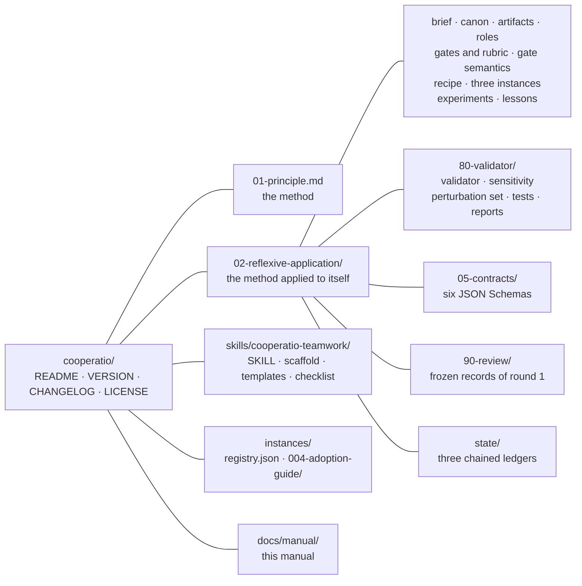

# Part I — Purpose and scope {- .part}

# What cooperatio is

## The problem it addresses

A complex target — a vehicle, a book, a software library, a long document
— is produced today by teams in which people, language models and code
all take part. The failure modes of such a team are familiar: one very
capable agent does everything and checks its own work; a request is
mistaken for a result ("I asked for medium quality, so it is medium
quality"); the same number is stated three ways in three places; a reviewer
invents a new grid every round, so nobody can say whether version 4 is
better than version 3; an error that was found once comes back because
nothing was built to detect it; and the work never ends, because every
review finds something.

Cooperatio is a method that answers each of these with a named component
and a rule, and a material that applies the method to itself so that the
rules can be measured rather than trusted.

## The idea in one sentence

The principle (`01-principle.md`, section 1) states it thus:

> Producing a complex artifact is compiling a graph of typed artifacts,
> each with an owner, a contract and a gate, in which separate roles
> communicate only through artifacts and notes, quality is measured by what
> the system delivered and not by what was asked for, each review is made by
> someone who did not produce, with a rubric frozen before it, so that
> rounds are comparable, and every error that escapes becomes a new gate,
> until a declared stopping criterion.

Put another way: it replaces "one very capable agent does everything" with
"a small organization, with explicit contracts, in which intelligence is raw
material and code is the glue that composes, checks and remembers".

The organization assembled for one target is a **production cell**. Its
parts are typed **artifacts** (files with one **owner**, a **contract**,
dependencies and **gates**), narrow **roles** described by **role cards**,
a **canon** that is the single source of numbers and terms, a
**validator** that reads every artifact against the canon, an
**independent review** with a **rubric** frozen by hash, **notes** as the
only change request between roles, and a **stopping criterion** declared
by the owner before the last round.

## What the material distributes

The material is a folder under version control. At version 0.6.0 it holds:

| Part | Path | What it is for |
| --- | --- | --- |
| The principle | `01-principle.md` | the method: idea, scheme, eleven components, ten golden rules, what changes by domain, the recipe in twelve steps, warning signs, limits, what would promote or withdraw a claim, ontological assumptions |
| The reflexive application | `02-reflexive-application/` | the method applied to itself: a brief, a canon, an artifact graph, four role cards, a gate table with a frozen rubric, a generic recipe in fifteen steps, three designed instances, the experiments about the method, the review of its first round, the lessons of every round, and the instrument |
| The instrument | `02-reflexive-application/80-validator/` | `validator.py` (the gates and the self-test), `sensitivity.py` (the gate on the gates), `perturbation_set.py` (the known defects), `test_validator.py` (the pytest suite), and the two published reports |
| The contracts | `02-reflexive-application/05-contracts/` | six JSON Schemas: note, state of a note, instance registry, round record, domain result, owner decision |
| The skill | `skills/cooperatio-teamwork/` | an agent skill that creates the teamwork files for a target, with a scaffold script, templates and a review checklist |
| The instances | `instances/` | `registry.json`, the record of the known instances pinned by sha256, and `004-adoption-guide/`, the cell of the second executed instance, distributed as a record |
| The owner records | `VERSION`, `CHANGELOG.md`, `LICENSE`, `.gitattributes` | the version of the method, its history with a migration note per version, the Apache License 2.0, and the rule that every text file checks out with LF line breaks |

## Who it is for

The brief of the reflexive application (`02-reflexive-application/00-brief.md`)
names two readers: whoever is going to instantiate the method on a new
target without having followed the first instance, and an orchestrator
agent that receives the recipe as an instruction. Both have to be able to
execute without asking what a term means — which is why the canon exists
and why every document links to it.

The method is for a team, not for a single executor. With a single agent
playing every role the separation is weak: it writes the rubric that will
judge it. The material says so in its limits (`01-principle.md`, section 9)
and in the skill: where there is only one agent, at least the rubric and the
review have to come from outside the producing run.

## The status of the evidence

The material calls itself a working hypothesis and says exactly what that
covers. The reader of this manual should carry three facts throughout:

1. **Two executed instances, both documentary, both by the same owner.**
   Instance `000-av-production`, an audiovisual production method held by
   the owner and not distributable, from which the method was generalized;
   and instance `004-adoption-guide`, the adoption guide of the method
   itself, whose cell is distributed under `instances/` and whose method
   document is pinned by sha256. The three other instances in the registry
   (a car, a book about 2027, an HPC library) are designed sketches, not
   executions.
2. **One part of the scheme has never been exercised: the recompilation by
   hash.** In neither execution did an engine rebuild a stale artifact from
   the hash of its inputs; the validator resolves the command an artifact
   declares against the paths it names and does not run it.
3. **Efficacy is one-armed.** Everything the method found, it found under
   the method; no production of the same target ran without the gates, so
   there is no escape rate to compare. The counterfactual is experiment E2,
   designed and not run; the cheaper seeded-escape design is E4, designed
   and awaiting the owner's budget (chapter 10).

The principle keeps a table, written before any data, of what would promote
each kind of claim to a result and what would withdraw it (section 9,
"What would promote or withdraw a claim"); the manual reproduces it in
chapter 10.

# When to use it, and when not

## The four conditions

The method holds where the target has (`01-principle.md`, opening):

- **(a)** a brief that an owner can declare, with a stopping criterion;
- **(b)** a discrete artifact, assemblable from intermediate parts;
- **(c)** sources of truth separable per content type;
- **(d)** dependencies between those parts that can be kept acyclic.

The ontological assumptions behind the four (section 10 of the principle)
tell which kinds of target fall outside:

| Assumption | A target that violates it | What happens |
| --- | --- | --- |
| the target is a discrete, assemblable artifact with a done moment | a continuous process or an ongoing service | the stopping criterion would be a fiction; a service is run, not compiled |
| the target decomposes into parts with acyclic dependencies | an exploratory target, whose next question is decided by the last result | it is a loop, not a graph; the method degrades to peer review with a rubric |
| quality is measurable by instruments that do not include the producer | a target where only taste decides | every gate becomes a contract and the independent review is the only instrument |
| the knowledge the target needs exists, or is produced by declared roles | an emergent target, whose content exists only after the audience reacts | its canon would be written after the fact, which is not a canon |

## Four situations that cost something

Inside the four conditions, the principle declares four recurring
situations where the method still runs but loses part of what it promises
(section 9, "When the method fits, and what each gap costs"). The table is
a declaration of scope written before any of the cases was measured
`[hypothesis]`:

| Situation | What is lost | What it costs to run anyway |
| --- | --- | --- |
| a single provider of models (every role from one family) | independence of family between producer and reviewer; what stays is independence of session and of reasoning, and the frozen rubric | record the relation in the round record (`reviewer_relation`), and get the rubric, or a reading review, from outside the run |
| a target without a registered prior | the facts about a prior that `p-prior` checks, and a recipe already executed once | the canon starts empty of recorded facts, and the first execution becomes a prior; budget an extra round for the gates that do not fit |
| a short target (a page, a note) | proportion: the cost per round is fixed and the target is small | below a few pages the method is dead weight; a checklist and one review cost less |
| a target without an instrument of its domain | the domain gates: only the documentary gates run, so the method degrades to a review with a rubric | the owner writes the domain instrument first, or declares in the brief which non-negotiable no gate measures, and the verdict says so |

## What it costs

Per round: one production, one independent review and the maintenance of
the instruments. The only costs measured so far are those of review runs,
in experiments E1 and E3 of `02-reflexive-application/60-experiments.md`:

| Experiment | Executor | Input tokens | Output tokens | Wall time |
| --- | --- | --- | --- | --- |
| E1 (with the rubric) | X, the producer's family | about 58,000 (most of them the prior's method document) | 55,000 to 66,000, 90 to 98 % of them reasoning | 8 to 10 minutes |
| E1 | Y, another family | not separable per call | not separable | about 4 minutes, indicative |
| E3 (without the rubric and the card) | X | about 56,000 | 41,000 to 46,000 | 10 to 13 minutes |
| E3 | Y | not separable | not separable | about 4 minutes, indicative |

The material is careful about these numbers: minutes taken in two sessions
of different throughput are not comparable, so the measure is the tokens of
each call, and a wall time is reported only beside the throughput of the
same run. The cost of a production round and of the instruments has not
been measured.

The method pays off when being wrong is expensive `[hypothesis]`; stated as
a condition still unmeasured, the probability of an error times its cost
has to exceed the cost per round times the rounds until the stop. For a
throwaway draft the recipe prescribes only steps 1, 3 and 11 (brief, canon,
one version and a read from outside).

## What already exists, and what this adds

The method borrows from established practice and says so, so that a reader
can tell the vocabulary from the claim (`01-principle.md`, section 9):

| Here | Established practice | What this adds, if anything |
| --- | --- | --- |
| artifact graph, rebuild by hash | build systems | the graph is of documents and decisions too, and an owner decision is a node |
| gate with magnitude and limit | quality gates of continuous integration; acceptance criteria | the limit carries its justification and origin label, and a gate counts only after its perturbation |
| gate sensitivity test | mutation testing; fault injection | a condition of every gate, recorded with its provenance; a noisy perturbation fails |
| frozen rubric, mechanical verdict | review checklists; scoring rubrics | frozen by hash before the review, so two rounds are comparable |
| notes routed to their origin | issue trackers; defect triage | a note aims at the artifact where the defect was born; an escaped regression becomes a gate or a reason |
| role cards | RACI matrices; job descriptions | the "does not decide" field, and the code-conversion degree per role |
| failure analysis per gate | FMEA | done for the validator's gates, for one failure mode, the false green (chapter 13) |

# The material at a glance

## Where to start

The root `README.md` gives three entry points:

- to understand the method, read `01-principle.md`;
- to apply it to a new target, read
  `02-reflexive-application/10-generic-recipe.md`; the three instances
  there show what an artifact, a gate and a rubric are in each domain;
- to have an agent create the files, install the skill in
  `skills/cooperatio-teamwork/` and ask it to set up teamwork for the
  target.

Its "ten-minute path" is reproduced, with the commands verified, in
chapter 17.

## What an adopter carries, and what is research

The material separates the two. The fixed cost of a cell is the set of
files the scaffold writes (24 with two roles; chapter 17 lists them), among
them the instrument it copies: three Python scripts the adopter runs and
does not have to read, about 5,700 lines at version 0.6.0 (`validator.py`
4,859, `sensitivity.py` 550, `perturbation_set.py` 333, measured by line
count), plus one review per round. The history that matters to an adopter
is the "Migration note" of each version in `CHANGELOG.md`; the rest of the
changelog — the panels, the probes, the reworks — is the research.

## Requirements

- Python 3.9 or later, standard library only, for the three scripts (they
  exit 2 below it; an interpreter older than 3.7 refuses the file before
  any line runs).
- `pytest` for the test suites, which are run with `python3 -B -m pytest
  -p no:cacheprovider` so that no bytecode cache lands in the material.
- A checkout with LF line breaks: `.gitattributes` enforces `* text eol=lf`,
  and every sha256 the instrument computes is taken over the text read as
  UTF-8, byte-order mark dropped, line breaks as LF, so a CRLF checkout
  keeps the pins.

## Versioning and the freeze policy

`VERSION` holds the semantic version of the method; `CHANGELOG.md` has one
entry per version, with a migration note. The round record
(`02-reflexive-application/state/round-record.jsonl`) has one line per
round, naming the executor of each role by **family** letter and effort,
never by model identifier.

After 0.6.0 the instrument is frozen: the validator, the sensitivity test
and the scaffold change only for a failure that changes a verdict, or for a
new execution. The next budget goes to measuring value (experiment E4) and
portability (an execution outside the documentary domain by someone who is
not the owner, experiment E5), not to more instrument.

## License

Apache License 2.0; the full text is in `LICENSE`.
