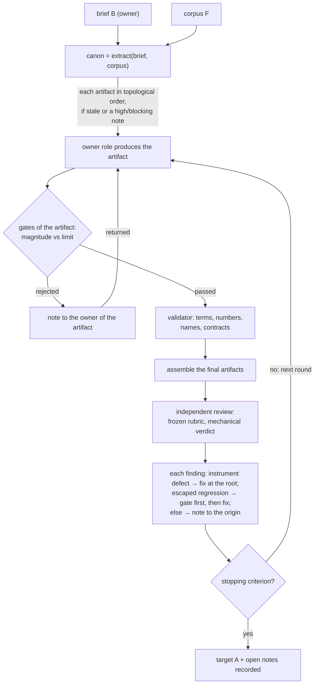
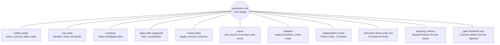
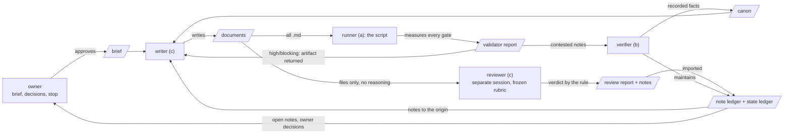
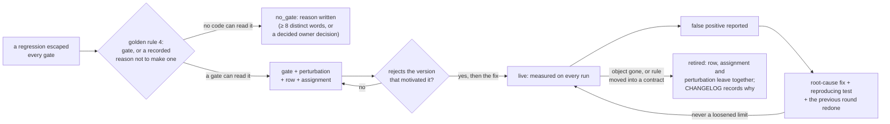
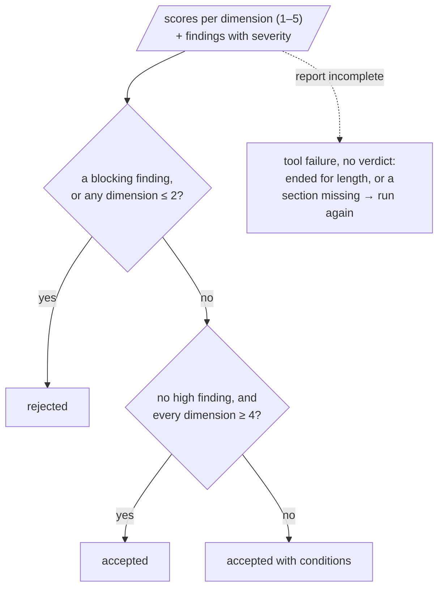

# Part II — The method {- .part}

# The scheme and the loop

## The scheme

The principle writes the method as a scheme — a naming of the parts and of
the loop, not a formula with a testable property (`01-principle.md`,
section 3). Let `A` be the target, `B` the brief and `F` the corpus:

```text
A = Compile( Graph( Roles, Artifacts, Gates ), B, F )  until  Stop

where:
  Artifact   = (name, owner, schema, dependencies, paths, gates, hash)
  Role       = (responsibility, inputs, outputs, decides, does not decide,
                exit gate, notes it emits, code-conversion degree)
  Gate       = measurable function over an artifact that returns pass/reject
               with the magnitude measured, never only a signal
  Note       = (target_artifact, severity, text, origin, evidence, round)
  Canon      = single source of numbers, names, terms and decisions, with a
                version per section and an owner per section
  Review     = independent reading of the product with a fixed rubric,
               comparable between rounds, that returns notes and a verdict
  Stop       = criterion declared by the owner before the last round
```

## The loop

```text
compile(graph, brief, corpus):
    canon ← extract(brief, corpus)                  # numbers, terms, names, rules
    repeat:
        for each artifact in topological order:
            if inputs changed (hash) or there is a high/blocking note against it:
                output ← owner_role.produce(inputs, canon, open_notes)
                for each gate of the artifact:
                    measure ← gate(output)          # magnitude, not only a signal
                    if rejected: note(artifact, severity, measure) ; return to owner
                validator.check(output, canon)  # terms, numbers, names, assets
        product ← assemble(final artifacts)
        review ← independent_reviewer(product, fixed_rubric)
        for each finding of the review:
            if it is an instrument defect (false positive): fix the instrument at the root
            if it is a regression that no gate caught: create the gate, then fix
            otherwise: note to the originating artifact
        if stopping_criterion: record open notes and exit
    until stop
```



Three features of the loop decide most of what follows in this manual:

- **Only what is stale is rebuilt.** An artifact is **stale** when the hash
  of an input changed since it passed its gates, or when a high or blocking
  note targets it. This is the design; as said in chapter 1, no execution
  has yet exercised an engine that rebuilds by hash.
- **A gate rejects with a magnitude.** The note it emits carries the
  measure, not a sign, so the owner of the artifact knows how far from the
  limit the output landed.
- **Each finding of the review has exactly three destinations.** Instrument
  defect, escaped regression, or product defect. The first fixes the
  instrument at the root; the second creates a gate *before* the fix; the
  third is a note to the artifact where the defect was born.

## The orchestrator

The orchestrator is whoever executes the recipe: it passes paths (never
summaries) to the roles, runs the engine and imports the notes. It is a
**step, not a role**: it decides nothing that a card assigns to a role or
to the owner (`10-generic-recipe.md`, "The orchestrator in pseudocode").

# The eleven components

The principle names eleven components that do not change from one domain
to another (section 4; section 6 says what does change). The last column
is the error each one prevents, with the example the material gives.



| Component | What it is | The error it prevents (example) |
| --- | --- | --- |
| **Artifact graph** | each intermediate output is a typed file with an owner, schema, dependencies and hash; the core recompiles only what changed | work redone for nothing and, worse, work *not* redone when the input changed |
| **Role cards** | each role has a card: what it decides, what it does not decide, inputs, outputs, exit gate, notes it emits | one role compensating for the defect of another; the "does not decide" field returns the defect to its owner as a note |
| **Contracts (schemas)** | every artifact validates against a schema before being accepted; the schema refuses what is ambiguous | an ambiguous position key in a hand-off sheet; an unknown field accepted at assembly instead of at validation |
| **Gates with magnitude** | a gate returns the measure, and the limit is declared with a justification; "greater than zero" lets a broken instrument pass | an offset measured against a reference that was itself wrong |
| **Routed notes** | a change request only by note, with target, severity, evidence and round; only high and blocking return the artifact; deduplication by hash | loose conversation between roles, a lost request, the same note three times |
| **Canon** | single source of numbers, names, terms to avoid, accepted variants, rules; each section with an owner and a version | a figure stated one way in one section and differently in another |
| **Validator** | a verifier that reads all artifacts against the canon and emits notes by itself | an old version of an asset cited by the canon while the sections used the new one |
| **Independent review with a fixed rubric** | another agent, with no access to the producers' reasoning, measures the product with the same grid each round; three verdicts | the team approving its own work; rounds that cannot be compared |
| **Instrument fixed at the root** | a false positive becomes a fix to the rule, with a test that reproduces the case, and the previous round is redone | `[hypothesis]`: no recorded execution in the material measures the cost of an instrument fixed downstream |
| **Stopping criterion** | the owner declares when to stop: the review of the last version becomes a list of open notes, not a new version | endless rounds |
| **Gate sensitivity test** | before trusting a gate, inject a known defect and check that it rejects | a gate that checked numbers while the non-negotiable was about statements; the sensitivity test found a validator that read line by line and missed numbers in broken sentences |

What changes by domain is: which roles there are, which artifacts, what
each gate measures, what the review rubric is, which sources of truth
exist for each type of content, and what code-conversion degree the domain
already allows. The principle's table of three instantiations (car, text,
HPC) calibrates what an "artifact", a "gate" and a "rubric" are in each; the
manual summarizes the three designed instances in chapter 16.

# Roles, artifacts and notes

## Roles and role cards

A **role** is a narrow responsibility exercised by an agent, a person or
code, which communicates with other roles only through artifacts and
notes. A role that neither emits notes nor has a gate is a step, not a
role.

Every role has a **role card** with seven fixed fields, which the gate
`p-card` reads as bold labels:

| Field | What goes there |
| --- | --- |
| **Decides** | what the role settles alone |
| **Does not decide** | the neighboring decisions the role would be tempted to make, and whose they are |
| **Inputs** | the artifacts it reads |
| **Outputs** | the artifacts it writes |
| **Exit gate** | the gates its output has to pass |
| **Notes it emits** | the typical target and severity |
| **Code-conversion degree** | how much of the work the code does, and the executor of the role |

The **code-conversion degree** has three values: (a) converted, the code
does it and a person or a model decides exceptions; (b) partial under
gate, the code does or measures a part; (c) contract and gate only, the
role is exercised by an agent or a person and the code only validates the
output. The degree is explicit per role and is expected to rise over time.

The reflexive application has four roles (`02-reflexive-application/03-roles/`):

| Role | Mission | Degree | Executor |
| --- | --- | --- | --- |
| writer | turn the principle into documents an agent can execute; fill the instances | (c) | a language model |
| verifier | check facts about the priors; maintain the instrument; decide false positives; own the note ledgers | (b) | code for the number checks and the contracts, judgment for the false positives |
| runner | run the validator and route its notes; decide nothing beyond the rules it executes (named "validator" until v0.6.0) | (a) | the script `validator.py` |
| reviewer | read the whole product with the frozen rubric; return scores, findings and a verdict by the mechanical rule | (c) | an executor that did not take part, in a separate session, ideally of another family |



## Executors and families

Separating roles makes it possible to give each role a different executor:
a person, code, or a language model of a chosen kind. The principle
(section 2, "Using several models across the roles") gives the rules:

- **Capability follows the role.** A mechanical, fully specified role takes
  a fast, inexpensive model; a role that designs or weighs hard trade-offs
  takes the strongest available. The gate, not the model's confidence,
  decides whether the output is accepted.
- **Independence across families is recommended, not required**
  `[hypothesis]`. The review is best run on a model of another family than
  the producer's; the cost is a second provider. It is a recommendation
  because the one datum is against it as a rule: in experiment E1 the
  producer's own model, in another session, caught 2 of 2 injected
  defects, as the model of another family did (`[against:E1]`). What a
  pilot did show is the part a team can adopt without a second provider: a
  frozen rubric with a mechanical verdict rule turned a finding into a
  verdict (`[experiment:E3]`).
- **Code is not a model.** Whatever a gate can measure is measured by code,
  identically whichever model produced the artifact.
- **Contracts make models swappable.** Replacing the model behind a role
  must not change any other file; if it does, the contract is too loose.
- **The assignment is auditable, and anonymous.** The round record names
  the executor of each role by **family** — a letter kept stable across the
  material — and by effort, never by model identifier. The map from letter
  to family stays with the owner, outside the material, and since the
  rework of v0.6.0 each chained line of the round record carries a salted
  commitment to that map (chapter 15). A route or an alias is not a
  family: whether two executors differ is checked on what each name maps
  to, never on the name.

The round record also states, line by line, the reviewer's relation to the
producer (`reviewer_relation`: `another family`, `same family, separate
session`, `same model, separate route`, or `none`), so the recommendation
can be checked against what was done.

## Artifacts

An **artifact** is an intermediate or final output, typed, with a name, a
single owner, paths, a schema, dependencies, gates and content identified
by hash. An owner decision is also an artifact: it has a name, it is
recorded as an open item for the owner, and the graph knows what depends on
it (golden rule 7).

The record of an artifact, in the JSON form a cell uses
(`03-artifacts.json`):

```text
{ "name": "...", "owner": "ROLE", "paths": ["..."], "depends_on": ["..."],
  "schema": "05-contracts/....schema.json" or null, "command": "..." or null,
  "gates": ["..."], "resource": "code" | "agent" | "human" | "machine",
  "proposed": false }
```

Three rules about the record matter to the validator:

- the `gates` list is the **one source of the map from gate to artifact**:
  the validator runs each gate on the files of the artifacts that list it,
  and the gate table has to mirror that assignment (chapter 13);
- `paths` may carry globs, and since v0.6.0 each literal path has to exist
  and each glob has to match at least once (`p-declared`);
- `command`, when present, is resolved against the folder: every path it
  names has to exist, and the command is never run. Paths and commands may
  carry `{version}`, which takes the layout's `version-label`.

The **artifact graph** is the set of artifacts with the dependencies between
them; it has to be acyclic, and the validator checks that on every pass
(`p-references`). "Depends on" means: the artifact reads that input and
becomes stale when it changes. A note is not a dependency.

## Notes

A **note** is the only change request between roles. It has six fields,
all required (`05-contracts/notes.schema.json`):

```text
{ "target_artifact": "name in the graph", "severity": "low|medium|high|blocking",
  "text": "what is wrong and what is expected", "origin": "role or instrument",
  "evidence": "file, excerpt, measurement", "round": N }
```

**Severity** has four values. Only `high` and `blocking` send the artifact
back to its owner; `low` and `medium` accumulate as debt that the stop
records. A note aims at the artifact where the defect was born, not where
it was seen; the note router refuses a target the graph does not know and
deduplicates by identity (target, severity, text, origin, evidence).

An **open note** is a note recorded and not resolved when the production
stops: written debt, not forgotten debt (golden rule 10). Since v0.6.0 the
state of a note lives in a ledger of its own, append-only and chained
(chapter 15).

## Sources of truth and the canon

Every type of content has one declared **source of truth**, and it is never
the writer (golden rule 2): a fact comes from the corpus or its primary
source; a number comes from the canon or from the instrument that measured
it; exact text comes from the original. The inventory is a table with
content type, the source that errs least, who consults it and what is
forbidden as a source (`01-sources-of-truth.md` in a cell).

The **canon** is the single source of numbers, names, terms to prefer and
to avoid, accepted variants and rules, with an owner and a version per
section. In the reflexive application it is a Markdown page whose tables
the validator reads directly (`01-canon.md`); in a cell it is a JSON file
(`02-canon.json`) with the lists the validator consumes. Everything that
two roles could write differently goes into it. The canon is itself an
artifact: it has an owner, a version and dependents, and the validator
reads it on every pass.

A **contract** is the schema an artifact has to validate before it is
accepted; it rejects the ambiguous before the expensive work (golden
rule 5). The material's own contracts are listed in appendix B.

# Gates, limits and the sensitivity test

## What a gate is

A **gate** is a measurable function over an artifact that returns pass or
fail together with the measured **magnitude**. It has a **limit** and a
written justification, and the justification starts with an **origin
label**:

| Label | Meaning |
| --- | --- |
| `[method]` | the limit follows from the method itself (for example, zero terms outside the canon) |
| `[brief]` | the limit was set by the owner in the brief |
| `[hypothesis]` | the limit is an assumption about the domain, plausible and justified, to be confirmed in a real instance |

A row of a gate table has five columns: Gate, Artifact, Magnitude, Limit,
Justification. The validator reads the justification's label and counts
its words (at least six, read from the `p-limit` row itself), and compares
the numbers of the Limit cell with the limit it applies.

Three distinctions the material insists on:

- **A tool that does not run is a tool failure, never a pass or a fail.**
  The validator exits 2 for it; the exit codes are in chapter 19.
- **A gate that was not measured is pending, neither a pass nor a fail.**
  A gate whose object is a list of the canon is pending when the list is
  empty, never "0 of 0 passed". A run with a pending the caller did not
  accept by name exits 4.
- **A signal gate** — one that only tests existence or "greater than zero"
  — lets a broken instrument through and has to gain a magnitude limit on
  both sides: an absurd value also rejects, because it signals a broken
  instrument.

A number taken from an earlier execution is a fact about it, never a limit
a new one inherits: a `[hypothesis]` limit may cite a prior as support,
never as the limit itself.

## Documentary gates and domain gates

The validator that ships with the material measures documents: terms,
sections, links, form, numbers stated about registered priors, the
contracts and the chains of its ledgers (the `p-*` gates, chapter 13). A
gate of a target's domain — the identity of a library's results, a
speedup, a mass — is a **domain gate**, named `d-<name>` in the cell's
gate table. The cell's own code measures it and writes a result file in the
contract `domain-result.schema.json`; the validator reads the result,
recomputes the sha256 of its inputs, refuses it when an input changed since
it was written, turns a `fail` into a note and a missing result into a
pending, never a pass. The validator does not run the cell's code
(chapter 21).

## The sensitivity test

Before trusting a gate, inject a known defect and check that the gate
rejects it; a gate that never rejects proves nothing. The material makes
this a condition of every gate: the **gate sensitivity test**
(`sensitivity.py`) copies the whole material, injects one **perturbation**
at a time, runs the validator on the copy and checks that the expected
(document, gate) row went from pass to fail — and that no other row
changed. A perturbation that changes another row is *noisy* and fails the
report like a missed one, unless it declares the other gate it reaches by
design. The report carries the provenance of what it was made against, and
the validator's `p-sensitivity` gate refuses a report that the instrument
cannot have produced. Chapter 14 describes the test in full.

## The lifecycle of a gate

A gate is born from a regression that escaped every gate (golden rule 4),
together with its perturbation. It lives while its object exists. It is
retired deliberately, never by neglect: when its object is gone, or when
its rule moved into a contract that refuses the defect earlier. The row of
the gate table, its assignment in the artifact list and its perturbation
leave together, and the changelog records "retired gate: `<id>`", the
reason and the rounds the gate stayed silent. No gate was retired between
v0.4.0 and v0.6.0.



The instrument detects half a retirement: removing a gate and keeping its
perturbation makes the perturbation missed; removing the perturbation of a
gate that still runs fails the test that every gate has one. Removing both
and regenerating the sensitivity report passes everything; only the
declaration in the changelog records that retirement.

# The independent review

## Who reviews, with what

An **independent review** is a reading of the product by someone who did
not produce it and has no access to the producer's reasoning, with the
fixed rubric, returning notes and a verdict. The reviewer receives the
files and the rubric — never drafts, conversation or summaries — and the
dispatch records the effective output limit of the executor and the reason
its generation ended. An ending for length, or a report that lacks a
section of the format, is a tool failure and produces no verdict; the
review runs again. This rule came from experiment E1, where one report
stopped at a limit the dispatch had not declared and carried a verdict no
reader could verify.

## The rubric

The **rubric** is the fixed grid of dimensions, anchors and verdict rule
that every review uses in every round; it is written before the first
review and frozen by hash. The generic recipe (step 8) asks for six to ten
dimensions with **rubric anchors** for scores 1, 3 and 5; a severity scale
of the findings with examples from the domain; a mechanical verdict rule;
and a report format.

The reflexive application's rubric (`04-gates-and-rubric.md`, section
"Rubric") has eight dimensions:

| Dimension | What is measured |
| --- | --- |
| D1 Fidelity to the principle | the eleven components and the golden rules applied without contradiction; nothing about the reference case invented |
| D2 Recipe executability | each step says what it reads, creates, does and when it is done |
| D3 Concreteness of instances | each element filled with domain content, not text that would serve any target |
| D4 Gates and numbers | gates with magnitude; plausible limits; justifications that say why that number; hypotheses marked |
| D5 Internal coherence | canon terms in their sense; the same number equal everywhere; references close |
| D6 Reflexivity | the production followed its own method and is honest where it did not |
| D7 Form | American English, plain Markdown, pseudocode in `text`, no path, date or machine, sizes in range |
| D8 Epistemic honesty | distinguishes method, prior instance and domain; marks hypotheses |

Its severity scale: `blocking` for an invented fact about the prior
instance, a contradiction with the principle that would change the
application, a missing mandatory document, or an instance that cannot be
executed; `high` for a gap that prevents an agent from executing a step, a
signal gate or unjustifiable limit, a term used in a sense different from
the canon's, or an instance element filled with generic text; `medium` for
a domain imprecision without a `[hypothesis]` mark; `low` for style.

## The verdict rule

The **verdict** has three values — `rejected`, `accepted with conditions`,
`accepted` — and the rule that produces it is mechanical:

```text
if a blocking finding exists or some dimension has a score ≤ 2:
    verdict = rejected
else if no high finding and every dimension has a score ≥ 4:
    verdict = accepted
else:
    verdict = accepted with conditions
```



Experiment E3 is the measure of what this rule is worth: without the
rubric and the severity table, two reviewers of different families still
named both injected defects but classed an invented fact about a prior as
`high` and accepted the product with conditions; with them, the same
finding was `blocking` and the verdict was `rejected` (`[experiment:E3]`).
That the severity table and the mechanical rule are the parts that did it
is a hypothesis the design does not separate `[hypothesis]`.

## The report format

1. **Verdict**, with the application of the rule.
2. **Scores by dimension**: table with dimension, score, evidence.
3. **Findings by severity**: each with target artifact (a name from the
   graph, or `corpus`), severity, text, evidence.
4. **Verified and correct.**
5. **Not verified**, and why.
6. **Out of scope.**
7. **Notes in JSON**, in the note contract (`origin` = `reviewer`).

From the second round on, the report adds the item-by-item table of the
previous round (resolved, partial, remained, worsened).

## Freezing, and who writes the rubric

The rubric is frozen with `validator.py --freeze-rubric FILE`, which writes
the sha256 of the rubric as the layout resolves it (a dedicated
`07-rubric.md` in a cell; the "Rubric" section of the gates file in the
corpus). The command **refuses to overwrite an existing pin**: replacing a
frozen rubric is a deliberate act via `--re-freeze-rubric`, with the reason
recorded in the changelog, because re-freezing after a review would make
the verdicts incomparable.

The provenance of the rubric matters. In the reflexive application the
rubric was written by the producing agent in the first round, against
step 8 of the recipe, which gives it to the owner and the reviewer; the
deviation is recorded in the lessons, and the round record names the
author of the rubric (`rubric_author`). A rubric written by the producer is
recorded as such — a gap, not a neutral fact — and the validator adds a low
note when a chained round line has `rubric_applied: true` and
`rubric_author: producer`.

# The golden rules and the warning signs

## The ten golden rules

From `01-principle.md`, section 5, each with its reason in short:

1. **Measure what the system delivered, not what was asked for.** The
   effective value comes from a named instrument applied to the produced
   artifact, never from the parameter that requested it.
2. **Every type of content has one declared source of truth, and it is
   never the writer.** A number taken from an earlier execution is a fact
   about it, never a limit a new one inherits.
3. **Every false positive is an instrument defect until proven otherwise.**
   The easy path is to loosen the limit; the right path is to understand
   why the instrument read wrongly. A third way out is legitimate when the
   instrument cannot accept exceptions: work around it and record the
   workaround as a note, so that it does not become a silent rule.
4. **Every regression that escaped all the gates becomes a gate, or a
   recorded decision not to make one.** Before fixing the defect, create
   the detector. Since v0.6.0 the state ledger records which (`escaped`,
   with `gate` or `no_gate`), and the validator refuses an escaped
   regression closed with neither.
5. **The contract refuses ambiguity before the expensive work starts.**
6. **Dates, machine names and absolute paths do not enter a durable
   artifact** if anonymity or reproducibility matters. The checking date is
   a command-line parameter, not content.
7. **A human decision is an artifact too.** What belongs to the owner is
   not invented.
8. **Convert judgment into code only when the criterion is measurable and
   the answer is unique.** The rest stays with an agent under a gate, or
   with a human under a contract.
9. **Version is method state; date of making is not.**
10. **What the review points out and the round does not fix is written
    down.**

## Signs that an instance is wrong

The principle (section 8) and the recipe ("Signs that the instance is
wrong, and which step catches them") give the same list from two sides:

| Sign | Step of the recipe that should have caught it |
| --- | --- |
| a role approves its own artifact without a gate | 5 (exit gate) and 7 |
| the review of round N is not comparable with that of N−1 | 8 (frozen rubric) |
| a finding was "resolved" by loosening a limit | 12 (root-cause fix) |
| two artifacts state different numbers for the same fact | 3 and 9 |
| the owner gets a question the brief already answered, or a role decided what its card said "does not decide" | 1 and 5 |
| the round gets longer and the notes do not fall | 12 (origin, not symptom) |
| someone redid by hand what the graph should have recompiled | 4 and 10 (hash) |

# Evidence and epistemic discipline

The material applies its own doctrine of evidence to itself. Four
mechanisms carry it: the registry of prior instances with its marks, the
labels a claim of efficacy has to carry, the experiments with their
provenance, and the table of what would promote or withdraw a claim.

## Prior instances and the `[prior:<id>]` mark

A **prior instance** is an instance of the method that ran before the
current one and is registered in the **instance registry**
(`instances/registry.json`). A statement about a prior carries
`[prior:<id>]`, and a number inside the marked unit is checked against that
prior's method document (`p-prior`). A statement that uses one of the
canon's prior-statement trigger phrases ("reference case", "prior
instance", "of the case", "the executed instance", "instance 0") without
the mark is a finding of `p-prior-mark`.

The registry at 0.7.2:

| Id | Status | Document | Locator | Method version |
| --- | --- | --- | --- | --- |
| `001-car`, `002-text-2027`, `003-hpc` | designed | none | none | — |
| `004-adoption-guide` | executed | `metodo-de-producao.md`, pinned by sha256 | `instances/004-adoption-guide` | 0.2.2 |

An executed entry carries `document`, `sha256`, `locator` and
`number_format` (`point-decimal` or `comma-decimal`), none of them null; a
designed entry keeps the four null, so it can never pass for a pinned
prior. An entry may also declare a `heading_style` (the shape of its
section, subsection and step headings), which the synthetic prior of the
sensitivity test follows (chapter 14); the instrument keeps that mechanism
for a cell whose prior is held outside its material, which this material
no longer uses.

Numbers about a prior do not enter the documents before they have a row in
the canon's "Recorded facts" table, which names the number, its context
(with the mark) and the sections of the prior's document where it lives.
The canon also commits, by sha256, to the text of each cited section of
the prior's document (at 0.7.2, the four cited sections of
`004-adoption-guide`), so that a later rewrite of a cited section is
detectable even where the text is not published (chapter 15).

## Claims of efficacy and their labels

A unit that uses one of the canon's efficacy trigger phrases ("pays off",
"the method found", "the gates caught", "the review found", "err less",
"the only way", and the rest of the closed list) claims that the method
works, and has to carry one of five labels outside code spans
(`p-efficacy-mark`):

| Label | Where the evidence is registered |
| --- | --- |
| `[prior:<id>]` | the method document of that registered prior |
| `[experiment:<id>]` | the section of that id in `60-experiments.md`, whose status is `executed` and whose "Provenance" table gives the sha256 of at least one input and one output |
| `[against:<id>]` | an executed experiment whose result goes against the claim: counter-evidence is labeled like evidence |
| `[lessons:<title>]` | the entry of `99-lessons.md` whose heading is that title |
| `[hypothesis]` | nowhere yet: an assumption, to be measured |

The gate is lexical and says so: a paraphrase of a claim escapes it, and
no list closes that gap; the mitigation is a review with a frozen rubric.
A claim labeled `[hypothesis]` that states a number or a universal
quantifier gets a low note: the label stays valid, the claim has the shape
of a measurement with none behind it.

## The experiments

`02-reflexive-application/60-experiments.md` registers the measurements
about the method itself, each with its question, object, conditions,
executors by family, protocol, predictions written before measuring,
results, what it shows and does not show, cost, what became a gate or a
lesson, and a provenance table. Only an executed experiment backs a claim.

| Id | Status | Question | Result in one line |
| --- | --- | --- | --- |
| E1 | executed | does the reviewer with the frozen rubric name two injected defects, and does a reviewer of another family differ? | both executors named 2 of 2 and gave `rejected` on the perturbed copy; one control run ended for length and is a tool failure, not a verdict |
| E2 | designed | the counterfactual: the same target produced with and without the method | not run; two productions per target |
| E3 | executed | the same reviewers without the rubric and the reviewer card | both still named 2 of 2, but classed the invented fact `high` and accepted with conditions: the apparatus turned the finding into a verdict |
| E4 | executed (0.7.1) | seeded escape: does the apparatus let fewer seeded defects escape than a careful checklist review, for how many added input tokens, and does another family find more? | 39 reviews in a document part and a code part; with the failed runs counted as all escaped, 79 escapes against 67 for +136 % added input tokens; with the family measured in every run alone, 21 against 21 for +135 %; the claim of the apparatus is withdrawn, the comparison of families is not decidable |
| E5 | designed | can a third party set up a cell for a target with domain measurements and reach a verdict without improvising instrument? | awaits the owner finding the third party |

## What would promote or withdraw a claim

Written before the data, as the gates are (`01-principle.md`, section 9),
so that the material leaves the state of a working hypothesis by a
measurement and not by a decision. The owner fixed the thresholds of the
review apparatus at 0.7.0, before any run of E4: half the escapes and half
the added input tokens to promote it; more added tokens without a
proportional drop in escapes to withdraw it.

| Claim | Promoted when | Withdrawn when | State after the data |
| --- | --- | --- | --- |
| a reviewer of another family adds to one of the producer's family | in E4 or an equivalent design, the arm of the other family finds at least 1 more defect per 10 seeded, in at least 2 of 3 repetitions | the difference is nil in 3 repetitions | open: 11 of the 16 reviews of the producer's family were tool failures (the generation hit its output limit), too few valid runs to compare |
| the review apparatus (validator and review with a frozen rubric) adds to a careful review without it | in E4, pooled over families, in at least 2 of 3 repetitions, arm A lets at most half as many seeded defects escape as arm B and consumes at most half its additional input tokens | in E4, pooled over families and repetitions, arm A consumes more additional input tokens than arm B and its relative reduction of escapes is smaller than its relative increase in those tokens | **withdrawn** by E4 in both readings: 79 escapes against 67 (-18 %) for +136 % added input tokens; with the family measured in every run alone, 21 against 21 (0 %) for +135 % `[against:E4]` |
| the method is portable outside the documentary domain | one execution outside it, by someone who is not the owner, with its domain gates read by the validator and a verdict of the canon | that execution cannot reach a verdict without improvising instrument | open: E5 is designed and not run |

The withdrawal holds for what E4 measured: one design, the review stage
only, seeded defects of classes its designer chose, and added input tokens
by the owner's definition, which favored the arm with fewer files by
construction. On escapes alone the family measured in every run found 21
against 21, so the withdrawal does not rest on the tokens `[against:E4]`.
What E4 showed besides:

- **the noise floor**: one defect set repeated gave differences of 1 or 2
  escapes per run, within run-to-run variation;
- **clean copies**: every valid review of an unseeded copy still produced
  8 to 14 findings and, but for one, a negative verdict, so the verdict did
  not separate a clean copy from a seeded one, in either arm;
- **the instrument alone**: the document validator reported 4 or 5 of the
  10 seeded classes per set; the static report of the code part named the
  lines of 6, 0 and 2 of the 12 defects per program;
- **by class**: in the code part, readability and design defects escaped
  less with the apparatus, logic defects no less.

The frozen rubric still does what E1 and E3 showed: it keeps two rounds
comparable and turns a finding into a verdict.
