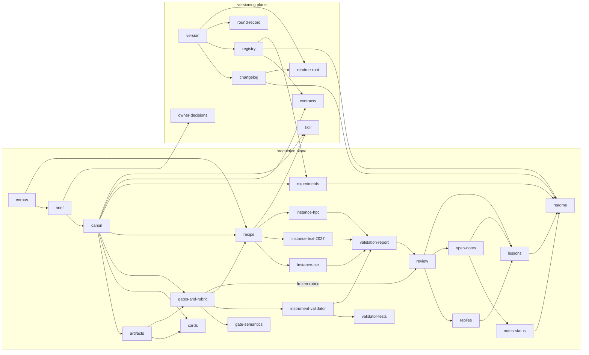
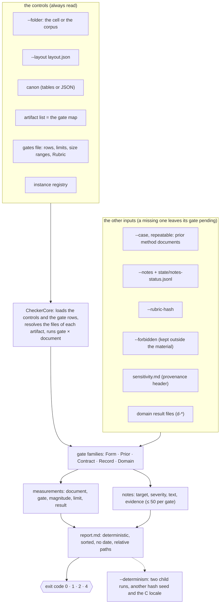
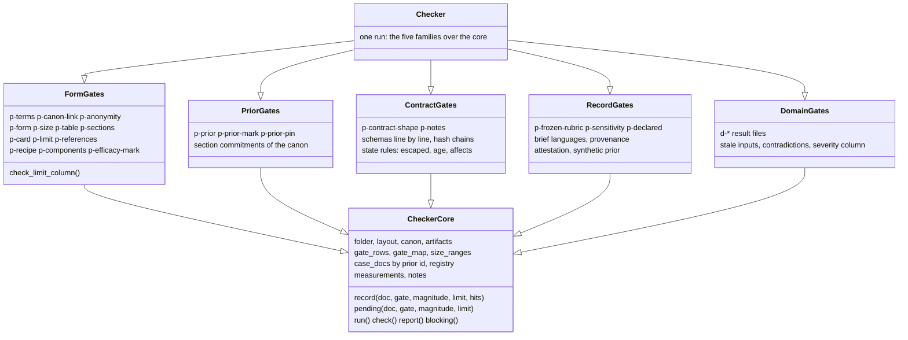
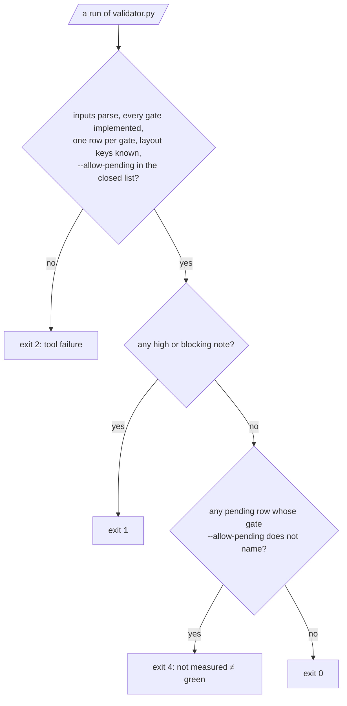

# Part III — The material and the instrument {- .part}

# The reflexive application

## What it is, and what round counts as evidence

`02-reflexive-application/` is the method applied to itself: a production
cell whose target is the set of documents that shows how to assemble a
production cell. Its brief (`00-brief.md`) declares the target, the two
readers, five non-negotiables with ids (`nn-method`, `nn-prior-facts`,
`nn-hypothesis`, `nn-form`, `nn-anonymity`), the owner decisions, a budget
(two returns per document per failed gate, then escalation) and the
stopping criterion: **exactly one independent review round**.

That first round, and only that round, was a production under the method.
The review gave `rejected` for the version it read (one blocking, two
high); the blocking and high notes were fixed and checked by the gates,
without a second review, as the brief prescribed; the 22 remaining notes
are kept, frozen, in `90-review/notes.json`. Every round after it (v0.2 on)
is a **maintenance round** of the material: recorded in the round record
with `kind: maintenance`, its scope and the reviewer's relation to the
producer, emitting no verdict of the canon, with its decisions in
`CHANGELOG.md`. The reflexive application is evidence about the method
only for round 1; the maintenance rounds are evidence about the material.

## The folder

| File or folder | Artifact | What it is |
| --- | --- | --- |
| `00-brief.md` | `brief` | target, non-negotiables with ids, owner decisions, budget and stop, the protocol of the maintenance rounds |
| `01-canon.md` | `canon` | method terms, terms to avoid, the fixed lists the validator reads, form rules, recorded facts, section commitments, historical vocabulary |
| `02-artifacts.md` | `artifacts` | the artifact table (the one source of the gate map) and the graph |
| `03-roles/` | `cards` | the four role cards: writer, verifier, runner, reviewer |
| `04-gates-and-rubric.md` | `gates-and-rubric` | the gate table with magnitude, limit and justification; the measurement `m-determinism`; the size ranges; the frozen "Rubric" section |
| `05-contracts/` | `contracts` | six JSON Schemas (appendix B) |
| `06-gate-semantics.md` | `gate-semantics` | what each gate reads in detail; the hash policy; domain gates; the false greens table; the gate lifecycle; the provenance of the rubric |
| `10-generic-recipe.md` | `recipe` | the fifteen steps, with "Reads", "Creates", "Does" and "Done when" each |
| `20-instance-car.md`, `21-instance-text-2027.md`, `22-instance-hpc.md` | `instance-*` | the three designed instances |
| `60-experiments.md` | `experiments` | E1 to E5 |
| `80-validator/` | `instrument-validator`, `validator-tests`, `validation-report` | the scripts, the test suite, `report.md` and `sensitivity.md` |
| `90-review/` | `review`, `replies`, `open-notes` | the frozen records of round 1: `rubric.sha256`, `auditor-report.md`, `auditor-notes.json`, `notes.json`, `replies.md` |
| `99-lessons.md` | `lessons` | one entry per round; append-only |
| `state/round-record.jsonl` | `round-record` | one line per round |
| `state/notes-status.jsonl` | `notes-status` | the state of each tracked note and panel finding |
| `state/owner-decisions.jsonl` | `owner-decisions` | the decisions only the owner can take |
| `README.md` | `readme` | the index and the runbook |

Four artifacts live at the root and are declared in the same table:
`version` (`VERSION`), `license`, `changelog`, `registry`
(`instances/registry.json`), `readme-root` and `skill` (the three files
of the skill). The gate `p-declared` checks that every Markdown document
of the folder belongs to an artifact or is listed in the canon as outside
the table; this production lists none.

## The artifact graph

Each arrow is "is read by". The graph is acyclic and the validator checks
it on every pass (`p-references`).

Two things the graph says about the order of the work: the three instances
only start after the recipe passes its gates, because it is the recipe
that fixes what an instance has to fill in; and the review only starts
after the validator passes on every document, so that the one review round
is not spent on defects the code already finds.

## The canon's tables the validator reads

The validator reads the tables of `01-canon.md` directly: changing a table
changes what it checks, and the canon's "Canon schema" section is
versioned (`v1`) so that a validator refuses a canon of another version.

| Section of the canon | Read by |
| --- | --- |
| Method terms | the glossary; not a gate |
| Terms to avoid | `p-terms` |
| Instantiation table rows, Mandatory sections of an instance | `p-table`, `p-sections` |
| Role card fields | `p-card` |
| Origin labels of a limit | `p-limit` |
| Method components | `p-components` |
| Prior-statement triggers, Efficacy triggers and their labels | `p-prior-mark`, `p-efficacy-mark` |
| Efficacy mark in append-only documents | the heading from which `99-lessons.md` is measured |
| Documents outside the artifact table | `p-declared` |
| Chained ledgers | `p-contract-shape` (the lines before each chain) |
| Frozen records | `p-frozen-rubric` |
| Accepted paths, Month names, Machine roots | `p-anonymity` |
| Recorded facts, Section commitments | `p-prior` |

A cell's JSON canon carries the same lists under the keys the scaffold
writes (`terms to avoid`, `instantiation table rows`, `mandatory sections`,
`role card fields`, `origin labels`, `method components`,
`prior-statement triggers`, `recorded facts`, `efficacy triggers`,
`documents outside the artifact list`), each a list of plain strings except
the recorded facts, which are objects.

# The validator

## Purpose

`validator.py` is the **runner**'s instrument: it reads every document the
artifact list assigns a gate to, measures each gate on it, and writes a
deterministic report with the magnitude, the limit and the result of each
(document, gate) pair, plus the notes the failures produce. It also runs
the global gates (the note ledgers, the frozen records, the sensitivity
report, the declared files, the domain results), carries an embedded
self-test, freezes the rubric, and measures its own determinism.

## Inputs and the layout

The validator is written for the corpus's Markdown layout and remapped to a
cell's JSON layout by `--layout layout.json`. The layout has a closed set of
keys; a key the validator does not read is refused (exit 2) instead of
silently falling back to a default it meant to override.

| Layout key | Meaning | Default (the corpus) | A scaffolded cell |
| --- | --- | --- | --- |
| `version` | the layout format | — | `1` |
| `artifacts.canon` | the canon | `01-canon.md` | `02-canon.json` |
| `artifacts.artifacts` | the artifact list | `02-artifacts.md` | `03-artifacts.json` |
| `artifacts.gates-and-rubric` | the gates file | `04-gates-and-rubric.md` | `06-gates.md` |
| `artifacts.roles-dir` | the role cards | `03-roles` | `04-roles` |
| `artifacts.rubric` | a dedicated rubric file (else the "Rubric" section of the gates file) | absent | `07-rubric.md` |
| `artifacts.sensitivity` | the sensitivity report | `80-validator/sensitivity.md` | `08-validator/sensitivity.md` |
| `artifacts.perturbations` | the perturbation data file of a cell | absent (the corpus keeps `perturbation_set.py`) | `08-validator/perturbations.json` |
| `artifacts.report` | the validator report | `80-validator/report.md` | `08-validator/report.md` |
| `artifacts.experiments`, `gate-semantics`, `notes-status`, `round-record`, `lessons`, `brief`, `owner-decisions` | the other documents the global gates read | the corpus's files | as the scaffold writes, or the defaults |
| `gates` | the parser of each gate: `builtin-markdown` or `builtin-json-canon`; every gate of the map has to use the same one | all `builtin-markdown` | all `builtin-json-canon` |
| `registry` | the instance registry, relative to the folder | `../instances/registry.json` | `priors.json` |
| `domain-results` | the result files of the `d-*` gates | `[]` | `[]` |
| `version-label` | what `{version}` expands to in paths and commands | absent | — |

The other inputs are command-line options (appendix C): `--case` for each
prior method document (repeatable; each is identified by its sha256
against the registry, and the number check of a `[prior:<id>]` unit reads
the document identified as `<id>`, in the number format its registry entry
declares); `--notes` for the note ledger; `--rubric-hash` for the frozen
pin; `--forbidden` for the list of forbidden identifiers; `--allow-pending`
for the gates whose pending rows the caller accepts by name.

## Architecture

Since v0.6.0 the checker is one class per family of gates over a core that
holds the state of a run and the interface every family uses. The split
moved the methods unchanged, and the report of the corpus was
byte-identical before and after it.

A run proceeds as follows (`CheckerCore.run`):

1. The controls are loaded through the layout: the canon, the artifact
   list, the gates file (its merged gate tables, one row per gate, else
   exit 2; its size ranges), the registry. Every gate id of the table or
   of the map has to be a builtin, a global gate or a `d-*` gate, else
   exit 2.
2. The gate map is built from the artifact list: for each gate, the
   artifacts that list it; for each artifact, the files its paths resolve
   to. Domain gates are skipped here and read from their result files in
   the global pass.
3. The documents that carry `p-prior` are scanned for `[prior:<id>]` ids,
   so that `p-prior-pin` knows which executed priors it has to pin.
4. A run that measures no documents writes a blocking note on `artifacts`:
   a production with no documents is not green, so a freshly scaffolded
   cell fails until it has real artifacts.
5. For each document in sorted order, for each (gate, artifact) pair in
   sorted order, the handler of the gate records a measurement and its
   notes. A hit is a note of the gate's severity (high unless the gate
   says otherwise) and fails the row; an advisory is a low note that does
   not. Notes are capped at 50 per gate, with one note saying how many were
   omitted.
6. The global gates run once (`check_global`): the brief's languages, the
   frozen records, the declared files and documents, the sensitivity
   report, the note ledgers, the domain results.
7. The Limit column of the gate table is compared with the limits the
   validator applied (`check_limit_column`).

## The report

`report.md` has three sections: **Measurements** (one row per document and
gate, sorted, with magnitude, limit and `pass`, `fail` or `pending`, then
the lines "Pending accepted by the caller", "Pending not accepted" and,
when an accepted gate had nothing pending, "Accepted but not pending");
**Instrument measurement** (the `m-determinism` row, the count of the
embedded self-test, and the sha256 of the test suite next to the
validator); and **Notes** (the count by severity and a table with target,
severity, text and evidence).

The report is deterministic by construction: no date, relative paths,
rows sorted by document and gate, notes sorted and deduplicated. With
`--output FILE` the report goes to the file and one summary line goes to
the error stream (`validator: exit N; notes: ...; pending not accepted:
...`), so that a failing run with `--output` is never silent.

`--determinism` runs the validator twice more as child processes, with
`PYTHONHASHSEED` set to 1 and 2 and, on the second run, `LC_ALL=C`, and
compares the sha256 of the two reports; a difference is a high note. The
working folder and the Python version (3.9 and 3.12) were varied by hand,
not by the measurement, and gave the same report.

## Exit codes

| Code | Meaning |
| --- | --- |
| 0 | every gate was measured, or its pending was accepted by name, and no note is high or blocking |
| 1 | at least one high or blocking note (a `--determinism` mismatch included) |
| 2 | invalid input or tool failure: a layout key the validator does not read, a file that is not UTF-8, a truncated table row, a gate it does not implement, a gate with two rows, a gate named by `--allow-pending` outside its closed list, a domain result that breaks its contract, a Python older than 3.9, an unexpected exception |
| 4 | no such note, but a gate not measured that `--allow-pending` does not accept |

`--allow-pending` accepts only four names: `p-anonymity`, `p-prior` and
`p-prior-pin` (the halves that need an input the material does not
distribute: the forbidden list, the owner-held prior document) and
`p-sensitivity-synthetic` (a sensitivity report a clone regenerated with a
synthetic prior). Any other name is exit 2, `p-sensitivity` included; a
missing sensitivity report is blocking; and `p-anonymity-language` (a
language the brief declares without month names) cannot be accepted
either. The history behind the closed list: the panel that reviewed v0.5.0
deleted the sensitivity report, accepted the gate by name and got exit 0.

## The hash policy

Every sha256 the instrument computes — the documents passed with `--case`,
the rubric, the gate section, the canon, the resolved gate map, the
validator itself, the inputs of a domain result and the lines of a chained
ledger — is the sha256 of the text as the validator reads it: UTF-8, a
byte-order mark dropped, every line break read as LF. A file that is not
UTF-8 text (a domain input only) is hashed as its bytes. The scripts write
UTF-8 to the console whatever its code page.

## The self-test and the test suite

`validator.py --self-test` runs 185 checks (at 0.6.0) embedded in the
script, with no inputs; the runbook and every cell use it without pytest,
and the report prints its count. The pytest suite
(`80-validator/test_validator.py`, 280 tests together with the scaffold's
`test_scaffold.py` at 0.6.0) runs the self-test and one case per rule:
one that passes and one that is rejected. Both are run with `python3 -B
-m pytest -p no:cacheprovider`, because pytest imports the files before
their own code can switch the bytecode cache off.

## The scaffold

`skills/cooperatio-teamwork/scripts/scaffold.py` creates an empty
production cell for a target, refusing to overwrite anything: it builds the
cell in a staging folder and moves it into place, so a failure leaves no
half-written cell. It copies the validator, the sensitivity script, the
perturbation module and five contracts from the material, so it has to run
from inside the material (or with the skill folder kept inside it);
copied alone, the skill creates the cell without them, says so, and the
cell has no validator until one is copied in. Chapter 17 lists what it
writes.
