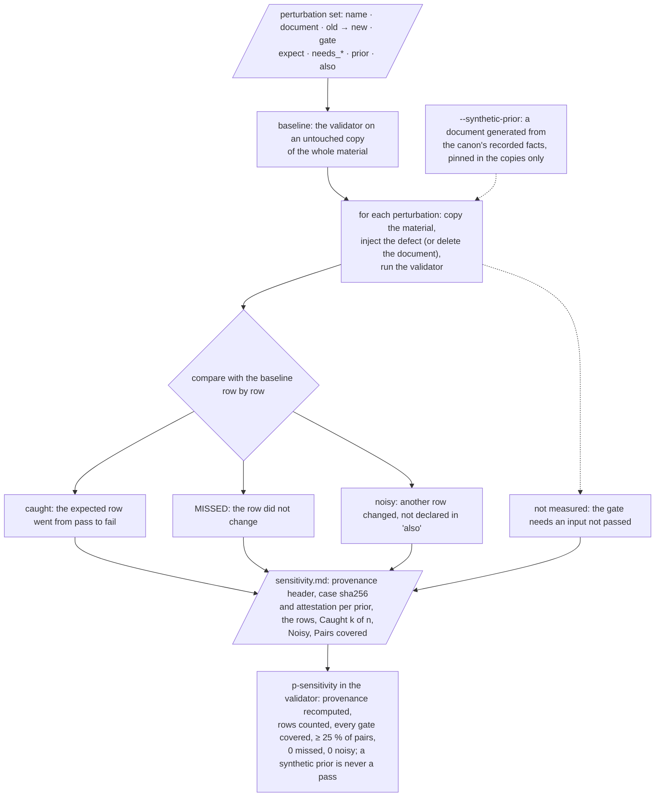
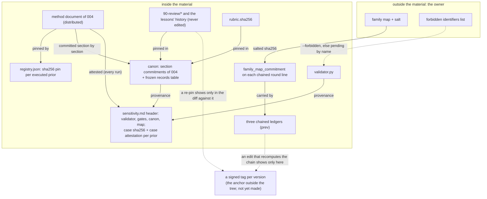

# The sensitivity test

## Purpose

A gate that never fails proves nothing. `sensitivity.py` is the gate on
the gates: it injects known defects, one at a time, into a copy of the
material and checks that the expected gate rejects each on the expected
document, and nothing else moves. Its report, `sensitivity.md`, is an
artifact the validator reads (`p-sensitivity`), with a provenance header
that ties it to the exact validator, gate table, canon and gate map it was
made against. The validator refuses a report that the instrument cannot
have produced, so the test cannot be satisfied by an old report or a
hand-written one.



## A perturbation

The corpus keeps its set in `perturbation_set.py` (65 perturbations at
0.7.2), a module the validator reads without importing the sensitivity
script; a cell keeps its own as data, `08-validator/perturbations.json`,
named by the layout key `artifacts.perturbations`. The fields:

| Field | Meaning |
| ---------- | ------------------------------ |
| `name` | unique, without a comma (the report lists the names on one line) |
| `document` | the document to perturb, relative to the folder; `../instances/registry.json` is the copied registry |
| `old`, `new` | the text replaced once in the document; with `delete: true` the document is removed instead |
| `gate` | the gate that has to react on that document; one the validator implements, never a domain gate |
| `expect` | `fail` (default), or `pending` for a defect that empties what the gate reads (one perturbation of the corpus empties a list of the canon) |
| `needs_case`, `needs_rubric_hash`, `needs_notes`, `needs_registry` | the validator inputs the expected gate cannot run without; a row whose input was not passed is not measured, never missed |
| `prior` | the registered prior whose method document the gate needs; without a `--case` document identified as it, the row is not measured, whatever other prior was passed |
| `also` | gates the defect also reaches by design, comma-separated; their rows are not counted as noise, and the report lists them (eleven perturbations of the corpus declare one: a pin decides which document is the prior, a list of the canon feeds a gate on every document, a placeholder in angle brackets also reads as an HTML tag, an edited old line of a chained ledger breaks its chain) |

Two examples from the corpus's set:

```text
Perturbation("avoid-word inserted", "10-generic-recipe.md",
             "## The orchestrator in pseudocode",
             "## The orchestrator of the pipeline", "p-terms")
Perturbation("prior number altered", "../01-principle.md",
             "produced a guide of 1054 words", "produced a guide of 1055 words",
             "p-prior", needs_case=True, prior=PRIOR_004)
```

## The copy is the material

Since v0.6.0 each perturbation runs on a copy of the whole material the
folder belongs to: the folder and everything its artifact table and
registry reach above it (the principle, the root README, the skill, the
changelog, the registry). Until then the copy was the folder alone, so no
perturbation could reach those documents. The copies go to `--work
SCRATCH_FOLDER`, or to a temporary folder; `.git`, `__pycache__` and
`.pytest_cache` are not copied.

## Specificity, coverage and the floor

The perturbed report is compared with the baseline row by row. A
perturbation is **caught** when the expected (document, gate) row went
from pass to fail (or to pending, when `expect` says so), **missed** when
it did not, and **noisy** when another row changed its result — not
counting the expected row, the row of `p-sensitivity` itself (which reads
the provenance an edit of an input pins on purpose), the rows of a
document that left the report, and the gates the perturbation declares in
`also`. A noisy perturbation fails the gate like a missed one.

Coverage is measured twice: by gate (every gate the artifact table
assigns, except `p-sensitivity`, the measurements and the domain gates,
has at least one perturbation) and by pair (the (document, gate) rows of
the baseline report that at least one measured perturbation targets). The
magnitude reads "k of n gates covered, p of q pairs (r %), 0 missed of m,
0 noisy"; at 0.7.2 the corpus reads 20 of 20 gates and 54 of 182 pairs
(29 %). An assigned gate without a perturbation, or fewer than 25 % of
the pairs, leaves `p-sensitivity` pending with the reason, never a pass;
the floor is a hypothesis, the first this version commits to, raised and
never lowered. The three generic perturbations of a new cell cover three
gates and three pairs; each gate a cell adds needs one of its own.

## Provenance

The header of the report records what it was made against, and the
validator recomputes every line and compares:

```text
validator sha256: <sha of validator.py: the running one, and the one next to the report>
gates sha256: <sha of the "Gates" section; a cell's whole gates file>
canon sha256: <sha of the canon>
map sha256: <sha of the sorted (gate, document path) pairs of the gate map>
perturbations: <count> (<names, comma-separated>)
case sha256: <prior id> <sha of the document passed>   (one per prior; "none")
case attestation: <prior id> <sha of the text + the four digests above>
```

Editing the validator, the "Gates" section, the canon or the gate map
makes the report stale: regenerate it (and then the validator report)
before the next run, or `p-sensitivity` fails on provenance. Deleting the
report does not help: a missing report is blocking, and `p-sensitivity`
cannot be accepted by name.

## The synthetic prior, for a prior held elsewhere

Since 0.7.0 the one executed prior of this material is distributed, so a
clone regenerates the report with the real document and needs none of
this section. The instrument keeps the mechanism for a cell whose prior is
held outside its material: its registry entry carries the reserved locator
`owner-held, not distributable`, and a maintainer who edits the instrument
without that document regenerates a full report with `--synthetic-prior
PRIOR_ID`: the script generates a document from the canon's
recorded facts (one numbered section per label the facts cite, holding
the facts' numbers in the prior's number format), in the `heading_style`
the registry declares for the real document, passes it as `--case`, and
patches its sha256 and its section digests into the registry and the canon
of every copy, never of the material.

The validator tells a synthetic prior by its `case sha256` differing from
the registry's pin, never by a line that declares it (the first draft's
declaring line could be deleted, and the report then read as the owner's).
A report made with a synthetic prior is never a pass: in a run without
that prior's document its row is `p-sensitivity-synthetic`, pending,
accepted only when the caller names that gate; in a run with the document
it is refused. It shows that every gate fails its known defect; it does
not show that the owner's document holds the facts, nor that the
validator reads that document's format beyond what the registry declares.

## The attestation, and what it leaves

The pin of the registry is public, so a `case sha256` line can be written
by hand with the real pin over a report made with the synthetic document.
Until the closing pass of v0.6.0 that forged line passed every run. Since
then the report records, for each document it was made with, a `case
attestation`: the sha256 of the document's text followed by the validator,
gates, canon and map digests of the report, which only whoever holds the
text can compute. A run that passes the document recomputes it and refuses
a mismatch; for this material, whose prior document is distributed, that
is every run. What it leaves, declared: for a prior held elsewhere, a run
without the document compares nothing, so **in a clone of such a cell the
forged line still passes**, and a frozen record re-pinned in the canon
shows there only in the diff against a signed version.

# Ledgers, records and integrity

## The three ledgers

Three append-only ledgers under `state/` hold the state the gates read,
one JSON object per line, each with a contract (appendix B):

| Ledger | One line per | Written by |
| --- | --- | --- |
| `round-record.jsonl` | round: method version, round label, the executor of each role by family and effort, a summary, and since v0.6.0 its `kind`, the `reviewer_relation`, `rubric_applied`, `rubric_hash`, `rubric_author`, the `family_map_commitment`, and optional cost fields (tokens per role, calls, finish reason, `wall_seconds`, `notes_count`, `crew`, `rounds_to_stop`) | the verifier, at the close of a round |
| `notes-status.jsonl` | state change of a tracked note: `ref` (`notes:<n>` for the n-th note of the frozen ledger, `panel:<version>:<id>` for a panel finding), `status` (`open`, `fixed`, `disputed`, `out of scope`), `closed_in`, `summary`, and the fields of the state rules below | the verifier |
| `owner-decisions.jsonl` | decision only the owner can take: `name`, `status` (`open`, `decided`), `blocks`, `version`, `summary`, and once decided the notes it `covers` | the owner, through the orchestrator |

## The hash chain

Each line written from v0.6.0 on carries `prev`, the sha256 of every line
above it, each followed by LF (for a file with no blank line, the sha256 of
the file before the line was appended). `p-contract-shape` recomputes the
chain: an earlier line edited, removed or reordered breaks the first
chained line after it. The canon's "Chained ledgers" table counts the
lines written before each chain (10 in the round record, 48 in the state
ledger, 0 in the owner decisions), which are never edited, and every line
after them has to carry `prev`, so stripping the chain is a finding too.

The reach is declared: the chain detects an edit made without recomputing
it — the careless maintainer and the honest error. It does not detect an
edit that recomputed it, which costs one sha256 per line, and it does not
cover the last line of a ledger, which can be rewritten with no sign until
a line is appended after it. Only an anchor outside the tree — a signed tag
per version, which is the owner's to make — answers that.

## The rules of the state of a note

Since v0.6.0 the last line of each tracked note is read against four rules
(`p-notes`):

- **Golden rule 4.** A note that is a regression that escaped every gate
  (`escaped: true`) closes with the gate it became (`gate`, a row of the
  cell's gate table) or with the recorded reason not to make one
  (`no_gate`, at least 8 distinct words, or `decision` exactly the name of
  a decided owner decision); closed with neither, it is a high note. The
  count of words measures the form of the reason, not its content.
- **Age.** An open note is counted in rounds from the version it was
  opened in (`opened_in`, or the version of a panel ref, or 0.1.0 for the
  frozen ledger). Past 3 rounds, and not scheduled for a version still
  ahead (`due`), it is a low note: schedule it, dispute it or close it with
  the reason. Three rounds is a hypothesis: a panel counted 16 of the 22
  notes of round 1 open nine rounds later.
- **Non-negotiables.** The brief gives each non-negotiable an id in a code
  span (`nn-<name>`); a note names those it affects (`affects`). An open
  note of severity high or blocking that affects one is blocking, unless a
  decided entry of the owner decisions covers it (`covers`). The fields a
  line's writer controls cannot undo the protection: the severity is the
  highest of the note ledger's and of every line of the ref; the
  non-negotiables are the union of every line's `affects`; a decision
  covers only while its last line is `decided`; a high or blocking note
  opened in 0.6.0 or later has to name what it affects (an empty list when
  nothing).
- **Evidence.** A note whose evidence names a file of the material needs
  that file to exist; the frozen ledger keeps the names of its time and is
  exempt.

## Frozen records

The records of the first review and the history of the lessons are never
edited. The canon's "Frozen records" table pins their sha256
(`90-review/auditor-report.md`, `auditor-notes.json`, `notes.json`,
`replies.md`, `rubric.sha256`, and the part of `99-lessons.md` above the
heading "The v0.5.0 round: exit 0 is not green"), and `p-frozen-rubric`
compares them on every run. An append-only rule that no gate checked is
how the panel that reviewed v0.5.0 rewrote a verdict unseen.

## The family map and its commitment

The round record names the executors by family letter; the map from
letter to family, and a salt, stay with the owner. Since the rework of
v0.6.0 a chained line of the round record of method version 0.6.0 or later
carries `family_map_commitment`, the sha256, over UTF-8, of

```text
json.dumps(map, sort_keys=True, separators=(',', ':'), ensure_ascii=False) + '\n' + salt
```

where `map` is the object from letter to the description of the family
and `salt` a string of 64 hex characters. `p-contract-shape` checks the
form only (64 hex characters); the owner proves the commitment by
revealing the map and the salt, and nothing in the material lets anyone
else check it. A pseudonym made of the hash of a host name or a user name
is not anonymity (a dictionary reverses it); this is why the material uses
letters and a salted commitment.

## What a clone verifies, and what rests on the owner



| A clone verifies | Only the owner verifies |
| --- | --- |
| every gate on every document; the pin, the numbers and the committed sections of `004`, whose document is distributed; the frozen rubric; the provenance of the sensitivity report, its attestation included; the hash chain of the three ledgers | nothing about the numbers since 0.7.0: every number stated about a prior is checkable in a clone |
| that a ledger line written since v0.6.0 was not edited without recomputing the chain | an edit that recomputed the chain; the lines before the chain; the history of the lessons and the record of the experiments' raw files |
| the family letter each round line records, and the form of its salted commitment | the map from a family letter to a family, and its salt |

The residual risks the material declares, as they stand at 0.7.2:

- for a cell whose prior is held elsewhere, a forged `case sha256` line
  passes in a clone without that document (this material no longer has
  such a prior);
- the 8 distinct words of a `no_gate` reason measure form, not content;
- the attestation does not prove the perturbations actually ran, only
  that the report was made over those inputs;
- the git history distributes the name of the author and the dates of the
  commits; the gates measure the content, not the history;
- the anchor outside the tree, a signed tag per version, is recommended
  and not yet made (an open owner decision).
