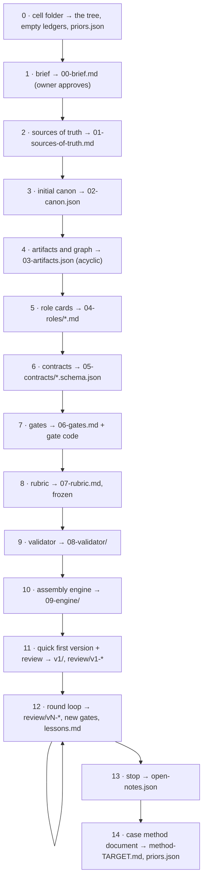
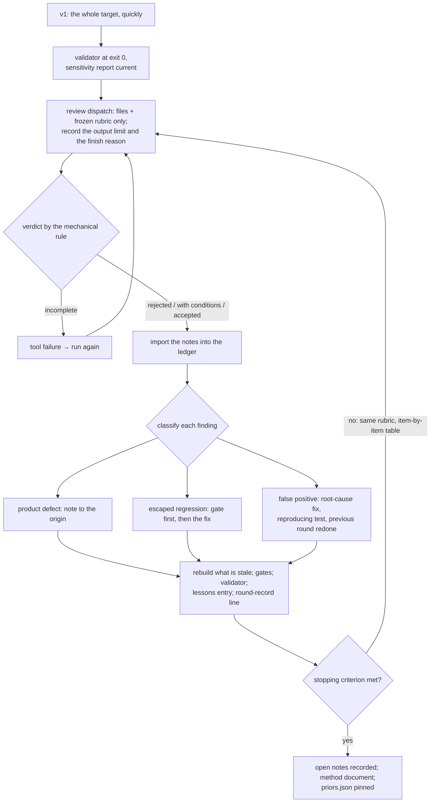

# Part IV — Using the method {- .part}

# Quick start

## The ten-minute path

The root `README.md` gives a four-step path; here it is with the commands
run from the root of the material.

1. Read the first section and section 7 of `01-principle.md` (the idea and
   the recipe).
2. Scaffold a cell:

   ```bash
   python3 skills/cooperatio-teamwork/scripts/scaffold.py \
       --target "My target" --roles writer reviewer --out ./teamwork
   ```

3. Fill the brief, give each non-negotiable an id (`nn-<name>`), fill the
   lists of `02-canon.json` the validator reads and one card per role (the
   skill's `references/templates.md` has a filled example).
4. Freeze the rubric, run the sensitivity test, then the validator, with
   the commands of the skill ("The commands of a cell", reproduced in
   chapter 19); read every pending row before reading the exit code.

## What the scaffold writes

With two roles the scaffold writes 24 files, refusing to overwrite
anything that exists; of the folders it creates, `09-engine/` and
`review/` stay empty:

| File | What it is |
| --- | --- |
| `00-brief.md` | the brief template: target, audience, non-negotiables, owner decisions, budget and stop |
| `01-sources-of-truth.md` | the table of sources per content type |
| `02-canon.json` | the canon as data: four sections, the lists the validator reads (empty), the recorded facts (empty) |
| `03-artifacts.json` | one placeholder artifact record |
| `04-roles/<role>.md` | one card per role, seven bold fields with placeholders, a link to the canon |
| `05-contracts/02-canon.schema.json` | the contract of the JSON canon (written by the scaffold) |
| `05-contracts/notes.schema.json`, `notes-status.schema.json`, `round-record.schema.json`, `domain-result.schema.json` | copied from the material |
| `06-gates.md` | an empty gate table and an empty "Size ranges" table |
| `07-rubric.md`, `07-rubric.sha256` | the rubric template and the pin placeholder `not-frozen` |
| `08-validator/validator.py`, `sensitivity.py`, `perturbation_set.py` | copied from the material |
| `08-validator/perturbations.json` | three generic perturbations (an avoid-word, an absolute path, a deleted card field) |
| `layout.json` | the layout of the cell (chapter 12) |
| `lessons.md`, `open-notes.json`, `priors.json` | empty |
| `state/notes-status.jsonl`, `state/round-record.jsonl` | empty |

## The first run is red, by design

Verified on a cell scaffolded with three roles at 0.6.0: the self-test
passes (185 checks), and the first validator run

```bash
python3 08-validator/validator.py --folder . --layout layout.json \
    --rubric-hash 07-rubric.sha256 --notes open-notes.json \
    --allow-pending p-anonymity
```

exits 1 with 3 blocking and 8 high notes: "no documents were measured; a
production with no documents is not green" (the placeholder artifact
matches no file), "declared artifact missing: `<relative path>`", "no
sensitivity report at `08-validator/sensitivity.md`", and one high note per
Markdown document of the cell that "belongs to no artifact and is not
declared outside the artifact table". This is the contract: a newly
scaffolded cell fails until it has real artifacts.

## The shortest path to green, verified

The following edits, made on a cell scaffolded with `--roles writer
reviewer`, took it from that red run to exit 0 with no notes in one pass
(verified on 0.6.0; the full chapter 18 is the real procedure, this is the
smallest cell the instrument accepts):

1. **`00-brief.md`**: a link to the canon (`Canon:
   [02-canon.json](02-canon.json)`), a `Languages: en` line, two
   non-negotiables with ids (`nn-source`, `nn-size`), one decided owner
   decision, a budget and a stop.
2. **`02-canon.json`**: `terms to avoid` (`pipeline`, `checkpoint`), the
   seven `role card fields`, the three `origin labels`, and `documents
   outside the artifact list` set to `01-sources-of-truth.md`,
   `07-rubric.md`, `lessons.md`, `08-validator/*.md`.
3. **`03-artifacts.json`**: three records — `brief` (`00-brief.md`, gates
   `p-terms`, `p-canon-link`, `p-anonymity`, `p-form`), `cards`
   (`04-roles/*.md`, those four plus `p-card`) and `gates` (`06-gates.md`,
   gates `p-limit`, `p-terms`, `p-canon-link`, `p-form`).
4. **`04-roles/writer.md`, `reviewer.md`**: the seven fields filled with
   one line each, the executor named by family and effort in the degree
   field.
5. **`06-gates.md`**: a link to the canon and one row per gate assigned
   above, each naming the same artifacts, with a magnitude, a limit and a
   justification of at least six words starting with an origin label; the
   "Size ranges" table left empty.
6. **`08-validator/perturbations.json`**: the three generic perturbations
   kept, plus one each for `p-form` (an HTML tag in the brief),
   `p-canon-link` (a broken link in a card) and `p-limit` (a justification
   deleted in the gates file), so that every assigned gate has one.

Then the four commands of the cell (chapter 19): the self-test (185
checks); the freeze, which printed the pin and replaced `not-frozen`; the
sensitivity test, whose report read "Caught 6 of 6. Noisy: 0 of 6. Pairs
covered: 6 of 22."; and the validator, which wrote a report of 23 rows
with `p-sensitivity` at "6 of 6 gates covered, 6 of 22 pairs (27 %), 0
missed of 6, 0 noisy", three `p-anonymity` rows pending and accepted (the
identifier half, with no forbidden list), `m-determinism` passed, and
exit 0. Had the three generic perturbations been left alone,
`p-sensitivity` would have been pending for the three uncovered gates and
the run would have exited 4.

# Setting up a cell

This chapter condenses the fifteen steps of
`02-reflexive-application/10-generic-recipe.md` and the procedure of the
skill into one how-to. Each step says what it creates and when it is done;
the recipe adds, for each, who performs it, what it reads and the trap the
step exists to avoid.



## Step 0 — the folder

Create the tree (the scaffold does), decide where everything that stays
out of version control goes and record it in the brief, and decide how
machine-dependent paths enter: always as a command-line variable, never
written into an artifact. Done when the tree exists, the ledgers exist
and are empty, and `priors.json` parses. Trap: starting to write the brief
in a conversation. What is not in a file has no hash, and what has no hash
makes nobody stale.

## Step 1 — the brief

`00-brief.md`, with fixed sections: target; for whom; non-negotiables,
each with an id in a code span (`nn-<name>`), written as sentences a gate
could measure ("mass ≤ X kg", "no fact without a source", not "safe",
"good", "fast"); owner decisions as a table with a status (and, since
v0.6.0, as lines of `state/owner-decisions.jsonl`); available sources of
truth; budget (maximum rounds per artifact, review rounds); a provisional
stopping criterion; what is not an objective; assumptions labeled
`[hypothesis]`. The brief also declares the languages of the documents on a
line `Languages: en` (two-letter codes), which the anonymity gate reads.
Done when every section is filled or says "owner decision pending", and
the owner recorded the approval.

## Step 2 — the sources of truth

`01-sources-of-truth.md`: a table with content type, the source that errs
least, who consults it, and what is forbidden as a source. The writer is
never a source of fact; a generative tool is never a source of exact text;
a number never comes from the paragraph that cites it. Done when every
content type of the brief has exactly one source.

## Step 3 — the canon

`02-canon.json`, with its schema in `05-contracts/`. Sections with owner,
version and state; canonical numbers (spelling by medium, unit, rounding,
nature, source); accepted variants; names and terms; rules. Fill the lists
the validator reads (a list left empty leaves its gate pending): `terms to
avoid`, `role card fields`, `origin labels` (with their brackets), and the
others the scaffold writes empty. List under `documents outside the
artifact list` the Markdown documents of the cell that belong to no
artifact (`01-sources-of-truth.md`, `07-rubric.md`, `lessons.md`,
`08-validator/*.md`), or `p-declared` reports them. Every number the cell
states about a registered prior gets a row of `recorded facts`:

```text
{ "number": "18", "context": "roles with a card [prior:<id>]", "section": "1.1" }
```

Done when every section has an owner and a version, every number of the
brief is in the canon, and the schema validates.

## Step 4 — the artifacts and the graph

`03-artifacts.json`: one record per artifact (chapter 6). Start from the
target and walk backward; give each artifact a single owner; turn every
owner decision into an artifact with resource `human`; mark as `proposed`
an artifact that has no file yet; compute the topological order. The
`gates` field of each record is the one source of the gate map. Done when
the graph is acyclic, every artifact has one owner, at least one gate and
(except the target) at least one consumer. Trap: a finding that lands on
the nearest artifact because the right target is not in the graph.

## Step 5 — the role cards

`04-roles/<role>.md`, one per artifact owner, with the seven fields as
bold labels (`**Decides:**`), plus "Questions it always asks" and the base
prompt the orchestrator hands to the agent. In "Does not decide", write
the neighboring decisions the role would be tempted to make and whose they
are. In the degree field, name the executor: a person, code, or a kind of
language model by family and effort; a role that audits another gets an
executor different from the one that produced the artifact. Done when
every card has the seven fields, no decision appears in "Decides" of two
cards, and no auditing role shares an executor with the role it audits.

## Step 6 — the contracts

`05-contracts/<artifact>.schema.json` for each artifact that passes
between roles, rejecting unknown fields and the domain's most likely
ambiguity, with one valid and one invalid example; the invalid one has to
fail. Done when validation runs in seconds, before any expensive work.
Trap: the ambiguous position key.

## Step 7 — the gates

`06-gates.md`: one row per gate of the artifact list, naming the same
artifacts, with magnitude, limit and a justification that starts with an
origin label and has at least six words; a "Size ranges" table with the
word range of each document, declared before writing. Give every signal
gate a magnitude limit on both sides; separate "rejects" from "tool
failure"; never let a limit inherit a prior's number. A gate of the domain
is a row `d-<name>` (chapter 21). The ids have to be ones the validator
implements, or `d-*`: any other id exits 2. Done when every limit has a
justification with an origin, and every code gate rejected its known
perturbation.

## Step 8 — the rubric, frozen

`07-rubric.md`: six to ten dimensions with anchors for 1, 3 and 5; the
severity scale; the mechanical verdict rule; the report format. Then:

```bash
python3 08-validator/validator.py --folder . --layout layout.json \
    --freeze-rubric 07-rubric.sha256
```

The scaffold's pin holds the placeholder `not-frozen`, which the first
freeze replaces; a real pin is refused, and a deliberate replacement goes
through `--re-freeze-rubric`. Done when the hash is recorded before the
first review and the round record will name who wrote the rubric. Written
by the owner with whoever will review; never by whoever will produce,
alone.

## Step 9 — the validator

The scaffold copied `validator.py`, `sensitivity.py` and
`perturbation_set.py` into `08-validator/`. Adapt the three generic
perturbations of `perturbations.json` to the cell's text and add one per
gate the cell assigns. Run the sensitivity test, then the validator
(chapter 19). Done when two runs give an identical report, every gate has
its perturbation caught, and the validator refuses a canon of another
schema version.

## Step 10 — the assembly engine

`09-engine/`: the graph core (state, hash per artifact, plan, execute), the
note router, the assembly of the target and the tests. The content hash of
an artifact is the sha256 over the canonical form of the file (UTF-8, the
whitespace at the end of each line normalized, a single final newline). The
plan marks each artifact `current`, `stale`, `missing`, `returned` or
`escalated`; only what is stale runs, in topological order; the router
refuses an unknown target, deduplicates, and only high and blocking return
the artifact; the assembly validates every contract before the expensive
work and names the output with the version label. Done when assembling
twice with the same inputs gives the same product. Trap: the namesake file
from an old version, which every reader silently picks.

## Step 11 — the quick first version and its review

Produce every artifact, even bad, instead of polishing the first ones;
assemble; hand the reviewer only the files and the rubric; record in the
dispatch the output limit and the reason the generation ended; import the
review's notes into the ledger. Done when every artifact exists, the
report follows the rubric's format and the notes entered the ledger
without refusal. Trap: polishing v1.

## Step 12 — the round loop

Chapter 20.

## Step 13 — the stop

The owner declares the criterion before the last round, in terms of rounds
or verdict, never calendar; the review of the last version becomes open
notes in `open-notes.json`, in the contract; a violated non-negotiable is
not an open note but an undelivered target.

## Step 14 — the case method document and the registration

`method-TARGET.md`: the ideas with the defect each prevents, the graph,
the step by step with the real commands, the pseudocode per role with its
degree, the owner decisions, the known false positives with a status,
`[unverified]` on whatever was not checked. Register the instance in
`priors.json` with id, status, the document's path relative to its own
repository root, its sha256, its locator and its number format. Trap: a
document that repeats the READMEs.

## Before handing over

Run through `skills/cooperatio-teamwork/references/review-checklist.md`.
At minimum: every document points to the canon; every gate has magnitude,
limit and a justified origin label; the graph is acyclic; every owner is a
role or the owner; every card has the seven fields; the rubric hash is
recorded; every non-negotiable of the domain is a `d-*` gate whose result
the cell's code writes; the validator exits 0 and every pending it reports
is one of the four it accepts by name, with the reason; and the files do
not claim the method has been validated on this target — the first review
round does that.

# Running the instrument

## The commands of a cell

From inside the cell, after the files are filled (the skill, "The commands
of a cell"):

```bash
python3 08-validator/validator.py --folder . --layout layout.json --self-test
python3 08-validator/validator.py --folder . --layout layout.json \
    --freeze-rubric 07-rubric.sha256
python3 08-validator/sensitivity.py --folder . --layout layout.json \
    --rubric-hash 07-rubric.sha256 --notes open-notes.json --work SCRATCH_FOLDER
python3 08-validator/validator.py --folder . --layout layout.json \
    --rubric-hash 07-rubric.sha256 --notes open-notes.json \
    --allow-pending p-anonymity --determinism --output 08-validator/report.md
python3 -B -m pytest -p no:cacheprovider tests/
```

The last line only if the cell keeps a test suite. Add `--case` for each
registered prior the cell cites, and `--forbidden` with the cell's list of
forbidden identifiers kept outside the cell (then drop `--allow-pending`).
Run the sensitivity test again after every change to the validator, the
gates file, the canon, the artifact list's gate map or the perturbation
set, and before the validator: the validator reads the report and fails
`p-sensitivity` on provenance otherwise.

## The commands of the corpus

From `02-reflexive-application/` (its README, "How to run the validator"):

```bash
python3 80-validator/sensitivity.py --folder . \
    --case PRIOR_000_DOCUMENT_PATH \
    --case ../instances/004-adoption-guide/metodo-de-producao.md \
    --rubric-hash 90-review/rubric.sha256 --notes 90-review/notes.json \
    --work SCRATCH_FOLDER --output 80-validator/sensitivity.md
python3 80-validator/validator.py --folder . \
    --case PRIOR_000_DOCUMENT_PATH \
    --case ../instances/004-adoption-guide/metodo-de-producao.md \
    --rubric-hash 90-review/rubric.sha256 --notes 90-review/notes.json \
    --allow-pending p-anonymity --determinism --output 80-validator/report.md
python3 80-validator/validator.py --self-test
python3 -B -m pytest -p no:cacheprovider 80-validator/test_validator.py \
    ../skills/cooperatio-teamwork/scripts/test_scaffold.py
```

The published report is made with exactly that command; at 0.6.0 it
exits 0 with no notes, 27 rows of `p-anonymity` pending and accepted (the
identifier half, with no forbidden list), `m-determinism` passed, the
self-test at 185 checks; the sensitivity report reads 65 of 65 caught, 0
noisy, 50 of 182 pairs; the test suites pass 280 tests.

## The clone run

The method document of instance 000 stays with the owner, so a clone of
the material does not have it. The clone passes the document of 004 and
accepts by name the gates that need the owner's:

```bash
python3 80-validator/validator.py --folder . \
    --case ../instances/004-adoption-guide/metodo-de-producao.md \
    --rubric-hash 90-review/rubric.sha256 --notes 90-review/notes.json \
    --allow-pending p-anonymity,p-prior,p-prior-pin --determinism
```

Expected: exit 0, no notes, the report on the standard output, the three
gates listed as pending accepted by the caller, the pin and the numbers of
004 measured (its edited document, or an invented number about it, is a
blocking note, exit 1), and the rows of 000 saying "owner-held evidence,
not measured here". Without any `--case` the same run still exits 0, but
measures neither pin.

A clone that edits the instrument cannot regenerate the sensitivity report
with the owner's document; it regenerates one with a synthetic prior:

```bash
python3 80-validator/sensitivity.py --folder . \
    --case ../instances/004-adoption-guide/metodo-de-producao.md \
    --synthetic-prior 000-av-production \
    --rubric-hash 90-review/rubric.sha256 --notes 90-review/notes.json \
    --work SCRATCH_FOLDER --output 80-validator/sensitivity.md
```

and then adds `p-sensitivity-synthetic` to `--allow-pending` of the clone
run. The report stays pending until the owner regenerates it with the
document (chapter 14).

## Reading a report

Read the pending rows before the exit code. A row is `pass`, `fail` or
`pending`; the lines after the table say which pending gates the caller
accepted, which it did not (the run exits 4 for those unless a note exits
1), and which accepted gates had nothing pending ("Accepted but not
pending", so the caller sees that the acceptance covered nothing). The
notes table gives, per note, the target artifact, the severity, the text
(prefixed by the gate id) and the evidence (the document). With
`--output`, one summary line goes to the error stream.

## Troubleshooting

| Message or symptom | Cause | What to do |
| --- | --- | --- |
| `no documents were measured; a production with no documents is not green` (blocking, on `artifacts`) | the artifact list has no record whose paths match a file, or no gates | fill `03-artifacts.json` with real records and gates |
| `p-declared: declared artifact missing: <path>` (blocking) | a literal path of an artifact matches no file, or a glob matches nothing | create the file or fix the path |
| `p-declared: document X belongs to no artifact and is not declared outside the artifact table` (high) | a Markdown document of the folder is neither an artifact nor listed in the canon | add it to an artifact's paths, or list it under `documents outside the artifact list` with the reason |
| `p-sensitivity: no sensitivity report at ...` (blocking) | `sensitivity.py` has not run, or the layout key `artifacts.sensitivity` points elsewhere | run the sensitivity test |
| `p-sensitivity` fails on provenance (validator, gates, canon or map sha) | the instrument or its inputs changed after the report | regenerate the report, then the validator report |
| `p-sensitivity` pending: an assigned gate without a perturbation, or fewer than 25 % of pairs | the perturbation set does not cover the cell's gates | add one perturbation per gate the artifact list assigns |
| exit 4 with `Pending not accepted: ...` | a gate was not measured and the caller did not accept it | supply the input (`--notes`, `--rubric-hash`, `--case`, the canon's list, the domain result), or accept it by name when it is one of the four |
| `--allow-pending accepts only p-anonymity, p-prior, p-prior-pin, p-sensitivity-synthetic ...` (exit 2) | the caller named a gate that has to be measured | measure it |
| `--allow-pending names gates this validator does not implement` (exit 2) | a typo in the gate name | fix the name |
| `the rubric is already frozen at ...` (exit 2) | `--freeze-rubric` on an existing pin | leave the pin, or `--re-freeze-rubric` deliberately with the reason in the changelog |
| `the gate table has more than one row for ...` (exit 2) | two rows for one gate | one row per gate |
| a gate id the validator does not implement (exit 2) | a placeholder row, a typo, or a cell-specific gate not named `d-*` | use a builtin id, or a `d-*` row with a result file |
| `layout: ...` or a layout key refused (exit 2) | a key the validator does not read (a typo such as `sensitivty`) | use the keys of chapter 12 |
| `more than one parser` (exit 2) | a cell from before 0.4.0 whose layout lacks `p-efficacy-mark` in its gate map, so the merged map names two parsers | add the gate to the layout's map |
| `p-prior`: a number of a marked unit unverified (blocking) | the number has no row in the recorded facts, or is absent from the sections the row cites, or the prior's document was not passed | add the row and check the number; pass `--case` |
| `p-prior`: malformed mark (blocking) | a `[prior:...]` whose id is not lowercase letters, digits and hyphens | fix the id |
| `p-prior-pin` blocking on the registry | a document passed is the pin of no executed instance, or a distributed prior's pin matches no document | pass the right document; check the registry's sha256 |
| `p-contract-shape`: a broken chain | an earlier chained line was edited, removed or reordered | restore the line; a state change is a new line |
| `p-notes`: an escaped regression closed with neither a gate nor a reason (high) | the ledger line has `escaped: true` and no `gate` of the gate table, no `no_gate` of 8 distinct words and no decided `decision` | name the gate, or write the reason |
| `p-anonymity-language` pending on the brief | the brief declares a language with no built-in months and no row in the canon's "Month names" | add the row with the twelve names |
| `Python 3.9 or later is required` (exit 2) | an older interpreter | use 3.9 or later |

# Running a round



## Before the review

The review only starts after the validator passes on every document and
the sensitivity report is current: reviewing a text that the validator
fails would spend a review round on defects the code already finds.

## The dispatch

The reviewer receives the files and the rubric, never the reasoning of
whoever produced them. The dispatch records the effective output limit of
the executor and the reason its generation ended. A report that ended for
length or lacks a section of the format is a tool failure and produces no
verdict; the review runs again. The reviewer's relation to the producer
is recorded in the round record (`reviewer_relation`), checked on what
each alias or route maps to, not on its name: a second session of the
producing model is `same family, separate session` or `same model,
separate route`, never "independent".

## Importing and classifying

Import the notes into the ledger (the router refuses an unknown target and
deduplicates); only high and blocking return the artifact. Classify each
finding:

- **product defect** — a note to the artifact where it originated;
- **regression that escaped every gate** — first create the gate (which
  has to reject the current version) with its perturbation, then fix; the
  state ledger records the note as `escaped`, and it closes with the
  `gate` it became or a `no_gate` reason;
- **false positive** — fix the instrument's rule at the root, with a test
  that reproduces the case, and redo the previous round to prove that no
  real finding disappeared; never loosen the limit.

Each owner answers note by note: done (where), partial (what is missing),
contested (reason) or out of scope (for whom). A validator note the writer
disputes goes to the verifier, who decides whether it is a false positive.

## Closing the round

The engine recompiles what is stale; the gates run; the validator runs;
the reviewer reviews with the same rubric and makes the item-by-item table
of the previous round. The round's entry goes to `lessons.md` (what it
taught and what became code, contract or gate), and a line goes to
`state/round-record.jsonl`:

```text
{"method_version": "0.6.0", "round": "v2", "kind": "production",
 "models": [{"role": "writer", "model": "family A, high effort"},
            {"role": "reviewer", "model": "family B, high effort"}],
 "reviewer_relation": "another family",
 "rubric_applied": true, "rubric_hash": "<the frozen sha256>", "rubric_author": "owner",
 "family_map_commitment": "<64 hex characters>",
 "summary": "...", "prev": "<sha256 of every line above>"}
```

A production line may carry a `verdict`; a maintenance line may not. The
optional cost fields (per role: `tokens` with `input`, `output`,
`reasoning`, `cached`; `calls`; `finish`) and the round's `wall_seconds`,
`notes_count`, `crew` and `rounds_to_stop` are what the principle asks a
round to measure, so that costs become comparable.

## The stop

Done when the criterion is written in terms of rounds or verdict, the
open notes validate against the contract with their state in the state
ledger, no non-negotiable is among the open notes (an open high or
blocking note that affects one is blocking at the stop unless a decided
owner decision covers it), the lessons have the round's entry, and the
instance is registered and pinned in `priors.json`.

# Domain gates in a cell

The distributed validator measures documents. A target whose
non-negotiables are domain measurements — identity of results, a speedup,
a mass — needs the cell's own code to write them as results the validator
reads, or its exit 0 says nothing about them.

## Declaring the gate

A row `d-<name>` in the cell's gate table, with its magnitude, limit and
justification like any other; an optional Severity column sets the
severity of a `fail` (high by default; a severity below high counts only
for a gate a decided owner decision covers, so a failed identity of
results cannot become a low note by the cell's own column). The artifact
list assigns the gate to the artifacts it measures, and the result's
inputs have to include every file of those artifacts.

## Writing the result

The cell's code measures the gate and writes a result file in the
contract `05-contracts/domain-result.schema.json`:

```text
{
  "contract_version": "1",
  "gate": "d-identity",
  "magnitude": "0 divergent of 38 cases",
  "limit": "0 divergent",
  "result": "pass",
  "inputs": [ { "path": "v2/candidate.bin", "sha256": "<sha256 of that file>" },
              { "path": "oracle/reference.bin", "sha256": "<sha256 of that file>" } ]
}
```

`result` is `pass`, `fail` or `tool-failure`. The sha256 of an input is
that of the file's text read as UTF-8 with LF line breaks (for a binary
file, of its bytes). The layout lists the result files under
`domain-results`.

## What the validator does with it

It recomputes the sha256 of every input; an input changed or missing
makes the result stale (blocking); a result that names no input, or whose
inputs do not include every file of the gate's artifacts, is blocking;
when the limit starts with a comparison and a number or is a bare zero,
the first number of the magnitude is compared and a contradiction is
blocking; `fail` is a note of the row's severity; `tool-failure` or a
result outside the contract is exit 2; a declared `d-*` gate with no
result is pending, which no caller can accept. The validator never runs
the cell's code: a result whose inputs were recomputed by hand after the
candidate changed passes, and the material says so.

## The cell's own sensitivity

The sensitivity test perturbs documents and leaves domain gates out of its
coverage; the sensitivity of a domain gate is the cell's own: mutants of
the implementation, a reference with a known defect, a seeded regression
that has to leave the run red. Experiment E5 is designed around exactly
this (a candidate that breaks identity has to leave the validator at exit
1), and a failing test of the cell is a rejection of its gate, with a note
to the implementation where the defect was born.

# Maintaining the material

For a maintainer of the material itself, or of a cell that carries a copy
of the instrument.

## The order of a change

Editing the validator, the "Gates" section of the gates file, the canon or
the gate map of the artifact table changes a sha the sensitivity report
records. The order that keeps the provenance coherent, as the changelog's
"Round infra" entries record it: the scripts first; then the canon and the
gate section the provenance pins; then the sensitivity report (regenerated
with the owner's document, or with the synthetic prior in a clone); then
the other documents and the validator report; then a round-record line,
chained, with the executors by family and effort.

## Adding a gate or a perturbation

A new gate needs, in the same change: its implementation and its handler
in the family it belongs to; a row in the gate table; its assignment in
the artifact list; its perturbation in `perturbation_set.py` (or the
cell's `perturbations.json`); a test in the suite; its declared semantics
in `06-gate-semantics.md` where a cell of the table is not enough; and a
regenerated sensitivity report. The lesson of v0.6.0 is the rule: when a
correction moves a definition, the place it moves to gets the pin, the
completeness check and the perturbation in the same round, or the
correction is declared incomplete.

## Retiring a gate

The row, the assignment and the perturbation leave together, and the
changelog records "retired gate: `<id>`", the reason and the rounds it
stayed silent (chapter 7).

## Re-freezing the rubric

Only when another review round opens: a new rubric is written by the
reviewing side, frozen through `--re-freeze-rubric` with the reason in
the changelog, and the round record names its author.

## Ledgers and frozen records

A change of state is a new chained line, never an edit; the last line of a
ledger is the one the chain does not yet cover, so append before relying
on it. The records of `90-review/` and the history of the lessons above
the measured heading are never edited; the append-only rule of the lessons
is checked by hand at each round (the old file has to be a prefix of the
new one), and the sweep for forbidden identifiers is run by hand each
round, recorded outside the material.

## Migration notes

Each entry of `CHANGELOG.md` carries a migration note for a cell that
moves to that version. The ones a cell from an older validator meets, in
order:

| To version | A cell has to |
| --- | --- |
| 0.3.0 | re-run `sensitivity.py`, since reports without the provenance header fail `p-sensitivity` by design; name its rubric in the layout (`artifacts.rubric`) |
| 0.4.0 | add `p-efficacy-mark` to the gate map of its layout (else exit 2, "more than one parser"); give its executed priors a `number_format`; give every number it states about a prior a row of its JSON canon's recorded facts; register its own entry in its priors registry; make the card links resolve; regenerate the sensitivity report |
| 0.4.1 | cite an instance inside a marked unit by its full id; give every executed entry a `locator` and a `number_format`, and keep the four fields null on a designed one; cite only executed experiments; name executors by family and effort, model identifiers going to the forbidden list |
| 0.4.2 | replace a copy of the validator from before 0.4.2 (it wrote a bytecode cache); run pytest with `-B -p no:cacheprovider` |
| 0.5.0 | give its artifact records a `gates` list and keep the gate table in step; fill the canon's lists or accept their pending by name; remove placeholders; write cards in bold fields; add `contract_version` to its contracts; give each note a line in the state ledger; copy `sensitivity.py`, write `perturbations.json`, name it in the layout and regenerate the report |
| 0.6.0 | list its Markdown documents outside the artifact list in the canon; give every literal path a file; write its `d-*` gates as result files under `domain-results`; use `[lessons:<title>]` and a provenance table for each cited experiment; freeze its rubric and pass `--notes` (their pending can no longer be accepted); regenerate the report (map, specificity, pairs); copy `perturbation_set.py`; give its non-negotiables ids and keep the owner's decisions in `state/owner-decisions.jsonl`; schedule, dispute or close the open notes older than three rounds; declare `"version": "v1"` in its JSON canon |

## The tests

```bash
python3 02-reflexive-application/80-validator/validator.py --self-test
python3 -B -m pytest -p no:cacheprovider \
    02-reflexive-application/80-validator/test_validator.py \
    skills/cooperatio-teamwork/scripts/test_scaffold.py
```

The suite runs the self-test, one passing and one failing case per rule,
the regression tests of the probes the panels found (a repointed file, a
mark outside its grammar, a number between backticks, a deleted report
accepted by name, a domain regression the validator never read), and the
scaffold's integration test, which asserts that a fresh cell fails high.

## The freeze policy, restated

After 0.6.0 the instrument changes only for a failure that changes a
verdict, or for a new execution. A maintainer who finds a false green adds
a row to the table of false greens, a regression test and, where it is a
defect of a document, a perturbation — and declares the change in the
changelog with its migration note.
